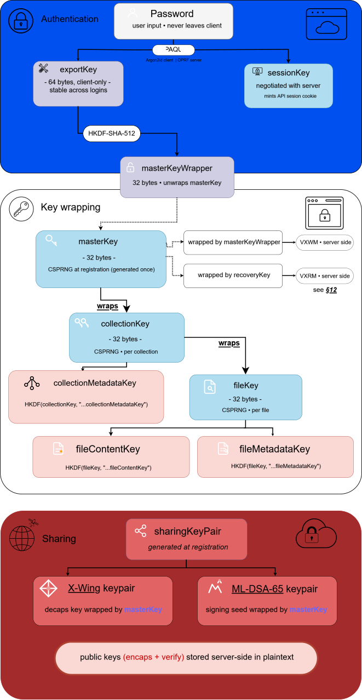

# VexaHub - Cryptography Specification

> **Document version:** 16
>
> **Protocol version:** 1
>
> **Status:** (Draft) Accepted

**See also:** [Cryptography Specification | Addendum](CRYPTO_ADDENDUM.md)

This document is the single source of truth for all cryptographic decisions in VexaHub. Any change to the parameters, algorithms, derivation paths, or binary formats defined here is a breaking change for existing accounts and **MUST** bump the protocol version (see [§13](#13-protocol-versioning-and-migration)).

## 1. Overview

VexaHub is a **zero-knowledge end-to-end encrypted** cloud storage service. The server never has access to user passwords, plaintext files, file names, or encryption keys capable of decrypting user data during normal operation.

Cryptographic goals:

- The server **cannot** decrypt user files, even with full database access.
- An attacker stealing only the database **cannot** mount offline password attacks **(OPAQUE OPRF defense)**.
- Password changes **do not** require re-encrypting user files.
- File mutation is supported **without** nonce-reuse vulnerabilities.
- Sharing is possible between users **without** the server learning shared content.
- **Post-quantum resistance** for _sharing key exchange_.
- Cross-platform **consistency** (web, desktop, future Android/iOS) through a public specification and shared test vectors ([§14](#14-test-vectors)). Today the primitives come from separate packages: OPAQUE, X-Wing, ML-DSA-65 and BLAKE3 are separate Rust/WASM packages, XChaCha20-Poly1305 comes from libsodium and HKDF from WebCrypto. The protocol itself (derivations, blob formats, AAD) is composed in TypeScript in the web client (`engine.ts`). A unified Rust crate is planned with the second client ([§18](#18-open-questions-and-future-work)).

Explicit non-goals:

- Defense **against** a fully compromised server colluding with itself to **attack a user** during an active session. A **persistent** session ([§9.2](#92-persistent-sessions-remember-me-opt-in)) opt-in widens this surface and is documented as such.
- Defense **against** a **malicious client update** pushed via the normal distribution channel. **Reproducible** builds are tracked as future work (See [§18](#18-open-questions-and-future-work)).
- Defense **against** an **attacker** with physical control of the user's unlocked device.

## 2. Primitives

| Purpose                    | Algorithm                                             | Parameters                                                                              |
| -------------------------- | ----------------------------------------------------- | --------------------------------------------------------------------------------------- |
| Password-authenticated AKE | OPAQUE ([RFC 9807][opaque_rfc])                       | Ristretto255 ciphersuite, `(3DH + ML-KEM-768)`                                          |
| Key stretching (in OPAQUE) | Argon2id                                              | m = 131072 KiB (128 MiB), t = 3, p = 4                                                  |
| Symmetric AEAD             | XChaCha20-Poly1305                                    | 24-byte nonces, 16-byte tags                                                            |
| Key derivation             | HKDF-SHA-512                                          | Domain-separated `info`, zero salt                                                      |
| Hybrid KEM (Sharing)       | X-Wing ([draft-connolly-cfrg-xwing-kem][xwing_draft]) | ML-KEM-768 + X25519, 32-byte shared secret                                              |
| Hybrid KEM (OPAQUE AKE)    | TripleDhKem (`opaque-ke`)                             | 3DH + ML-KEM-768 encapsulation in KE1/KE2                                               |
| Digital signatures         | ML-DSA-65 (FIPS 204)                                  | Share invitation authenticity, device attestation, key rotation                         |
| CSPRNG                     | OS CSPRNG                                             | `getrandom` (Rust), `crypto.getRandomValues` (web)                                      |
| Memory hygiene             | `sodium.memzero` (web), `zeroize` crate (Rust)        | Web: `sodium.memzero` with `fill(0)` fallback. `Zeroizing<T>` applies to Rust code only |

**Rationale:**

- **Ristretto255** over **P-256**: prime-order group, simpler hash-to-curve, better-maintained **constant-time** implementations in the **Rust** ecosystem.
- **Argon2id 128 MiB / t=3 / p=4**: above **OWASP 2024** and industry baselines (Bitwarden, 1Password sit around 64 MiB), while staying below the **~256 MiB** threshold where **Safari iOS WASM** allocations begin to fail. **OPAQUE OPRF** already neutralizes **pre-computation attacks** against the database; the **Argon2id** cost is a **defense-in-depth** layer for the case where `serverSetup` is also **compromised**. Frozen identical for all users on protocol version 1. No per-user fallback, no heterogeneous parameters.
- **XChaCha20-Poly1305** over **AES-GCM**: 24-byte nonces make random nonce generation safe without counters; constant-time on all platforms; no hardware AES dependency.
- **HKDF-SHA-512**: matches the **OPAQUE** ciphersuite hash, universally available, larger output reservoir than **SHA-256** with no performance penalty in this context.
- **X-Wing** over manual **ML-KEM-768 + X25519** combiner: formally proven IND-CCA secure construction (IACR 2024) with an optimized combiner that avoids hashing the ML-KEM ciphertext. Secure if either **X25519** or **ML-KEM-768** is secure. Eliminates a custom KDF combiner from our attack surface. Still an **IETF Internet-Draft** ([draft-connolly-cfrg-xwing-kem][xwing_draft]) but the underlying algorithms are **NIST-finalized** and the wire format is stable.
- **TripleDhKem** over standard **TripleDH**: the `opaque-ke` crate's `TripleDhKem` variant augments the **OPAQUE 3DH** key exchange by having the client send an **ML-KEM-768** encapsulation key in **KE1** and the server encapsulate to it in **KE2**. The **ML-KEM** shared secret is mixed into the key schedule alongside the **three DH** products. This closes the **harvest-now-decrypt-later** threat on login transcripts. An **attacker** recording **OPAQUE** flows today **cannot** derive session keys with a future **CRQC**. The **Ristretto255** OPRF remains classical; a **CRQC** + database + `serverSetup` theft would allow offline password attacks, but Argon2id 128 MiB remains as the final barrier. This is the **strongest** hybrid OPAQUE available today; **full** PQ OPAQUE ([draft-vos-cfrg-pqpake][pqpake_draft]) is tracked as **future** work.
- **ML-DSA-65** (NIST Level 3): matches the security level of **ML-KEM-768** inside **X-Wing**. Without **PQ** signatures, a **CRQC** could forge share invitations, device registrations, and key rotations. Compromising the trust graph **without** ever breaking encryption. Signature sizes (~3.3 KB) and public keys (~1.95 KB) are larger than **Ed25519** but acceptable for metadata-layer operations.

## 3. Key Hierarchy

<!-- markdownlint-disable MD033 -->

<!-- markdownlint-enable MD033 -->

The intermediate `masterKeyWrapper` exists for uniformity with all other derivations and to avoid using `exportKey` directly as an `AEAD` key. It carries no extra security versus a direct slice of `exportKey`, but keeps the derivation graph consistent.

### 3.1 Key summary

| Key                        | Size | Origin                                  | Lifetime                   | Server sees                        |
| -------------------------- | ---- | --------------------------------------- | -------------------------- | ---------------------------------- |
| password                   | var  | User input                              | Typing                     | Never                              |
| exportKey                  | 64   | OPAQUE output                           | Session                    | Never                              |
| masterKeyWrapper           | 32   | HKDF(exportKey)                         | Session                    | Never                              |
| sessionKey                 | 64   | OPAQUE output                           | Session                    | Yes (used for cookie)              |
| masterKey                  | 32   | CSPRNG at registration                  | Permanent                  | Wrapped only                       |
| localKey                   | 32   | CSPRNG at `"Remember me"` activation    | Until revocation or logout | Never                              |
| collectionKey              | 32   | CSPRNG at collection creation           | Until rotation             | Wrapped only                       |
| fileKey                    | 32   | CSPRNG at file creation                 | Until rotation             | Wrapped only                       |
| recoveryKey                | 32   | HKDF(BIP39 seed)                        | Recovery                   | Never                              |
| X-Wing decaps key          | 32   | CSPRNG at registration                  | Permanent                  | Wrapped only                       |
| X-Wing encaps key (pub)    | 1216 | Derived from decaps key                 | Permanent                  | Plaintext                          |
| ML-DSA-65 signing seed     | 32   | CSPRNG at registration                  | Permanent                  | Wrapped only                       |
| ML-DSA-65 verify key (pub) | 1952 | Derived from signing seed               | Permanent                  | Plaintext                          |
| linkKey                    | 32   | CSPRNG (keyless) or Argon2id (password) | Link access                | Never (fragment or client-derived) |
| publicLinkWrapKey          | 32   | HKDF(linkKey)                           | Link access                | Never                              |
| localCacheKey              | 32   | HKDF(masterKey)                         | Session                    | Never                              |
| searchIndexKey             | 32   | HKDF(masterKey)                         | Session                    | Never                              |

## 4. HKDF Domain Separation

Format: `vexahub:v{PROTOCOL_VERSION}:{purpose}[:{context}]`.

**Salt policy:** All HKDF derivations use a **32-byte zero salt** except `shareWrapKey`, which uses a **random 32-byte salt**.

For derivations where the **IKM** is uniformly random (e.g. `masterKey`, `exportKey`, `collectionKey`, `fileKey`), zero salt has no security impact when `info` is unique per purpose, and simplifies cross-platform interoperability.

For `shareWrapKey`, the **IKM** is the **X-Wing** shared secret (output of **a KEM combiner**), not raw **CSPRNG** output. If the combiner ever produced biased output due to an implementation flaw or a weakness in one of the constituent **KEMs**, a random salt provides a **meaningful extra defense layer**. The salt is transmitted alongside the **X-Wing** ciphertext in the share record and **does not need to be secret**.

| Derivation                                       | `info` string                                                                                                                                       | length                |
| ------------------------------------------------ | --------------------------------------------------------------------------------------------------------------------------------------------------- | --------------------- |
| masterKeyWrapper from exportKey                  | `vexahub:v1:masterKeyWrapper`                                                                                                                       | 32                    |
| collectionKeyWrap from masterKey                 | `vexahub:v1:collectionKeyWrap:{collection_uuid}`                                                                                                    | 32                    |
| fileKeyWrap from collectionKey                   | `vexahub:v1:fileKeyWrap:{file_uuid}`                                                                                                                | 32                    |
| contentIdKey from masterKey (per collection)     | `vexahub:v1:contentIdKey:{collection_uuid}`                                                                                                         | 32                    |
| fileContentKey from fileKey                      | `vexahub:v1:fileContentKey`                                                                                                                         | 32                    |
| fileMetadataKey from fileKey                     | `vexahub:v1:fileMetadataKey`                                                                                                                        | 32                    |
| collectionMetadataKey from collectionKey         | `vexahub:v1:collectionMetadataKey`                                                                                                                  | 32                    |
| segmentNonce from fileContentKey                 | `vexahub:v1:segmentNonce:` ‖ uint32_be(generation) ‖ uint64_be(segment_index)                                                                       | 24                    |
| recoveryKey from BIP39 seed                      | `vexahub:v1:recoveryKey:{user_uuid}`                                                                                                                | 32                    |
| shareWrapKey from X-Wing shared secret           | `vexahub:v1:shareWrap:{share_uuid}`                                                                                                                 | 32 (RNG 32-byte salt) |
| publicLinkWrapKey from linkKey                   | `vexahub:v1:publicLink:{link_id}`                                                                                                                   | 32                    |
| session token from sessionKey (server side)      | `vexahub:v1:sessionToken`                                                                                                                           | 32                    |
| localCacheKey from masterKey                     | `vexahub:v1:localCacheKey`                                                                                                                          | 32                    |
| searchIndexKey from masterKey                    | `vexahub:v1:searchIndexKey`                                                                                                                         | 32                    |
| childCollectionKeyWrap from parent collectionKey | `vexahub:v1:childCollectionKeyWrap:{child_uuid}` (see [Addendum §21](CRYPTO_ADDENDUM.md#21-sub-collection-creation-by-an-editor-subject-to-change)) | 32                    |

> HKDF salts are not secrets; uniqueness is enforced exclusively by the `info` field.
>
> Zero salt simplifies cross-platform interoperability and has no security impact when `info` is unique per purpose.
>
> All UUIDs embedded in HKDF `info` strings **MUST** be encoded as **raw 16-byte big-endian binary**, not as hyphenated text.
>
> This eliminates formatting ambiguity across platforms and implementations. Example: UUID `550e8400-e29b-41d4-a716-446655440000` is encoded as 16 bytes `0x55 0x0e 0x84 ...`, not as 36-byte ASCII.

The `collectionKey` in `collectionMetadataKey` is unique per collection, so no `collection_uuid` is needed in the `info` string.

```rs
collectionMetadataKey = HKDF-SHA-512(
    ikm  = collectionKey,
    salt = 32 zero bytes,
    info = "vexahub:v1:collectionMetadataKey",
    L    = 32
)
```

The `collectionKeyWrapKey` and `fileKeyWrapKey` are derived solely to wrap/unwrap their respective stored keys:

```rs
collectionKeyWrapKey = HKDF-SHA-512(
    ikm  = masterKey,
    salt = 32 zero bytes,
    info = "vexahub:v1:collectionKeyWrap:" || collection_uuid,
    L    = 32
)

fileKeyWrapKey = HKDF-SHA-512(
    ikm  = collectionKey,
    salt = 32 zero bytes,
    info = "vexahub:v1:fileKeyWrap:" || file_uuid,
    L    = 32
)
```

> `linkKey` is either raw CSPRNG output (keyless link) or Argon2id output (password-protected link). In both cases, HKDF domain separation via `link_id` ensures distinct wrapping keys per link. Zero salt applies (same policy as other CSPRNG-sourced IKM derivations).

## 5. Binary Blob Formats

All encrypted blobs use versioned, self-describing binary formats prefixed with 4 magic bytes, a format version, and an algorithm ID. Parsers **MUST** verify magic, version, and algorithm before decryption. Unknown values **MUST** cause an error, never a silent fallback.

Algorithm IDs:

- `0x01` -> XChaCha20-Poly1305
- `0x02` -> X-Wing (ML-KEM-768 + X25519)

Signature algorithm IDs:

- `0x10` -> ML-DSA-65

### 5.1 `VXWM` - Wrapped Master Key (password-derived)

```rs
Offset  Size  Field
------  ----  ---------------------------------------
0       4     Magic "VXWM" (0x56 0x58 0x57 0x4D)
4       1     Format version (0x01)
5       1     Algorithm ID (0x01)
6       24    Nonce (random)
30      48    Ciphertext (32 B masterKey + 16 B tag)
------
Total: 78 bytes
```

```rs
AAD: user_id (16 bytes, raw UUID)
```

### 5.2 `VXRM` - Wrapped Master Key (recovery-phrase-derived)

Identical structure to `VXWM`, distinct magic to prevent cross-use.

```rs
Offset  Size  Field
0       4     Magic "VXRM" (0x56 0x58 0x52 0x4D)
4       1     Format version (0x01)
5       1     Algorithm ID (0x01)
6       24    Nonce (random)
30      48    Ciphertext (32 B masterKey + 16 B tag)
Total: 78 bytes
```

```rs
AAD: user_id (16 bytes, raw UUID)
```

### 5.3 `VXFC` - File Content Segment

```rs
Offset  Size   Field
0       4      Magic "VXFC"
4       1      Format version (0x01)
5       1      Algorithm ID (0x01)
6       16     File ID (UUID, raw bytes)
22      4      File generation (uint32 BE)
26      8      Segment index (uint64 BE)
34      24     Nonce (derived deterministically)
58      N+16   Ciphertext + tag
```

```rs
AAD = version ‖ alg_id ‖ file_id ‖ generation ‖ segment_index
// 1 + 1 + 16 + 4 + 8 = 30 bytes
```

The **AAD** bound to each segment is the **30-byte** tuple `version ‖ alg_id ‖ file_id ‖ generation ‖ segment_index`. This binds every ciphertext to its position and generation, preventing reorder and rollback attacks within a file.

### 5.4 `VXFM` - File Metadata

```rs
Offset  Size   Field
0       4      Magic "VXFM"
4       1      Format version (0x01)
5       1      Algorithm ID (0x01)
6       16     File ID (UUID, raw bytes)
22      4      File generation (uint32 BE)
26      24     Nonce (random)
50      N+16   Ciphertext (CBOR-encoded metadata) + tag
```

```rs
AAD = version ‖ alg_id ‖ file_id ‖ generation
// 1 + 1 + 16 + 4 = 22 bytes
```

CBOR schema for plaintext metadata (canonical CBOR, [RFC 8949 §4.2.1][cbor_rfc]):

```rs
{
  "n":  tstr,           // filename
  "m":  tstr,           // mime type
  "s":  uint,           // plaintext size in bytes
  "sc": uint,           // total segment count
  "ct": uint,           // creation time, unix seconds
  "mt": uint,           // modification time, unix seconds
  "h":  bstr .size 32,  // BLAKE3 hash of plaintext (integrity)
}
```

> **Filename constraints:** The `"n"` field **MUST** be validated by the client
> before encryption:
>
> - Valid UTF-8, NFC-normalized.
> - Maximum **1024 bytes** (encoded).
> - **MUST NOT** contain null bytes or control characters (U+0000-U+001F, U+007F).
> - **MUST NOT** be empty.
>
> The server never sees plaintext filenames. Validation is a client-only
> responsibility.
>
> **Nonce requirement:** A fresh random nonce **MUST** be generated for every `VXFM` encryption, including re-encryption on generation increment. `fileMetadataKey` is derived from `fileKey` without `generation` in the derivation path, meaning the metadata key is **stable across generations**. Nonce reuse under the same `fileMetadataKey` is catastrophic. It breaks **XChaCha20-Poly1305** confidentiality.
>
> Implementors **MUST NOT** cache or reuse a previous `VXFM` nonce.
>
> **Segment count verification:** Before starting a download, the client **MUST** read `sc` from `VXFM` and verify that the number of segments received matches. A mismatch indicates truncation or tampering and the client **MUST** abort the download without surfacing partial content. This catches truncation before committing bandwidth, unlike the **BLAKE3** hash check in [§6.5.9](#659-final-integrity-verification) which only runs after the full download.

Unknown CBOR keys **MUST** be preserved on re-encryption to allow forward-compatible field additions.

> Parsers **MUST** reject non-canonical **CBOR** input. Any blob or payload that does not conform to [RFC 8949 §4.2.1][cbor_rfc] deterministic encoding **MUST** cause a hard error, **never** silent acceptance or re-canonicalization.

### 5.5 `VXCM` - Collection Metadata

```rs
Offset  Size  Field
------  ----  ---------------------------------------
0       4     Magic "VXCM"
4       1     Format version (0x01)
5       1     Algorithm ID (0x01)
6       16    Collection ID (UUID, raw bytes)
22      24    Nonce (random, fresh on every write)
46      N+16  Ciphertext (CBOR-encoded metadata) + tag
```

```rs
AAD = version ‖ alg_id ‖ collection_id
```

CBOR schema:

```json
{
  "n": tstr,   // collection name
  "ct": uint,  // creation time
  "mt": uint,  // modification time
}
```

> **Nonce requirement:** `collectionMetadataKey` is stable for the lifetime of a `collectionKey`. A fresh random nonce **MUST** be generated on every `VXCM` write (rename, timestamp update). Nonce reuse under the same `collectionMetadataKey` is catastrophic.
>
> On `collectionKey` rotation (share revocation), `collectionMetadataKey` changes and the nonce space resets, but this **does not** relax the fresh-nonce requirement.

### 5.6 `VXPS` - Persistent Session Blob

Stored **server-side** in `persistent_sessions`. The `localKey` (32 bytes **CSPRNG**,
generated at `"Remember me"` activation) is stored exclusively in `IndexedDB`
on the user's device and **never transmitted to the server**.

```rs
Offset  Size  Field
0       4     Magic "VXPS"
4       1     Format version (0x01)
5       1     Algorithm ID (0x01)
6       24    Nonce (random)
30      48    Ciphertext (32 B masterKey + 16 B tag)
Total: 78 bytes
```

```rs
AAD = user_id ‖ session_id (32 bytes, raw UUID)
```

> `session_id` is a **UUID v4** generated **client-side** at activation, before encryption. The client encrypts `VXPS` with `user_id ‖ session_id` as **AAD**, then sends `{ sessionId, vxps, device }` to `POST /api/v1/auth/persistent-session/create`. The server uses `sessionId` as the `persistent_sessions` row id and responds **409** if that id already exists.
>
> The client **MUST** store `session_id` alongside `localKey` in `IndexedDB` and include it in the **AAD** on every
> `VXPS` encryption and decryption. This cryptographically binds the blob to a specific session.
>
> A `VXPS` blob from a revoked session **cannot** be reused in a new one.

### 5.7 `VXSK` - Wrapped Sharing Keys

```rs
Offset  Size   Field
0       4      Magic "VXSK"
4       1      Format version (0x01)
5       1      Algorithm ID (0x01)
6       24     Nonce (random)
30      91     Ciphertext (75 B CBOR object + 16 B tag)
------
Total: 121 bytes
```

```rs
AAD: user_id (16 bytes, raw UUID)
```

CBOR schema, keys in canonical order (`ds` then `xw`):

```json
{
  "ds": bstr .size 32,    // ML-DSA-65 seed (not expanded signing key)
  "xw": bstr .size 32,    // X-Wing decapsulation key (seed)
}
```

CBOR plaintext: map header (1) + `"ds"` (3) + bstr(32) (34) + `"xw"` (3) + bstr(32) (34) = 75 bytes.

> Parsers **MUST** reject non-canonical **CBOR** input. Any blob or payload that does not conform to [RFC 8949 §4.2.1][cbor_rfc] deterministic encoding **MUST** cause a hard error, **never** silent acceptance or re-canonicalization.

### 5.8 `VXCK` - Wrapped Collection Key

```rs
Offset  Size  Field
------  ----  ---------------------------------------
0       4     Magic "VXCK" (0x56 0x58 0x43 0x4B)
4       1     Format version (0x01)
5       1     Algorithm ID (0x01)
6       24    Nonce (random)
30      48    Ciphertext (32 B collectionKey + 16 B tag)
------
Total: 78 bytes
```

```rs
AAD: user_id ‖ collection_id (32 bytes, both raw UUID)
```

### 5.9 `VXFK` - Wrapped File Key

```rs
Offset  Size  Field
------  ----  ---------------------------------------
0       4     Magic "VXFK" (0x56 0x58 0x46 0x4B)
4       1     Format version (0x01)
5       1     Algorithm ID (0x01)
6       24    Nonce (random)
30      48    Ciphertext (32 B fileKey + 16 B tag)
------
Total: 78 bytes
```

```rs
AAD: collection_id ‖ file_id (32 bytes, both raw UUID)
```

### 5.10 `VXSH` - Wrapped sharing key

```rs
Offset  Size   Field
------  ----  ---------------------------------------
0       4      Magic "VXSH"
4       1      Format version (0x01)
5       1      KEM algorithm ID (0x02 = X-Wing)
6       24     Nonce (random)
30      N+16   Ciphertext (CBOR { "k": bstr, "p": uint, "id": bstr, "kind": "collection"|"file" }) + tag
------
Total: 116 bytes (file share) / 122 bytes (collection share)
```

```rs
AAD: sender_id ‖ recipient_id (32 bytes, both raw UUID)
```

```json
// Inner CBOR object (canonical, RFC 8949 §4.2.1):

{
  "k":    bstr .size 32,    // wrapped key (collectionKey OR fileKey)
  "p":    uint,             // permission bitmask (see §11.6)
  "id":   bstr .size 16,    // collection_id or file_id, raw 16-byte UUID
  "kind": tstr ("collection" | "file"),
}

// RFC 8949 §4.2.1 deterministic encoding orders map keys by the bytewise
// lexicographic order of their canonical CBOR encoding, which for
// text-string keys reduces to length-then-lexicographic. The keys here
// encode as:

    "k"    -> 0x61 0x6b              (2 bytes)
    "p"    -> 0x61 0x70              (2 bytes)
    "id"   -> 0x62 0x69 0x64         (3 bytes)
    "kind" -> 0x64 0x6b 0x69 0x6e 0x64 (5 bytes)

"k" and "p" are both 2-byte encodings; tie-break is lexicographic on the
second byte: 0x6b ('k') < 0x70 ('p').
Canonical order is therefore: "k" -> "p" -> "id" -> "kind".

Layout:

    Map header (4 entries, 0xa4)                          : 1 byte
    "k" key (0x61 0x6b)                                   : 2 bytes
    "k" value: bstr(32) header (0x58 0x20) + 32 data      : 2 + 32 = 34 bytes
    "p" key (0x61 0x70)                                   : 2 bytes
    "p" value: uint(1) (0x01)                             : 1 byte
    "id" key (0x62 0x69 0x64)                             : 3 bytes
    "id" value: bstr(16) header (0x50) + 16 data          : 1 + 16 = 17 bytes
    "kind" key (0x64 0x6b 0x69 0x6e 0x64)                 : 5 bytes
    "kind" value: tstr "collection" (0x6a + 10 bytes)     : 1 + 10 = 11 bytes
    "kind" value: tstr "file"        (0x64 + 4 bytes)     : 1 +  4 =  5 bytes

CBOR plaintext (collection share):
    1 + 2 + 34 + 2 + 1 + 3 + 17 + 5 + 11 = 76 bytes
CBOR plaintext (file share):
    1 + 2 + 34 + 2 + 1 + 3 + 17 + 5 +  5 = 70 bytes

Encrypted blob total:
    Collection share: 6 (header) + 24 (nonce) + 76 (plaintext) + 16 (tag) = 122 bytes
    File share:       6 (header) + 24 (nonce) + 70 (plaintext) + 16 (tag) = 116 bytes
```

The order in which the encoder _receives_ the fields does not matter; what matters is that the **canonical-CBOR** encoder emits them in length-then-lexicographic order. Both `serde_cbor` (with deterministic option) and `cbor4ii` (with the `canonical` feature) produce this ordering. Test vectors in [§14](#14-test-vectors) **MUST** verify byte-identical output across implementations.

This is **defense-in-depth** alongside the **ML-DSA-65** signature. If a signature verification is **accidentally** skipped due to a bug, the **AAD** binding still **prevents** the server from redirecting shares between users.

> Parsers **MUST** reject non-canonical **CBOR** input. Any blob or payload that does not conform to [RFC 8949 §4.2.1][cbor_rfc] deterministic encoding **MUST** cause a hard error, **never** silent acceptance or re-canonicalization.

### 5.11 `VXPL` - Public Link Blob

Wraps a `collectionKey` or `fileKey` for anonymous access via a public link. The blob is type-agnostic (both are 32 bytes); the server's `public_links` record indicates whether the target is a file or collection.

```rs
Offset  Size  Field
------  ----  ---------------------------------------
0       4     Magic "VXPL" (0x56 0x58 0x50 0x4C)
4       1     Format version (0x01)
5       1     Algorithm ID (0x01)
6       24    Nonce (random)
30      48    Ciphertext (32 B key + 16 B tag)
------
Total: 78 bytes
```

```rs
AAD: link_id (16 bytes, raw UUID)
```

**Wrapping key derivation:**

```rs
publicLinkWrapKey = HKDF-SHA-512(
    ikm  = linkKey,
    salt = 32 zero bytes,
    info = "vexahub:v1:publicLink:" || link_id,
    L    = 32
)
```

`linkKey` is derived via one of two paths depending on whether the link is password-protected:

**Keyless link (no password):**

```rs
linkKey = CSPRNG(32)
URL: /share/{token}#key={base64url(linkKey)}
```

The `linkKey` is placed in the URL fragment, which is never sent to the server. The `token` is an opaque 32-byte random lookup value generated server-side, distinct from `link_id`.

**Password-protected link:**

```rs
linkKey = Argon2id(
    password  = user-supplied password (UTF-8, NFC-normalized),
    salt      = passwordSalt (32 bytes, CSPRNG, stored server-side),
    m         = 131072 KiB (128 MiB),
    t         = 3,
    p         = 4,
    L         = 32
)
URL: /share/{token}
```

No fragment in the URL. The visitor requests the link via `token`, the server returns `passwordSalt` (and `link_id`), and the client derives `linkKey` from the password entered by the visitor. The server never sees the password.

`/share/{token}` is the webapp page. It reads the link through the API at `GET /api/v1/links/{token}`.

Password-protected links are limited to **5 attempts per 15 minutes**. Beyond that the server refuses access until the window expires.

The `VXFM` served for a file behind a public link is the one stored with the key generation pinned on the link (`key_generation`), so the visitor can decrypt it with the key wrapped in `VXPL` even after a later key rotation.

> **Argon2id parameters** are identical to the OPAQUE registration parameters in [§2](#2-primitives). This is intentional: the same WASM/native implementation is reused, and the cost is appropriate for a one-time unlock operation.

**Server-side schema:**

```sql
CREATE TABLE public_links (
    id              UUID PRIMARY KEY,        -- link_id, UUID v7 generated client-side
    user_id         UUID NOT NULL REFERENCES users(id) ON DELETE RESTRICT,
    file_id         UUID REFERENCES files(id) ON DELETE CASCADE,
    collection_id   UUID REFERENCES collections(id) ON DELETE CASCADE,
    token           TEXT NOT NULL UNIQUE,     -- 32 random bytes, base64url
    vxpl            BYTEA NOT NULL,           -- 78 bytes
    password_salt   BYTEA,                    -- 32 bytes or NULL (keyless)
    max_downloads   INTEGER,                  -- NULL = unlimited
    download_count  INTEGER NOT NULL DEFAULT 0,
    key_generation  INTEGER NOT NULL DEFAULT 0, -- key generation pinned at link creation
    created_at      TIMESTAMPTZ NOT NULL DEFAULT now(),
    expires_at      TIMESTAMPTZ,              -- NULL = no expiry
    revoked_at      TIMESTAMPTZ,
    moderated_at    TIMESTAMPTZ,              -- disabled by moderation (revoked_at is set too)
    moderation_case_id UUID,
    CONSTRAINT public_links_target_check CHECK (
        (file_id IS NOT NULL AND collection_id IS NULL)
        OR (file_id IS NULL AND collection_id IS NOT NULL)
    )
);

CREATE INDEX ON public_links (token) WHERE revoked_at IS NULL;
CREATE INDEX ON public_links (user_id) WHERE revoked_at IS NULL;
```

**Revocation:** setting `revoked_at` revokes API access immediately. The wrapped key inside `VXPL` is the **real** `fileKey` or `collectionKey`. An attacker who captured the `VXPL` blob and `linkKey` before revocation retains the ability to decrypt previously downloaded content. This is the same inherent E2EE limitation as share revocation ([§11.1](#111-share-revocation)). The planned re-encryption mechanism in [§11.1.1](#1111-optional-content-re-encryption-after-revocation) would apply identically to public link revocation.

**Moderation:** the server can disable a reported link. It sets `moderated_at` and `revoked_at` and records the `moderation_case_id`, so every access check refuses the link. Clearing the decision restores it. The server never sees the content behind the link, unless the report itself hands it the link's key (for example a full keyless URL with its `#key=` fragment). Moderation acts on access, not on encryption.

> **`link_id` vs `token`:** `link_id` (UUID) is generated client-side and used in the HKDF `info` string and AAD. `token` (32 random bytes) is generated server-side as an opaque lookup value for the URL path. The separation prevents the server from manipulating the cryptographic binding: even if the server swaps `token` values between links, the AAD mismatch on `link_id` causes decryption to fail.

### 5.12 `VXMC` - Local Metadata Cache Entry

Encrypts an entry of the web client's local metadata cache in `IndexedDB`. Never sent to the server.

```rs
Offset  Size  Field
------  ----  ---------------------------------------
0       4     Magic "VXMC" (0x56 0x58 0x4D 0x43)
4       1     Format version (0x01)
5       1     Algorithm ID (0x01)
6       24    Nonce (random)
30      N+16  Ciphertext + tag
------
Minimum: 46 bytes
```

```rs
AAD = header (6 bytes) ‖ user_id ‖ entry_id (38 bytes, both raw UUID)
```

Key: `localCacheKey` ([§3.1](#31-key-summary), [§4](#4-hkdf-domain-separation)), derived from `masterKey` and held in the Crypto Worker for the session.

### 5.13 `VXSI` - Encrypted Search Index

The encrypted search index of the user's own files and collections, built by the client and stored server-side in the `search_index` table (one row per user) through `GET`, `PUT` and `DELETE /api/v1/storage/search/index`. Search runs entirely in the client: the server never sees a query or a name.

```rs
Offset  Size  Field
------  ----  ---------------------------------------
0       4     Magic "VXSI" (0x56 0x58 0x53 0x49)
4       1     Format version (0x01)
5       1     Algorithm ID (0x01)
6       24    Nonce (random, fresh on every write)
30      N+16  Ciphertext (canonical CBOR) + tag
------
Minimum: 46 bytes. Maximum accepted by the server: 50 MiB.
```

```rs
AAD = header (6 bytes) ‖ user_id (22 bytes)
```

```rs
searchIndexKey = HKDF-SHA-512(
    ikm  = masterKey,
    salt = 32 zero bytes,
    info = "vexahub:v1:searchIndexKey",
    L    = 32
)
```

**Plaintext:** the raw documents, never the internal export of a search library. The client rebuilds its in-memory index from them after decryption, so the format does not depend on any library.

```json
{
  "d": [                       // entries
    {
      "k":  uint,              // 0 = file, 1 = collection
      "m":  tstr,              // mime type (files only, absent for collections)
      "n":  tstr,              // name
      "p":  bstr .size 16 / null, // collection_id (file) or parent_id (collection), raw UUID
      "id": bstr .size 16,     // file_id or collection_id, raw UUID
      "mt": uint,              // modification time, unix seconds
    }
  ],
  "v": uint,                   // plaintext schema version, 1
}
```

Canonical order: `d` < `v` at the top level, and `k` < `m` < `n` < `p` < `id` < `mt` in an entry. Parsers **MUST** reject non-canonical CBOR. An unknown `v` **MUST** cause a full rebuild, never a partial read. The plaintext is not compressed in protocol version 1.

**Scope:** only the user's own files and collections that are not in the trash. Items shared with the user are not indexed.

**Writes:**

- Every `PUT` **MUST** use a fresh random nonce: `searchIndexKey` is stable for the lifetime of `masterKey`.
- The client rebuilds and uploads the index when `dataUpdatedAt` (returned by `GET`) is later than `indexUpdatedAt`, when decryption fails, or when `v` is unknown.
- A password change or a recovery leaves `VXSI` valid (`masterKey` does not change). A destructive reset and an account deletion delete it.

**Trust model:** `VXSI` is a cache, never a source of truth.

- The server cannot read or forge entries (AEAD, key derived from `masterKey`, AAD bound to `user_id`).
- The server can delete it or serve an older version. The client **MUST** therefore check every hit against live data (the item still exists and its `VXFM` / `VXCM` decrypts) before showing it, and drop entries that do not.
- The server learns the blob size, which grows with the number and length of names, and when it changes. The number of files and collections is already known to it.

`IndexedDB` may keep a local copy of the same blob ([§9.6.1](#961-web-clients)).

### 5.14 `VXCC` - Child-wrapped Collection Key

Wraps the `collectionKey` of a sub-collection created by an editor ([Addendum §21](CRYPTO_ADDENDUM.md#21-sub-collection-creation-by-an-editor-subject-to-change)) under the parent `collectionKey`. The editor cannot produce a `VXCK`, which requires the owner's `masterKey`.

```rs
Offset  Size  Field
------  ----  ---------------------------------------
0       4     Magic "VXCC" (0x56 0x58 0x43 0x43)
4       1     Format version (0x01)
5       1     Algorithm ID (0x01)
6       24    Nonce (random)
30      48    Ciphertext (32 B collectionKey + 16 B tag)
------
Total: 78 bytes
```

```rs
AAD: parent_id ‖ collection_id (32 bytes, both raw UUID)
Key: childCollectionKeyWrapKey (§4)
```

The distinct magic tells every reader to unwrap with the parent `collectionKey`, never with a `masterKey`, and prevents cross-use with `VXCK`.

**Transitional for the owner:** a `VXCC` in the owner's `collection_keys` **MUST** be replaced by a regular `VXCK` the next time the owner's client unwraps it: unwrap with the parent key, re-wrap with `collectionKeyWrapKey` from `masterKey`, upload ([Addendum §21.3](CRYPTO_ADDENDUM.md#213-access)). The editor's copy in `share_collection_keys` stays a `VXCC`.

## 6. File Encryption

### 6.1 Segmentation

Files are split into fixed-size plaintext segments. MVP segment size: **1 MiB** (1,048,576 bytes). The last segment may be shorter. Fixed segment size enables byte-precise Range requests on ciphertext, resumable uploads via `tus`, and parallel processing.

Zero-byte files are **supported**. A file with N=0 plaintext bytes produces zero segments, `ciphertext_length = 0`, and `VXFM.sc = 0`. The segment count verification check **MUST** pass for `sc = 0` with **zero** segments received. The **BLAKE3** integrity hash in `VXFM` **MUST** be computed over empty input.

### 6.2 Per-segment nonce derivation

Segment nonces are derived deterministically from the file generation and segment index:

```rs
nonce = HKDF-SHA-512(
    ikm  = fileContentKey,
    salt = 32 zero bytes,
    info = "vexahub:v1:segmentNonce:" ‖ uint32_be(generation) ‖ uint64_be(segment_index),
    L    = 24
)
```

### 6.3 File generation counter (mutability)

Each file carries a `generation` counter starting at `0` at creation. **Any modification to file content increments `generation` by 1** before re-encryption. The new generation is stored server-side atomically with the new ciphertext blobs.

This prevents the catastrophic XChaCha20-Poly1305 nonce-reuse vulnerability that would otherwise occur when re-encrypting a modified segment with the same `(fileContentKey, segment_index)` pair. By including `generation` in the HKDF info, every modification produces a fresh nonce space.

**Mandatory invariants:**

- The server **MUST** reject any upload whose `generation` value is less than or equal to the currently stored generation for that file.
- The server **MUST** store `generation` in the file row and return it with file metadata so clients can verify monotonicity.
- When a client uploads a new generation, all segments belonging to that generation **MUST** be uploaded atomically (transactional or staged commit). Partial generation uploads **MUST** be garbage-collected after a short TTL.
- Clients **MUST** refuse to decrypt a segment whose `generation` field in the `VXFC` header does not match the expected generation from file metadata.

The `generation` field is 32 bits, providing 4 billion modifications per file. This is effectively unbounded for any realistic workload.

### 6.4 Content vs metadata key separation

`fileContentKey` and `fileMetadataKey` are derived from the same `fileKey` via distinct HKDF info strings. This prevents any cross-use of nonces between content segments and metadata blobs.

> **Warning to implementors:** `fileMetadataKey` does **NOT** include `generation` in its derivation path. It is stable across all generations of a file. This is by design.
>
> Metadata key separation from content keys is the goal. However, this means every `VXFM` encryption **MUST** use a fresh random nonce. See [§5.4](#54-vxfm---file-metadata) for the explicit nonce requirement.

### 6.5 Content Identification and Resumable Upload Integration

VexaHub uses the [tus 1.0.0][tus_protocol] resumable upload protocol for file uploads between clients and the server, with one exception: files whose plaintext is smaller than **5 MiB** are sent in a single request to `POST /api/v1/uploads/direct` (multipart body with a `metadata` field carrying `vxfk`, `vxfm` and the upload parameters, and a `ciphertext` file part). The server rejects a direct upload whose ciphertext exceeds **5 MiB + 370 bytes** (5 segments of 74 bytes of overhead). The ciphertext format is identical in both paths. This section specifies how the cryptographic design integrates with **tus**, and how the **client** identifies file content in a way that preserves the **zero-knowledge** guarantee.

### 6.5.1 Goals

- Allow a **client** to detect that a previously interrupted upload exists on the server and resume it from the correct offset, **without** re-uploading already-transferred segments.
- Allow a **client** to detect that the file the user is about to upload **already** exists in their account, and offer to skip, replace, or duplicate it.
- Preserve the **zero-knowledge** property: the server **MUST NOT** be able to determine the plaintext content of a file from its content identifier, and **MUST NOT** be able to detect that two distinct users hold the same plaintext file.

### 6.5.2 Per-user content identifier

For **each** file, the **client** computes a content identifier as a keyed hash bound to the user's `masterKey`:

```rs
contentIdKey = HKDF-SHA-512(
    ikm  = masterKey,
    salt = 32 zero bytes,
    info = "vexahub:v1:contentIdKey:" || collection_uuid,
    L    = 32
)

content_id = BLAKE3_keyed(contentIdKey, plaintext)   // 32 bytes
```

Properties:

- **Deterministic per user per collection**: the same plaintext produces the same `content_id` for the same user in the same collection, enabling reliable resume detection.
- **Distinct across users**: two different users with the same plaintext produce different `content_id` values, because their `masterKey` differs.
- **Distinct across collections**: the same plaintext in different collections produces different `content_id` values, because the `collection_uuid` in the HKDF info differs. The server cannot correlate content across a user's collections.
- **Not invertible**: the server cannot recover plaintext from `content_id`.
- **Not testable against known content**: the server cannot pre-compute hashes of known files, because the keyed hash requires `contentIdKey` which the server never sees.
- **No recomputation on key rotation**: `contentIdKey` is derived from `masterKey` (which never rotates), not from `collectionKey`. Resume and duplicate detection remain fully functional immediately after a share revocation and `collectionKey` rotation.

> **Accepted trade-off:** After a `collectionKey` rotation on share revocation, the `content_id` values within the collection remain unchanged. The server can observe that the same set of files exists before and after rotation.
>
> This is a **minor** metadata leak. The server already knows the collection exists, how many files it contains, and their ciphertext sizes. Knowing that the file set didn't change after a key rotation leaks negligible additional information.
>
> File content, names, and all other metadata remain fully protected by the rotated keys.
>
> Deriving `contentIdKey` from `collectionKey` would eliminate this leak but would require downloading and re-hashing every file's full plaintext on every revocation. Which is impractical for large collections and a severe UX penalty that outweighs the marginal privacy gain.

The **client** transmits `content_id` to the **server** in the clear as part of upload lookup and creation requests. The **server** stores it indexed **per user** but **cannot** use it for any **cross-user analysis**.

### 6.5.3 No cross-user deduplication

By design, **VexaHub** does **NOT** perform **cross-user deduplication** of stored content. If two **users** upload the same file, **two distinct ciphertext blobs** are **stored**.

This is a deliberate **trade-off**: **cross-user deduplication** is **incompatible** with **strong zero-knowledge** guarantees because it **leaks** the existence of duplicate content across **accounts** and creates an **oracle** for content presence.

### 6.5.4 Streaming computation

`BLAKE3_keyed` supports **incremental** hashing. The client **MUST** compute `content_id` in a **streaming** fashion as it reads the **local** file, never loading the **full** plaintext into **memory**. For **very** large files (multi-GiB), the client **SHOULD** display a **"Preparing upload"** progress indicator during this phase, since it **precedes** the actual upload.

### 6.5.5 tus integration

VexaHub uses the [tus 1.0.0][tus_protocol] core protocol with the **Creation** and **Termination** extensions. The tus endpoint is `/api/v1/cloud` (creation with `POST /api/v1/cloud`, then `HEAD`, `PATCH` and `DELETE` on `/api/v1/cloud/{tusId}`), not `/uploads`. The routes under `/api/v1/uploads` are the VexaHub extensions (direct upload, lookup, commit, rewind, abandon). The **Checksum** extension is **NOT** used: per-segment **Poly1305** authentication tags already provide **cryptographic** integrity, and adding a tus-level **checksum** (md5/sha1/crc32) would be **redundant** and **weaker**.

**Upload-Length semantics**: the tus `Upload-Length` header carries the **ciphertext** length, not the plaintext length. The client computes the expected ciphertext length deterministically from the plaintext length:

```rs
plaintext_size                        = N bytes
SEGMENT_PLAINTEXT_SIZE                = 1 MiB = 1,048,576 bytes
SEGMENT_HEADER_SIZE                   = 58 bytes (VXFC header, includes file_id)
SEGMENT_TAG_SIZE                      = 16 bytes (Poly1305)
SEGMENT_CIPHERTEXT_OVERHEAD           = SEGMENT_HEADER_SIZE + SEGMENT_TAG_SIZE = 74 bytes
SEGMENT_CIPHERTEXT_SIZE_FULL          = SEGMENT_PLAINTEXT_SIZE + SEGMENT_CIPHERTEXT_OVERHEAD = 1,048,650 bytes

full_segments                         = floor(N / SEGMENT_PLAINTEXT_SIZE)
last_segment_plaintext                = N mod SEGMENT_PLAINTEXT_SIZE
last_segment_ciphertext               = (last_segment_plaintext > 0)
                                          ? last_segment_plaintext + SEGMENT_CIPHERTEXT_OVERHEAD
                                          : 0

ciphertext_length = full_segments x SEGMENT_CIPHERTEXT_SIZE_FULL + last_segment_ciphertext
```

The **plaintext** size is **never** sent to the **server**. The **server** knows **only** the ciphertext size as `Upload-Length`.

### 6.5.6 Upload lookup flow

Before **creating** a new tus upload, the **client** queries the **server** to detect a **resumable upload** or an **existing** committed file:

```rs
GET /api/v1/uploads/lookup?content_id={hex}&collection_id={uuid}
Accept: application/vnd.vexahub.v1+json
```

Server responses:

- **404 Not Found**: No existing upload or committed file matches.

  The client **MUST** proceed with a fresh tus `POST /api/v1/cloud` to create a new upload resource (or a direct upload for small files).

- **200 OK** with `{ "kind": "incomplete", "uploadId": "...", "tusId": "...", "uploadOffset": <int>, "generation": <int>, "expiresAt": "..." }`:

  An incomplete upload exists for this user with this `content_id`. The client SHOULD send a tus `HEAD` to the upload URL (`/api/v1/cloud/{tusId}`) to confirm the offset, then resume with `PATCH` requests.

- **200 OK** with `{ "kind": "committed", "fileId": "...", "generation": <int> }`:

  The file already exists fully committed in the user's account. The client **MUST** prompt the user to choose between skip, replace (creates generation+1), or duplicate (creates a new `file_id`).

The server **MUST** scope the lookup to the authenticated user. Cross-user lookups by `content_id` **MUST** return 404 even if a match exists in another account.

### 6.5.6.1 Commit

After the tus upload is fully transferred (`uploadOffset == uploadLength`), the client **MUST** commit it via:

```rs
POST /api/v1/uploads/{tus_id}/commit
Content-Type: application/json

{
    "vxfk": "<base64url>",   // VXFK blob (78 bytes)
    "vxfm": "<base64url>"    // VXFM blob (>=66 bytes)
}
```

The commit endpoint performs the following atomically within a single transaction:

1. Verifies the upload is fully transferred.
2. Checks storage quota.
3. Creates the `files` row (new file) or updates it (existing file, generation bump), including `vxfm`.
4. Creates the `file_keys` row with `vxfk`, `vxfm`, `keyGeneration`, and `collectionKeyGeneration` (pinned to the current collection key generation for public link support, see [§5.11](#511-vxpl---public-link-blob)).
5. Marks the `tus_uploads` row as completed.

For **new files**, `keyGeneration` starts at `0`. For **file updates** (generation bump), `keyGeneration` is incremented from the current maximum.

The route parameter is the tus upload id (`tusId`), not the `tus_uploads` row id. The `VXFM` minimum is 66 bytes: 50-byte header and nonce, plus the 16-byte tag.

The client **MUST** generate `fileKey` via CSPRNG, derive `fileKeyWrapKey` from the parent `collectionKey`, wrap `fileKey` into the `VXFK` blob, derive `fileMetadataKey` from `fileKey`, and encrypt the file metadata into the `VXFM` blob **before** calling commit. The server validates blob magic and minimum sizes but cannot verify cryptographic correctness (zero-knowledge).

If the upload targets an existing file (`file_id` set in tus metadata), the server enforces monotonic generation and optional optimistic concurrency (`expected_current_generation`) as described in [§6.3](#63-file-generation-counter-mutability) and [§11.5.2](#1152-resolution-flow).

### 6.5.7 Resume alignment

A tus `PATCH` **MAY** contain any number of bytes, and may interrupt at any byte boundary. When an interrupted upload is resumed via `HEAD` followed by `PATCH`, the server-reported `Upload-Offset` may fall in the middle of a **VexaHub** crypto segment or a storage part. The client **MUST NOT** submit ciphertext starting at that arbitrary offset, because `XChaCha20-Poly1305` does not support partial **AEAD** writes and the storage backend requires all non-trailing parts to have identical size.

The rewind target **MUST** satisfy two alignment constraints:

1. **Segment-aligned**: the offset **MUST** fall on a segment ciphertext boundary (`offset % SEGMENT_CIPHERTEXT_SIZE_FULL == 0`), because `XChaCha20-Poly1305` does not support partial **AEAD** writes. A segment is a single atomic encryption unit.

2. **Storage-part-aligned**: the offset **MUST** fall on a storage part boundary. The storage backend splits uploads into fixed-size parts for multipart transfer; all non-trailing parts must have identical size. Resuming mid-part produces an undersized part that causes the multipart finalization to fail. The part size is defined as `STORAGE_PART_SIZE = SEGMENT_CIPHERTEXT_SIZE_FULL * STORAGE_PART_SEGMENTS` (currently `STORAGE_PART_SEGMENTS = 8`).

Since `STORAGE_PART_SEGMENTS` is a multiple of 1, aligning to storage parts automatically satisfies segment alignment.

Resume procedure:

1. Client sends `HEAD {tus_url}` and reads `Upload-Offset` (`O`).
2. Client computes the storage-part-aligned resume offset:

   ```rs
       raw_segment  = floor(O / SEGMENT_CIPHERTEXT_SIZE_FULL)
       aligned_seg  = raw_segment - (raw_segment % STORAGE_PART_SEGMENTS)
       aligned_off  = aligned_seg * SEGMENT_CIPHERTEXT_SIZE_FULL
   ```

3. If `O > aligned_off`, the server holds a partial storage part. The client **MUST** request the server to truncate the upload back to `aligned_off` via the custom endpoint:

   ```rs
       POST /api/v1/uploads/{tus_id}/rewind
       { "to_offset": <aligned_off> }
   ```

   The server **MUST** verify the requested offset is storage-part-aligned, truncate the underlying storage object, update `tus_uploads.upload_offset`, and respond 204.

4. Client resumes with `PATCH` from `aligned_off`, re-deriving each segment nonce from `(generation, segment_index)` as defined in [§6.2](#62-per-segment-nonce-derivation).

The rewind endpoint is **NOT** part of the tus standard. It is a **VexaHub** extension necessary because tus alone cannot express the constraint that uploads must be aligned to **AEAD** segment and storage part boundaries.

#### 6.5.7.1 Backend Storage Layer Alignment

**VexaHub** uses a backend server to persist upload data to storage. The server internally translates tus `PATCH` requests into multipart upload parts. This section specifies constraints that bridge the cryptographic segment model with the **server's multipart** upload mechanics.

**Client-side invariant:** Every tus `PATCH` request **MUST** contain one or more **complete** `VXFC` ciphertext segments. The client **MUST NOT** send a partial segment in a `PATCH` body. This is enforced by the client's encryption pipeline: the client encrypts a full plaintext segment into a `VXFC` blob and only then writes it to the `PATCH` stream. The last `PATCH` of an upload **MAY** contain a final segment shorter than `SEGMENT_CIPHERTEXT_SIZE_FULL` (because the last plaintext segment may be shorter than 1 MiB), but it is still a **complete** `VXFC` blob.

**Consequence:** If a network interruption occurs mid-`PATCH`, the bytes received by the backend server may end at an arbitrary offset. The server stores trailing bytes that fall below the minimum part size as an **incomplete part** (a separate `.part` object). These bytes may contain zero or more complete `VXFC` segments followed optionally by a partial segment. Partial segment bytes are **not usable**.

`XChaCha20-Poly1305` requires the full ciphertext and tag to decrypt.

**Part size alignment:**

The server **MUST** select a part size that is a multiple of `SEGMENT_CIPHERTEXT_SIZE_FULL`. This ensures that completed multipart parts always contain an exact number of complete `VXFC` segments. When the server auto-scales the part size to accommodate large files, it **MUST** round the resulting size up to the nearest multiple of `SEGMENT_CIPHERTEXT_SIZE_FULL`. If the resulting part size exceeds the maximum allowed part size, the server **MUST** reject the upload.

**`HEAD` response handling (mandatory):**

The backend server reports `Upload-Offset` as `committed_parts_size + incomplete_part_size`. For **VexaHub** uploads, this offset may fall mid-segment when an interruption occurred mid-`VXFC` blob. The server **MUST** intercept `HEAD` responses for **VexaHub** uploads and apply the following logic:

1. Compute `committed_offset` = sum of completed multipart part sizes.
2. Get `incomplete_part_size` from the `.part` object, or `0` if none exists.
3. If `(committed_offset + incomplete_part_size)` is divisible by `SEGMENT_CIPHERTEXT_SIZE_FULL`, OR equals `upload_length`, the `.part` bytes are segment-aligned. Report `Upload-Offset = committed_offset + incomplete_part_size`. Do **NOT** delete `.part`.
4. Otherwise, the `.part` bytes end mid-segment. Delete the `.part` object. Report `Upload-Offset = committed_offset`.

This ensures every `HEAD` response reports a segment-aligned offset, and the server's prepend mechanism only fires when the prepended bytes are themselves complete segments.

> **Why intercept at `HEAD` rather than at every `PATCH`?**
>
> The backend server's write method automatically prepends `.part` bytes to the next `PATCH` data. This behavior is correct when `.part` contains complete segments (the prepended bytes are valid `VXFC` blobs). It is corrupting only when `.part` contains a trailing partial segment. Deleting `.part` unconditionally before every write would discard valid complete segments and cause an offset mismatch between the server's reported `Upload-Offset` and the actual committed state. Intercepting at `HEAD` is precise: `.part` is deleted only when its bytes are unsafe to prepend, and the reported offset is always segment-aligned.

**Rewind procedure:**

The rewind endpoint exists for cases beyond the `HEAD`-time auto-cleanup: explicit client-initiated rewind (e.g. modify-during-upload per [§6.5.8](#658-generation-transitions-during-in-progress-uploads)), or rewind to an offset earlier than the current `Upload-Offset`.

```sh
POST /api/v1/uploads/{tus_id}/rewind
{ "to_offset": <segment_start> }
```

The server **MUST**:

1. Verify `to_offset` satisfies all of:
   - `to_offset = 0`, OR `to_offset = k x SEGMENT_CIPHERTEXT_SIZE_FULL` for some positive integer `k`.
   - `to_offset <= tus_uploads.upload_length`.
   - `to_offset <= tus_uploads.upload_offset`.

   Reject with `HTTP 400 Bad Request` on any failure.

2. Verify the requested offset falls on or after the boundary of the last completed multipart part. If the requested offset falls **inside** a completed part, return `HTTP 409 Conflict` with a response body indicating the earliest valid rewind offset (the start of the last completed part). With segment-aligned parts and complete-segment `PATCH` requests, a rewind into a completed part should never occur. The server **MUST NOT** attempt to re-upload or reconstruct parts.

3. Delete the incomplete part object (`{upload_id}.part`) if one exists.

4. Update `tus_uploads.upload_offset` to `to_offset`.

5. Respond `204 No Content`.

**Locking:** The rewind endpoint **MUST** acquire the same per-upload lock used by tus `PATCH` operations (via the configured **Locker**). Rewind and `PATCH` on the same `upload_id` are mutually exclusive. Concurrent rewind requests on the same `upload_id` are also mutually exclusive.

**Client-side BLAKE3 state on rewind:**

The `content_id` computation in [§6.5.4](#654-streaming-computation) processes plaintext segments incrementally as the client reads the local file. When a rewind occurs, the client's **BLAKE3** hasher state has consumed plaintext segments that are no longer present in the upload.

After any rewind operation (`HEAD`-time auto-cleanup or explicit rewind endpoint call), the client **MUST**:

1. Discard the in-progress **BLAKE3** hasher state.
2. Restart `content_id` computation from the beginning of the local plaintext.
3. Re-encrypt all segments from `to_offset / SEGMENT_CIPHERTEXT_SIZE_FULL` onward, deriving fresh per-segment nonces from `(generation, segment_index)` per [§6.2](#62-per-segment-nonce-derivation).

The recomputed `content_id` **MUST** match the value originally registered with the server in [§6.5.6](#656-upload-lookup-flow). A mismatch indicates the local plaintext changed during the upload; the client **MUST** treat this as a generation transition per [§6.5.8](#658-generation-transitions-during-in-progress-uploads) and start a fresh upload.

> Implementations **MAY** optimize by saving **BLAKE3** hasher state at each segment boundary and restoring on rewind, eliminating the full re-hash. This is a **non-normative** performance enhancement; the spec requires only that the resulting `content_id` is correct.

**Invariant summary:**

> At the moment the backend server's write method begins processing any `PATCH` for a **VexaHub** upload:
>
> - Either no `.part` object exists for that upload ID, OR
> - The `.part` object contains exclusively complete `VXFC` segments (its byte length is divisible by `SEGMENT_CIPHERTEXT_SIZE_FULL`, or equals the trailing-segment offset).

Violation produces silent data corruption that is only detectable at download time via **AEAD** authentication failure or **BLAKE3** integrity mismatch.

### 6.5.8 Generation transitions during in-progress uploads

If the user modifies a file locally while an upload for that file is still in progress, the client **MUST**:

1. Send `DELETE {tus_url}` (tus Termination extension) to discard the in-progress upload server-side.
2. Recompute `content_id` for the new plaintext.
3. Increment the file's `generation` counter by 1.
4. Create a new tus upload via `POST /api/v1/cloud` with the new `content_id`, the new `Upload-Length`, and the incremented `generation` in the upload metadata.
5. After full transfer, commit with fresh `VXFK` and `VXFM` blobs via `POST /api/v1/uploads/{tus_id}/commit` ([§6.5.6.1](#6561-commit)).

The server **MUST NOT** allow two concurrent uploads for the same `(user_id, file_id)` pair. The unique constraint defined in [§6.5.10](#6510-server-side-schema) enforces this.

### 6.5.9 Final integrity verification

After a download completes, the client **MUST** recompute `BLAKE3(plaintext)` and compare it against the `h` field stored in the file's `VXFM` blob (see [§5.4](#54-vxfm---file-metadata)). A mismatch indicates corruption, truncation, or tampering, and the client **MUST** refuse to surface the file to the user, **MUST** log the incident, and SHOULD offer to retry the download.

This BLAKE3 hash is the unkeyed plaintext hash and serves only as an integrity check on a reconstructed download. It is distinct from `content_id` in [§6.5.2](#652-per-user-content-identifier), which is keyed and serves as a per-user identifier for resume and duplicate detection.

### 6.5.10 Server-side schema

```sql
CREATE TABLE tus_uploads (
    id            UUID PRIMARY KEY DEFAULT uuidv7(),
    tus_id        TEXT NOT NULL UNIQUE,       -- tus upload id, used in /api/v1/cloud/{tusId}
    crypto_version SMALLINT NOT NULL DEFAULT 1,
    user_id       UUID NOT NULL REFERENCES users(id) ON DELETE CASCADE,
    file_id       UUID,                       -- NULL until commit
    collection_id UUID NOT NULL REFERENCES collections(id) ON DELETE CASCADE,
    content_id    BYTEA NOT NULL,             -- 32 bytes BLAKE3_keyed
    generation    INTEGER NOT NULL,
    upload_length BIGINT NOT NULL,            -- ciphertext bytes
    upload_offset BIGINT NOT NULL DEFAULT 0,
    storage_path  TEXT NOT NULL,              -- e.g. tus-incomplete/{id}
    created_at    TIMESTAMPTZ NOT NULL DEFAULT now(),
    updated_at    TIMESTAMPTZ NOT NULL DEFAULT now(),
    expires_at    TIMESTAMPTZ NOT NULL,       -- TTL for abandoned uploads
    completed_at  TIMESTAMPTZ,                -- NULL until commit
    expected_current_generation INTEGER       -- optimistic concurrency, see below
);

-- Prevents two concurrent uploads of the same content for the same user
CREATE UNIQUE INDEX tus_uploads_user_content_active
    ON tus_uploads (user_id, content_id)
    WHERE completed_at IS NULL;

-- Prevents two concurrent uploads for the same logical file
CREATE UNIQUE INDEX tus_uploads_user_file_active
    ON tus_uploads (user_id, file_id)
    WHERE completed_at IS NULL AND file_id IS NOT NULL;

CREATE INDEX tus_uploads_expires_active
    ON tus_uploads (expires_at)
    WHERE completed_at IS NULL;

CREATE INDEX tus_uploads_user_collection
    ON tus_uploads (user_id, collection_id);
```

> The `crypto_version` on a tus upload **MUST** match the `crypto_version` that will be committed to the `files` table.
>
> If a client upgrades crypto version mid-upload (e.g. during a protocol migration), the in-progress upload **MUST** be discarded and restarted under the new version.

`expected_current_generation` semantics:

- `NULL` for normal first-upload flows (file does not exist yet) and for normal modify flows where the client did not request optimistic concurrency.
- Set to a non-NULL `M` only when the client requested overwrite-with-CAS via the conflict resolution flow.
- When non-NULL, the server's commit logic verifies `files.generation = expected_current_generation` inside the same transaction that updates `files.generation` and the ciphertext. Mismatch -> HTTP 409 with the current generation, upload discarded.
- Checked at commit only, not on every `PATCH`.

### 6.5.11 Abandoned upload garbage collection

A scheduled job **MUST** periodically (recommended: hourly) remove rows from `tus_uploads` where `completed_at IS NULL AND expires_at < now()`, and **MUST** delete the corresponding object at `storage_path` from the storage backend. The default TTL for an incomplete upload is **7 days** from `created_at`, refreshed to 7 days on each successful `PATCH`. Long-running uploads of very large files therefore stay alive as long as the user is making progress, but truly abandoned uploads are reaped within a week.

### 6.5.12 Threat model additions

| Attacker capability                                                          | VexaHub response                                                                                                                                               |
| ---------------------------------------------------------------------------- | -------------------------------------------------------------------------------------------------------------------------------------------------------------- |
| Server tries to test database for known plaintext via hash                   | Blocked: `content_id` is keyed by per-user `contentIdKey`, never seen by server                                                                                |
| Server tries cross-user deduplication to infer relationships                 | Blocked: distinct users produce distinct `content_id` for identical plaintext                                                                                  |
| Server truncates an upload to inject a shorter file                          | Detected at download via **BLAKE3** plaintext hash in `VXFM` ([§5.4](#54-vxfm---file-metadata), [§6.5.9](#659-final-integrity-verification))                   |
| Server reorders segments within a generation                                 | Blocked by per-segment **AAD** binding `(version, alg, file_id, generation, segment_index)`                                                                    |
| Server swaps VXFM metadata between files                                     | Blocked by **AAD** binding `(version, alg, file_id, generation)` on VXFM                                                                                       |
| Server swaps key-wrapping blobs between users                                | Blocked by **AAD** binding on `VXWM`, `VXRM`, `VXSK` (`user_id`) and `VXPS` (`user_id ‖ session_id`)                                                           |
| Server truncates download (drops trailing segments)                          | Detected by segment count `sc` in `VXFM` before full download completes                                                                                        |
| Server rolls back to an older generation                                     | Blocked by monotonic `generation` enforcement ([§6.3](#63-file-generation-counter-mutability)) and client-side verification                                    |
| Server tries to correlate files across collections for the same user         | Blocked: `contentIdKey` is per-collection, same plaintext produces different `content_id` in different collections                                             |
| Server observes unchanged `content_id` values after `collectionKey` rotation | Accepted: minor metadata leak (file set unchanged), negligible over what server already knows (file count, ciphertext sizes). Content remains fully protected. |
| Server upgrades `permission` on a share record to grant elevated access      | Detected: recipient **MUST** verify decrypted `"p"` matches server-visible `permission` column; mismatch -> share rejected                                     |
| Server swaps VXPL blobs between public links                                 | Blocked by AAD binding on `link_id`                                                                                                                            |
| Server tries to brute-force password-protected link                          | Blocked: Argon2id 128 MiB; server never sees password or `linkKey`                                                                                             |
| Server captures URL fragment from keyless link                               | Not possible: URL fragments are never sent to the server per HTTP spec                                                                                         |
| Attacker captures full URL before link revocation                            | Accepted E2EE limitation: same as share revocation ([§11.1](#111-share-revocation))                                                                            |

## 7. OPAQUE Protocol

### 7.1 Implementation

VexaHub implements **OPAQUE** ([RFC 9807][opaque_rfc]) on top of the `opaque-ke` Rust crate, packaged separately for each side:

- `@vexahub/opaque-client`: **WebAssembly** build used by the **SvelteKit** webapp.
- `@vexahub/opaque-server`: build used by the **backend**.

Future clients (desktop, **Android (Kotlin)**, **iOS (Swift)**) are planned on a unified Rust crate ([§18](#18-open-questions-and-future-work)). Byte-for-byte identical outputs across targets are verified by the test vectors in [§14](#14-test-vectors).

### 7.2 Ciphersuite (frozen at protocol version 1)

- OPRF group: Ristretto255
- KE group: Ristretto255
- Hash: SHA-512
- Key exchange: TripleDhKem (Triple Diffie-Hellman + ML-KEM-768 hybrid)
- Key stretching function: Argon2id with the parameters in [§2](#2-primitives)

This ciphersuite is identical across every client and the server. Any change is a protocol version bump.

> The `TripleDhKem` variant extends the standard OPAQUE 3DH key exchange with a post-quantum KEM hop. During KE1, the client generates an ephemeral ML-KEM-768 keypair and sends the encapsulation key alongside the standard DH ephemeral. In KE2, the server encapsulates to the client's ML-KEM-768 key and includes the ciphertext in the response. Both parties absorb the KEM ciphertext into the transcript hash and mix the ML-KEM shared secret with the three DH products when deriving session keys.
>
> This ensures session keys are quantum-resistant: an attacker must break both the Ristretto255 DH and ML-KEM-768 to recover a session key from a recorded login transcript. The OPRF (Ristretto255) remains classical. See [§17](#17-threat-model-summary) for the residual threat model.

### 7.3 Server setup

> `serverSetup` **MUST** be encrypted at rest and loaded into memory at process startup.
> It **MUST NOT** persist unencrypted on disk.

At first deployment, the server generates a one-time `serverSetup` containing the **OPRF** secret key (the global pepper) and the server's static **AKE** keypair.

**Storage requirements:**

- Loaded into SERVER via the `OPAQUE_SERVER_SETUP` environment variable.
- NEVER committed to Git, NEVER logged, NEVER returned in any API response.
- Backed up encrypted in at least two independent locations (Pass **vault** + offline encrypted **backup** on **cold storage**).
- Rotation invalidates all existing accounts and is treated strictly as a disaster-recovery action.

**Loss of `serverSetup` = permanent loss of all user accounts.** Backup discipline is **non-negotiable**.

### 7.4 Server static public key pinning

All clients pin the server's static public key, derived from `serverSetup` and hardcoded at build time. On every OPAQUE flow completion, the client compares the received `serverStaticPublicKey` against the pinned value. Mismatch **MUST** abort the flow and surface a security warning to the user.

This defends against a substituted server, contingent on the client distribution channel not being compromised (see [§17](#17-threat-model-summary) and [§18](#18-open-questions-and-future-work)).

## 8. Registration and Login Flows

### 8.1 Registration

1. Client: user enters email, display name and password. The email is canonicalized (`NFC_normalize(lowercase(email))`) before use.
2. Client: `opaque.client.startRegistration({ password })` -> `{ clientRegistrationState, registrationRequest }`.
3. Client -> Server: `POST /api/v1/auth/signup/start { email, registrationRequest }`.
4. Server: rejects a non-canonical email, and refuses an email that is already registered or still under suppression after an account deletion ([§19.3](#193-account-deletion)), with the same error shape in both cases.
5. Server: `opaque.server.createRegistrationResponse({ serverSetup, userIdentifier: email, registrationRequest })` -> `{ registrationResponse }`.
6. Server: allocates the new `userId` and keeps the pending registration for 30 minutes (the user writes down the recovery phrase in between).
7. Server -> Client: `{ registrationResponse, userId }`. `userId` is the AAD of `VXWM`, `VXRM` and `VXSK` ([§5](#5-binary-blob-formats)), so the client needs it before wrapping anything.

   > **OPAQUE identifiers:** `client` = canonical email, `server` = `vexahub.com`, on both registration and login. Changing either is a protocol change.

8. Client: `opaque.client.finishRegistration(...)` -> `{ registrationRecord, exportKey, serverStaticPublicKey }`.
9. Client: verifies `serverStaticPublicKey` matches the hardcoded pin; aborts on mismatch.
10. Client: derives `masterKeyWrapper` from `exportKey`.
11. Client: generates `masterKey` (32 random bytes from CSPRNG).
12. Client: generates X-Wing keypair and ML-DSA-65 signing keypair.
13. Client: wraps `masterKey` with `masterKeyWrapper` -> `VXWM` blob (AAD `userId`).
14. Client: wraps sharing private keys with `masterKey` -> `VXSK` blob (AAD `userId`).
15. Client: generates a 24-word BIP39 recovery phrase, derives `recoveryKey`, wraps `masterKey` -> `VXRM` blob (see [§12](#12-account-recovery)).
16. Client: creates the **root collection**: generates its UUID v7 and `collectionKey`, wraps the key -> `VXCK`, encrypts its metadata -> `VXCM`.
17. Client: requires the user to confirm the recovery phrase by re-entering specific word positions.
18. Client -> Server: `POST /api/v1/auth/signup/finish { userId, email, displayName, registrationRecord, vxwm, vxsk, vxrm, sharingPublicXwing, sharingPublicSignature, rootCollectionId, rootVxck, rootVxcm }`.
19. Server: stores the user row and the root collection atomically, then sends a verification code by email. The code is entered at `POST /api/v1/auth/signup/verify-email`; the pending verification is tied to an `HttpOnly` cookie, never to the JSON body. Login stays blocked until the email is verified ([§8.2](#82-login)).
20. Client: zeroizes `password`, `exportKey`, `masterKeyWrapper`, plaintext private keys, recovery phrase, `recoveryKey`. Keeps `masterKey` and sharing private keys live in the Crypto Worker.

### 8.2 Login

1. Client: user enters email and password.
2. Client: `opaque.client.startLogin({ password })` -> `{ clientLoginState, startLoginRequest }`.
3. Client -> Server: `POST /api/v1/auth/signin/start { login, authRequest }` (`login` is the canonical email).
4. Server: looks up the user, loads `registrationRecord`. For an unknown email it uses the fake OPAQUE response already produced by `startLogin`, so the response has the same shape whether the account exists or not.
5. Server: `opaque.server.startLogin(...)` -> `{ loginResponse, serverLoginState }`.
6. Server: stores `serverLoginState` in Valkey under a random `loginSessionId` with a **120-second** TTL.

   > If the `loginSessionId` expires before the client sends `signin/finish`, the server returns **HTTP 401**. The client **MUST** restart the login flow from **step 1**.
   >
   > The **120-second** window accommodates **Argon2id** computation on low-end WASM targets plus network latency. It can be changed server-side **without** a protocol version bump.

7. Server -> Client: `{ loginResponse, loginSessionId }`. No key blob is returned at this step.
8. Client: `opaque.client.finishLogin(...)` -> `{ finishLoginRequest, sessionKey, exportKey, serverStaticPublicKey }`.
9. Client: verifies pinned key.
10. Client -> Server: `POST /api/v1/auth/signin/finish { loginSessionId, authFinish }`.
11. Server: retrieves and immediately deletes `serverLoginState` from Valkey.
12. Server: `opaque.server.finishLogin(...)` -> `{ sessionKey }`. The password is now proven.
13. Server: one of four outcomes:

    - **Account suspended:** error, no session is created. This is only revealed after the password is proven.
    - **Email verification required:** a code is sent by email, the pending verification is tied to an `HttpOnly` cookie and the response is `{ requiresEmailVerification: true }`. No session yet.
    - **2FA required:** the response carries a short-lived `twoFactorToken`; the client completes with `POST /api/v1/auth/2fa/verify` ([AUTHENTICATION §4.5](AUTHENTICATION.md#45-email-verification-and-two-factor-authentication)). No session yet.
    - **Success:** see step 14.

14. Server: derives the session token, stores a hashed session row and sets the cookie:

    ```rs
    token  = HKDF-SHA-512(ikm = sessionKey, salt = 32 zero bytes, info = "vexahub:v1:sessionToken", L = 32)
    cookie = APPSESSID = "{session_id}.{base64url(token)}"
    stored = SHA-256(utf8(base64url(token)))   // sessions.secret_hash
    ```

    Cookie attributes: [§16.3](#163-cookies).

15. Server -> Client: `vxwm` and `vxsk` are returned with the response that completes the login (`signin/finish`, or `2fa/verify` when 2FA is required), never before the password is proven.
16. Client: derives `masterKeyWrapper`, parses `VXWM`, decrypts `masterKey`.

    > 16a. On every file access, the client **MUST** verify that the `generation` field inside the decrypted `VXFM` blob matches the `generation` stored in the server's file metadata response. A **mismatch** indicates the server is serving a stale metadata blob from a previous generation and the client **MUST** reject the file.

17. Client: parses `VXSK`, decrypts sharing private keys with `masterKey`.
18. Client: zeroizes `password`, `exportKey`, `masterKeyWrapper`. `masterKey` and sharing private keys are loaded into the Crypto Web Worker.

> **Password change note:** `VXSK` is wrapped under `masterKey`, not `masterKeyWrapper`. Since password changes re-wrap `masterKey` under a new `masterKeyWrapper` but do not change `masterKey` itself, the existing `VXSK` blob remains valid and does not need re-wrapping.
>
> The server **MUST** continue to return the existing `VXSK` after a password change.

## 9. Session Management

### 9.1 Active sessions (default)

- `masterKey` and sharing private keys live exclusively inside a dedicated Crypto Web Worker, never in the main thread's JavaScript heap.
- Main <--> Worker communication uses a strict request/response protocol (`encryptSegment`, `decryptSegment`, `unwrapCollectionKey`, `createShareInvitation`, `acceptShareInvitation`, etc.). The Worker returns operation results, not key material, with one exception: `localKey` is returned to the main thread when a persistent session is created, so it can be stored in IndexedDB ([§9.2](#92-persistent-sessions-remember-me-opt-in)).
- Inactivity timeout: 30 minutes. On timeout, the Worker is terminated and all in-memory key material is zeroized; the user must re-authenticate.
- Session cookie: 24-hour absolute lifetime, renewed on activity, `HttpOnly; Secure; SameSite=Strict`.
- Closing the tab destroys the Worker and the `masterKey`. Without a persistent session, the next visit requires a fresh login.
- Worker script is served same-origin under strict CSP ([§16](#16-web-security-headers)), no inline, no eval beyond `wasm-unsafe-eval`.

> **Activity definition:** The inactivity timer is reset by any of the following events:
>
> - Any user interaction that triggers an authenticated **API** request (file list, collection browse, metadata fetch, upload, download).
> - Any message sent to the **Crypto Worker** (encrypt, decrypt, wrap, unwrap).
>
> The main thread is responsible for signalling the Worker on **API** activity. The Worker **MUST** expose a `resetInactivityTimer()` message that the main thread calls on every authenticated API response. The Worker's timer runs independently and is not accessible to the main thread beyond this signal.

### 9.2 Persistent sessions ("Remember me", opt-in)

A device-bound resume mechanism. **NEVER** enabled by default.

#### Activation

1. Client generates `localKey` (**32 random bytes** _via_ **CSPRNG**) and a `session_id` (UUID v4).
2. Client encrypts `masterKey` with `localKey` -> `VXPS` blob, AAD `user_id ‖ session_id` (see [§5.6](#56-vxps---persistent-session-blob)).
3. Client stores `localKey` and `session_id` in **IndexedDB**.
4. Client sends `POST /api/v1/auth/persistent-session/create { sessionId, vxps, device }`.

   > **Implementation note:** If the client **crashes** or **loses** connectivity between **step 3** _and_ **step 4**,
   > `localKey` is left orphaned in `IndexedDB` with no matching server-side session. This is harmless:
   > on the next visit, the absence of a `PS-AUTH` cookie causes the orphaned `localKey` to be
   > silently ignored. Implementations **MAY** garbage-collect orphaned `localKey` entries on startup.

5. Server stores `{ id: sessionId, userId, vxps, secretHash, device, createdAt, lastVerifiedAt, expiresAt }` in `persistent_sessions`, or responds **409** if `sessionId` already exists.
6. Server issues a `PS-AUTH` cookie: `HttpOnly; Secure; SameSite=Strict; Max-Age=30d`. Its value is `{session_id}.{secret}`, where the secret is 120 random bits (base32); only its SHA-256 is stored (`secret_hash`). The cookie is not rotated on use.

#### Resume

1. Client detects `PS-AUTH` cookie **and** `localKey` in `IndexedDB`.

   > If `PS-AUTH` is present but `localKey` is absent from `IndexedDB` (e.g. **storage cleared**), the persistent session **MUST** be silently discarded and the password form shown. The server-side session remains valid **until it expires** or **is explicitly revoked**.

2. Client offers a "Resume as `<user>`" prompt instead of the password form.
3. `GET /api/v1/auth/persistent-session/resume` (cookie auto-attached).
4. Server validates cookie, returns `{ vxps, vxsk }`.
5. Client retrieves `localKey` from `IndexedDB`, decrypts `VXPS` -> loads `masterKey` into the **Crypto Worker**.
6. Server issues a **fresh active-session cookie** alongside the persistent one. Its token is random, since there is no OPAQUE `sessionKey` on resume.

#### Revocation

- **Logout**: client deletes `localKey` from `IndexedDB` + `DELETE /api/v1/account/persistent-sessions/{id}`.
- **Sign out everywhere**: client clears `IndexedDB` + `DELETE /api/v1/account/persistent-sessions` (no id) revokes all `persistent_sessions` for the user.
- **Password change**: server wipes all `persistent_sessions`; client must re-activate "Remember me".

#### Security trade-off (must be disclosed at opt-in)

> **Remember me** stores an encrypted copy of your master key on **VexaHub** servers (`VXPS` blob), and the decryption key (`localKey`) on this device in `IndexedDB`. Neither side alone is sufficient to recover your data.
>
> An attacker who **simultaneously** gains full control of VexaHub servers **and** captures your `PS-AUTH` session cookie **and** reads your device's `IndexedDB` could decrypt this remembered session. Under normal operation your data remains private.
>
> For **strict zero-knowledge guarantees**, leave **Remember me** unchecked and authenticate with your password each session. Desktop and mobile clients achieve zero-knowledge persistent sessions **via OS keychain**. The server holds **no key material in either case**.

#### 9.2.1 Zero-knowledge tiers

| Mode                                 | Zero-knowledge                    | Server holds            |
| ------------------------------------ | --------------------------------- | ----------------------- |
| Web (no `Remember me`)               | ✅ True ZK                        | Nothing session-side    |
| Web (`Remember me`)                  | ⚠️ Trade-off (opt-in, documented) | `vxps` (encrypted blob) |
| Web (`Remember me` + `WebAuthn` PRF) | ✅ True ZK                        | `vxps` (encrypted blob) |
| Desktop / Mobile                     | ✅ True ZK                        | Nothing                 |

#### 9.2.2 WebAuthn PRF (future, non-trivial)

Browsers supporting the WebAuthn `prf` extension can derive a device-bound secret from a passkey or hardware authenticator that never leaves the device, replacing `localKey` entirely. Support is now broad on Android, Apple platforms (iCloud Keychain passkeys) and Windows Hello, and on Linux it goes through roaming hardware keys; roaming keys on Apple platforms remain the main gap. Implementation requires a registered passkey per device. PRF is opt-in, and users who enable it replace `localKey` entirely rather than falling back to it. The server still holds `vxps`. Tracked in [§18](#18-open-questions-and-future-work).

#### 9.2.3 Mandatory safeguards

- Strict opt-in.
- Settings page listing every persistent session with device label, creation time, last use, and a one-click revoke.
- Password change revokes all persistent sessions.
- Server-side expiry: the persistent session expires server-side after 30 days without use; each use pushes the deadline back.
- "Sign out everywhere" wipes server-side persistent sessions and the local IndexedDB blob.

### 9.3 Session schemas

```sql
CREATE TABLE sessions (
    id               TEXT PRIMARY KEY,         -- first part of the cookie value
    user_id          UUID NOT NULL REFERENCES users(id) ON DELETE CASCADE,
    secret_hash      BYTEA NOT NULL,           -- SHA-256 of the token part of the cookie
    created_at       TIMESTAMPTZ NOT NULL DEFAULT now(),
    last_verified_at TIMESTAMPTZ NOT NULL DEFAULT now(),
    expires_at       TIMESTAMPTZ NOT NULL,
    revoked_at       TIMESTAMPTZ,
    remote_ip        INET,                     -- full address
    user_agent       TEXT
);

CREATE TABLE persistent_sessions (
    id               UUID PRIMARY KEY,         -- session_id, UUID v4 generated client-side
    user_id          UUID NOT NULL REFERENCES users(id) ON DELETE CASCADE,
    vxps             BYTEA NOT NULL,
    secret_hash      BYTEA NOT NULL,
    device           TEXT NOT NULL,
    created_at       TIMESTAMPTZ NOT NULL DEFAULT now(),
    last_verified_at TIMESTAMPTZ NOT NULL DEFAULT now(),
    expires_at       TIMESTAMPTZ NOT NULL,
    revoked_at       TIMESTAMPTZ
);

CREATE INDEX ON sessions (user_id) WHERE revoked_at IS NULL;
CREATE INDEX ON persistent_sessions (user_id) WHERE revoked_at IS NULL;
```

### 9.4 Client-side Key Caching in the Crypto Worker

The Crypto Worker holds `masterKey` and sharing private keys for the duration of a session. `collectionKey` and `fileKey` values are unwrapped on demand and cached inside the Worker with a bounded eviction policy. This section defines that policy.

#### 9.4.1 Cache structure

The Worker maintains two separate LRU caches:

- **Collection key cache**: keyed by `collection_id`, holds unwrapped `collectionKey` values.
- **File key cache**: keyed by `file_id`, holds unwrapped `fileKey` values.

Both caches are held exclusively in **Worker** memory. They are never serialized, never written to **IndexedDB**, never passed to the main thread.

#### Default bounds (SHOULD)

| Platform        | Collection cache | File cache | Rationale                                                                        |
| --------------- | ---------------- | ---------- | -------------------------------------------------------------------------------- |
| Web (browser)   | 128              | 512        | Same working set as desktop; idle eviction and Worker termination limit exposure |
| Mobile (UniFFI) | 64               | 256        | Constrained device memory; native zeroization is reliable                        |
| Desktop         | 128              | 512        | Larger working sets; native zeroization; less memory pressure                    |

Implementations **MAY** override these defaults for UX reasons (e.g., a desktop client with thousands of files would thrash on 128 collections). Overrides **MUST** be documented in the platform's security model. Implementations **MUST NOT** make caches unbounded. Implementations **MUST NOT** raise bounds purely to avoid implementing eviction logic.

#### MUST requirements regardless of platform

- Both caches **MUST** have an explicit upper bound enforced by LRU eviction.
- The Worker **MUST** run an idle-eviction timer in addition to the session inactivity timeout. **After 60 seconds of cache inactivity** (no encrypt/decrypt/wrap/unwrap operations touching that cache), the Worker **MUST** evict the entire cache and zeroize all entries in a single operation. The security goal is to minimize how long key material lives in heap during idle periods.
- Idle eviction is independent of the 30-minute session inactivity timeout. The session timeout terminates the Worker and zeroizes everything; idle eviction proactively trims the working set during a live session.
- Eviction **MUST** zeroize the key material (`Uint8Array.fill(0)` on web, `Zeroizing<T>` drop on native) before releasing the reference.

#### Why idle eviction matters on web

JavaScript GC may have already copied key bytes to other heap regions before any explicit `fill(0)` runs. The actual zeroization mechanism on web is **Worker termination**, which deallocates the Worker's heap. Idle eviction reduces the population of keys exposed to GC copying during a live session. This is defense-in-depth, not a guarantee. The threat model in [§17](#17-threat-model-summary) acknowledges this.

#### 9.4.2 Key fetch and unwrap on demand

When the Worker receives an operation request for a `file_id` or `collection_id` it does not currently hold in cache, it proceeds as follows.

The main thread maintains a network-level cache of encrypted blobs (`VXCK`, `VXFK`) received from the server. This cache holds ciphertext only. The main thread never sees plaintext key material. When the Worker needs a blob it signals the main thread, which either returns the blob from its network cache or fetches it from the server.

**For a `collectionKey`:**

1. Worker signals main thread to provide the `VXCK` blob for `collection_id`.
2. Main thread returns the blob (from network cache or a fresh server fetch).
3. Worker derives `collectionKeyWrapKey` from `masterKey` and `collection_id`.
4. Worker unwraps `collectionKey` and stores it in the collection key LRU cache.
5. `collectionKeyWrapKey` is zeroized immediately after unwrap.

**For a `fileKey`:**

1. Worker first ensures the parent `collectionKey` is in cache, fetching it per the above if needed.
2. Worker signals main thread to provide the `VXFK` blob for `file_id`.
3. Main thread returns the blob (from network cache or a fresh server fetch).
4. Worker derives `fileKeyWrapKey` from `collectionKey` and `file_id`.
5. Worker unwraps `fileKey` and stores it in the file key LRU cache.
6. `fileKeyWrapKey` is zeroized immediately after unwrap.

The main thread is never told which key is being derived or for what operation. It only sees blob fetch requests and blob responses.

#### 9.4.3 Cache eviction

Both caches use LRU eviction. When a cache reaches its maximum size and a new entry must be added, the least recently used entry is evicted and its key material is explicitly zeroized before the memory is released.

Keys are also evicted immediately in the following situations:

- Session timeout (30-minute inactivity): entire cache is cleared and Worker is terminated.
- Logout: entire cache is cleared before Worker termination.
- Password change: entire cache is cleared. The user re-authenticates and keys are re-fetched on demand in the new session.
- Share revocation received from server on sync: the affected `collection_id` or `file_id` is evicted immediately from whichever cache holds it.
- `reset_generation` mismatch detected on login: entire cache is cleared before the Worker processes any further requests.

#### 9.4.4 Concurrency within the Worker

The Worker processes one unwrap operation at a time per key. Concurrent operation requests for the same `(collection_id, file_id)` pair are queued and resolved against the same cached value once it is available. The Worker never initiates two concurrent unwrap operations for the same key.

### 9.5 Key Fetch Ordering on Login and First File Access

Login ([§8.2](#82-login)) unwraps `masterKey` and sharing private keys eagerly. All other key material is fetched lazily on first access.

#### 9.5.1 Lazy fetch model

No `collectionKey` or `fileKey` is unwrapped at login time. The Worker holds only `masterKey` and sharing keys after login completes. This keeps login fast regardless of how many collections and files the user has, and avoids loading key material for collections the user may never visit in that session.

#### 9.5.2 First file access flow

When the user opens a file for the first time in a session:

1. Main thread sends a decrypt request to the Worker including `file_id` and `collection_id`.
2. Worker checks file key cache. On miss, Worker checks collection key cache.
3. On collection key cache miss, Worker signals main thread to fetch `VXCK` blob from server.
4. Main thread fetches `VXCK` and passes it to Worker. Main thread never sees the plaintext key.
5. Worker unwraps `collectionKey` and caches it.
6. Worker signals main thread to fetch `VXFK` blob from server.
7. Main thread fetches `VXFK` and passes it to Worker.
8. Worker unwraps `fileKey` and caches it.
9. Worker proceeds with the decrypt operation and returns only the operation result to the main thread.

On subsequent access to the same file within the session, steps 2 through 8 are skipped entirely if both keys are still in cache.

#### 9.5.3 Collection prefetch hint

The main thread **MAY** send a prefetch hint to the Worker when the user navigates into a collection, to warm the collection key cache before any file is opened. A prefetch hint causes the Worker to unwrap and cache the `collectionKey` for that collection only. It does **NOT** trigger unwrapping of any `fileKey` values within the collection, since the user has not yet accessed any specific file.

Prefetch hints are a performance optimisation only. The Worker treats a prefetch hint identically to a collection key cache miss triggered by a real operation. Prefetch hints **MUST NOT** be sent for collections the user has not explicitly navigated to.

### 9.6 Offline and Desktop Behavior

#### 9.6.1 Web clients

Web clients have no persistent local storage of plaintext key material or plaintext file content. When a web client goes offline mid-session:

- The Worker continues to hold `masterKey`, sharing keys, and any cached `collectionKey` and `fileKey` values in memory.
- Operations on already-cached keys continue to function for content whose ciphertext has already been downloaded to the browser.
- Operations requiring a server fetch will fail with a network error. The client **MUST** surface this to the user as an offline error, not a decryption failure.
- The inactivity timeout continues to run. If the user is offline for 30 minutes, the Worker is terminated and key material is zeroized on timeout as normal. Re-authentication requires network access.

Web clients **MUST NOT** attempt to cache plaintext file content or unwrapped key material in IndexedDB, localStorage, or any other browser storage. IndexedDB holds `localKey` and the persistent session id ([§9.2](#92-persistent-sessions-remember-me-opt-in)), the encrypted metadata cache (`VXMC`, [§5.12](#512-vxmc---local-metadata-cache-entry)) and the search index. It never holds content or a plaintext key other than `localKey`.

#### 9.6.2 Desktop clients

Desktop clients use the OS keychain to store `masterKey` between sessions, achieving true zero-knowledge persistent sessions without server involvement. The keychain entry is created at first login and updated on password change.

**Keychain entry:**

```rs
service:  "vexahub"
account:  user_id
secret:   masterKey (32 raw bytes)
```

The keychain entry is protected by the OS and accessible only to the VexaHub process. It is never written to disk by VexaHub directly.

**Session resume on desktop:**

1. App launches and reads `masterKey` from OS keychain.
2. App sends a request to the server using the stored session cookie to fetch `vxsk`.
3. If the server returns 401 (session expired or revoked), the app **MUST** discard the cached cookie, prompt the user to re-enter their password, and run the full OPAQUE login flow ([§8.2](#82-login)). The keychain entry for `masterKey` remains valid and does not need to be replaced unless the password change flow is triggered.
4. On successful fetch, app decrypts `VXSK` using `masterKey` to recover sharing private keys.
5. Worker is initialised with `masterKey` and sharing keys. No password entry required.

If the keychain entry is missing (first install, or after the user manually cleared it), the user is prompted to authenticate with their password regardless of cookie state.

**Offline operation on desktop:**

Desktop clients **MAY** maintain an encrypted local cache of file content and metadata for offline access. If a local cache is implemented:

- File content **MUST** be stored as the original `VXFC` ciphertext segments, not as plaintext. Decryption happens in the Worker at access time.
- File metadata **MUST** be stored as the original `VXFM` blob, not as plaintext CBOR.
- The local cache index (which files are cached, their sizes and generations) **MAY** be stored in plaintext, as this information is already known to the server.
- On reconnection, the client **MUST** fetch current `generation` values for all cached files and evict any whose cached generation is behind the server's current generation. Stale ciphertext **MUST NOT** be served to the user.
- The local cache **MUST** be fully deleted on logout and on `reset_generation` mismatch.

> **Argon2id:**
>
> The app context does not use browser-origin isolation headers.
> `crossOriginIsolated` as checked via `window.crossOriginIsolated` is not
> applicable in the app renderer.
>
> Argon2id runs via the native Rust implementation with `p = 4` as
> specified in [§2](#2-primitives). The WASM path is not used.
>
> The `crossOriginIsolated` bootstrap check ([§16.2](#162-other-headers))
> **MUST** be skipped on the app. App builds **MUST** instead verify
> at startup that the native Argon2id implementation is active and that the
> parallelism parameter matches the spec value.

### 9.7 Multi-tab Behavior on Web

Multiple browser tabs for the same origin do not share Web Workers. Each tab spawns its own Crypto Worker, holds its own copy of `masterKey` in Worker memory, and manages its own key caches independently.

#### 9.7.1 Implications

- `masterKey` may exist in memory in multiple Workers simultaneously when the user has multiple tabs open. This is an accepted consequence of the web security model. The number of in-memory copies is bounded by the number of open tabs.
- Each Worker's inactivity timeout runs independently. A tab left idle for 30 minutes will terminate its Worker and zeroize its key material, even if other tabs remain active.
- There is no cross-tab communication of key material. Tabs **MUST NOT** use `BroadcastChannel`, `SharedArrayBuffer`, or any other cross-tab mechanism to pass key material between Workers.

#### 9.7.2 Session invalidation across tabs

The session cookie is shared across all tabs automatically by the browser. When a user explicitly logs out in one tab, the client **MUST**:

1. Call the server logout endpoint to invalidate the session row in DB.
2. Terminate its own Worker and zeroize its key material.
3. Broadcast a logout signal to other tabs via `BroadcastChannel` (channel name: `"vexahub:session"`).

Other tabs listening on `"vexahub:session"` **MUST** terminate their Workers and zeroize their key material immediately on receiving the logout signal, then redirect to the login screen.

Tabs that miss the broadcast (for example, a tab opened in a different browser window without shared `BroadcastChannel` access) will encounter a 401 on their next API request due to the invalidated session cookie. On receiving a 401 response to any authenticated API request, a tab **MUST** terminate its Worker, zeroize key material, and redirect to the login screen.

A 401 received during normal operation (not following a logout broadcast) should be treated the same way: the session has expired or been revoked server-side, and the client must re-authenticate.

### 9.8 Download Service Worker

A dedicated Service Worker (`src/service-worker/`) is registered same-origin to handle
large file downloads as streams. It acts as a proxy between the Crypto Worker and
the browser's native download mechanism, enabling arbitrarily large files to be
downloaded without buffering the entire plaintext in memory.

**Role:** receive decrypted plaintext segments from the Crypto Worker and pipe them
to the browser as a standard HTTP response stream. The Download Service Worker
holds no cryptographic keys and never observes `masterKey`, `fileKey`, or any
other secret material.

#### 9.8.1 Download flow

1. Main thread requests the Crypto Worker to decrypt the file's `VXFM` blob and
   return `sc` (total segment count). The Crypto Worker decrypts `VXFM` using
   `fileMetadataKey` (derived from `fileKey`) and returns only `sc` and `h` to
   the main thread. No raw key material leaves the Worker. As segments are
   received, the main thread tracks the running count and **MUST** abort the
   download if the number of segments received does not match `sc` (see
   [§5.4](#54-vxfm---file-metadata)). This catches server-side truncation before
   the full download completes.
2. Main thread initiates a download and registers a one-time stream URL with the
   Download Service Worker via `postMessage`.
3. The browser navigates to that URL; the Service Worker intercepts the request and
   returns a `ReadableStream` response.
4. The main thread creates a `MessageChannel` and transfers one port to the Crypto
   Worker and the other to the Download Service Worker, each via `postMessage` with
   `Transferable` ownership transfer. This bootstrap step **MUST** go through the
   main thread: a Dedicated Worker cannot send a `MessagePort` directly to a
   Service Worker without the main thread as intermediary. After the ports are
   transferred, the main thread holds no port and plays no further role in the
   plaintext data path. The main thread retains its existing `postMessage` channel
   to the Crypto Worker for ciphertext blob delivery (step 5a) and for receiving
   the final `BLAKE3` hash (step 7); only plaintext is kept off the main thread heap.
5. For each segment, the Crypto Worker:
   a. Signals the main thread to provide the `VXFC` ciphertext blob for the
   segment. The main thread fetches it from the server via a byte-range request
   on the file's storage path (see [§6.1](#61-segmentation)) and passes the
   ciphertext back to the Worker. The main thread never sees the plaintext.
   b. Decrypts it via `downloadSegment`.
   c. Updates its incremental `BLAKE3` hasher state with the plaintext bytes (see
   [§9.8.5](#985-integrity-verification-during-streaming)).
   d. Transfers the plaintext `ArrayBuffer` to the Service Worker via the
   `MessageChannel` port using `Transferable` ownership transfer.
6. The Service Worker enqueues each received `ArrayBuffer` into its
   `ReadableStream` controller and forwards it to the browser. Each buffer is
   eligible for GC as soon as the browser consumes it from the stream.
7. After all segments are transferred, the Crypto Worker finalises the `BLAKE3`
   hash and sends it to the main thread via the existing Worker `postMessage`
   channel (not the `MessageChannel` port, which belongs to the Service Worker).
   The main thread verifies it against the
   `h` field in `VXFM` (see [§6.5.9](#659-final-integrity-verification)) before
   signalling the Service Worker to close the stream.
8. If the `BLAKE3` check fails, the main thread **MUST** instruct the Service
   Worker to abort the stream immediately, **MUST** surface an error to the user,
   and **MUST NOT** leave the partial download accessible.

> **Why Crypto Worker -> Service Worker direct channel:** routing plaintext through
> the main thread would expose decrypted file content to the main thread's JS heap,
> creating an unnecessary plaintext surface. The `MessageChannel` direct path keeps
> plaintext confined to the Crypto Worker and the Service Worker after the initial
> port bootstrap, neither of which is accessible to main thread JavaScript.

#### 9.8.2 Security constraints

- The Download Service Worker **MUST NOT** receive any key material. Its only
  input is plaintext `ArrayBuffer` segments received via the `MessageChannel` port.
- All communication between the Crypto Worker and the Service Worker **MUST** use
  `postMessage` with `Transferable` ownership transfer. `SharedArrayBuffer`
  **MUST NOT** be used on any leg of this pipeline.
- The one-time stream URL registered with the Service Worker **MUST** be scoped to
  the authenticated session and **MUST** be invalidated immediately after the
  download completes or is aborted. It **MUST NOT** be guessable or reusable across
  sessions.
- The Service Worker script **MUST** be served same-origin under the CSP defined in
  [§16](#16-web-security-headers). Service Worker registration is governed by
  `script-src 'self'` (not `worker-src`, which covers only Dedicated and Shared
  Workers). The existing `script-src 'self'` directive in §16.1 covers Service
  Worker script loading. No inline scripts, no eval.
- The Service Worker **MUST NOT** cache any response body. The synthesized response
  **MUST** include `Cache-Control: no-store`.
- The `MessageChannel` ports on both sides **MUST** be closed and dereferenced
  after the download completes or aborts, so the channel cannot be reused to inject
  data into a future download stream.

#### 9.8.3 Relationship to COOP/COEP

The Download Service Worker shares the same browsing context group as the Crypto
Worker under `Cross-Origin-Opener-Policy: same-origin` +
`Cross-Origin-Embedder-Policy: require-corp` (see [§16.2](#162-other-headers)).

These headers **MUST** remain in place. Their purpose in this architecture is
**Spectre-style side-channel mitigation**, not `SharedArrayBuffer` access (which
is not used anywhere in the download pipeline). Without cross-origin isolation, a
cross-origin page sharing the same renderer process could use high-resolution
timers to mount timing side-channel attacks against the Crypto Worker's WASM
memory, which holds live `masterKey`, `collectionKey`, and `fileKey` material
during active decrypt operations.

> **Justification for COOP/COEP in this codebase:** cross-origin isolation places
> the app in its own renderer process, preventing cross-origin pages from using
> Spectre-style timing side-channels to read the Crypto Worker WASM heap, which
> holds live `masterKey`, `collectionKey`, and `fileKey` material during active
> decrypt operations. `SharedArrayBuffer` is not used anywhere in this codebase.
> See [§16.2](#162-other-headers) for the authoritative header definitions and
> [§16.7](#167-sharedarraybuffer-usage-restrictions) for the SAB prohibition.

#### 9.8.4 Segment pipeline and parallelism

The main thread **MAY** maintain a bounded pool of in-flight ciphertext fetch
requests (recommended: 2-4 concurrent segments) to pipeline network fetch latency
against decryption latency. Fetched ciphertext blobs are queued on the main thread
and handed to the Crypto Worker one at a time. The Crypto Worker decrypts segments
sequentially within its single-threaded event loop; the pipeline lives on the main
thread side only and does not introduce concurrent key access inside the Worker.

The pool size **MUST** be bounded. Unbounded pre-fetching would accumulate
ciphertext in main thread memory without bound and undermine backpressure from the
browser's download stream.

#### 9.8.5 Integrity verification during streaming

`BLAKE3` supports incremental hashing. The Crypto Worker **MUST** maintain a
running `BLAKE3` hasher state throughout the download and feed each decrypted
plaintext segment into it immediately after decryption, before transferring the
segment to the Service Worker. This avoids buffering the full plaintext for a
post-download hash pass, satisfying [§6.5.9](#659-final-integrity-verification)
without breaking the streaming memory model.

The finalised hash is sent to the main thread only after the last segment is
transferred. The main thread **MUST** verify it against `VXFM.h` before
signalling stream completion. The Service Worker **MUST NOT** close the stream
successfully until it receives an explicit completion signal from the main thread;
it **MUST** hold the stream open (without forwarding further data) while the hash
verification is in progress.

#### 9.8.6 Idle-eviction interaction during downloads

The Crypto Worker's idle-eviction timer (see [§9.4.3](#943-cache-eviction))
fires after **60 seconds of cache inactivity**. Each `downloadSegment` call
that touches a cached key constitutes cache activity and resets the timer. On a
cache miss, the timer is not reset until the key is fully unwrapped and stored —
there is a window at the start of a miss where the timer continues to run. On slow
network connections the inter-segment gap may also exceed 60 seconds, causing the
Worker to evict `collectionKey` and `fileKey` mid-download and fail the
subsequent decrypt call.

To prevent this, the Crypto Worker **MUST** suppress idle-eviction for any key
currently participating in an active download. Concretely:

- When a download begins, the Crypto Worker **MUST** mark the relevant `fileKey`
  (and its parent `collectionKey`) as **download-pinned**.
- Download-pinned keys **MUST NOT** be evicted by the idle-eviction timer for the
  duration of the download, regardless of the inter-segment gap.
- The download-pinned status **MUST** be cleared as soon as the download completes,
  aborts, or the stream is closed — whichever comes first.
- The 30-minute session inactivity timeout is **not** suppressed. If the session
  timeout fires during a download, the Worker is terminated, the download stream is
  aborted, and the user must re-authenticate.
- Only keys directly required for the active download are pinned. The idle-eviction
  timer continues to evict all other cached keys normally.

## 10. Server-side Storage

### 10.1 Users table

Only the columns relevant to this specification are listed. The real table also holds profile, billing and moderation columns.

```sql
CREATE TABLE users (
    id                       UUID PRIMARY KEY,
    email                    VARCHAR(319) NOT NULL,  -- canonical email, OPAQUE client identifier
    display_name             VARCHAR(50) NOT NULL,
    email_verified           BOOLEAN NOT NULL DEFAULT FALSE,
    locale                   VARCHAR(10) NOT NULL DEFAULT 'en',
    opaque_protocol_version  SMALLINT NOT NULL DEFAULT 1,
    registration_record      BYTEA NOT NULL,
    vxwm                     BYTEA NOT NULL,
    vxrm                     BYTEA NOT NULL,
    vxsk                     BYTEA NOT NULL,
    sharing_public_xwing     BYTEA NOT NULL,   -- 1216 bytes, X-Wing encapsulation key
    sharing_public_signature BYTEA NOT NULL,   -- 1952 bytes, ML-DSA-65 verification key
    two_factor_secret        TEXT,             -- TOTP secret, NULL = 2FA off
    root_collection_id       UUID REFERENCES collections(id),
    audit_log_enabled        BOOLEAN NOT NULL DEFAULT TRUE,
    version_retention_days   INTEGER DEFAULT 7, -- see §19.5
    reset_generation         INTEGER NOT NULL DEFAULT 0,
    created_at               TIMESTAMPTZ NOT NULL DEFAULT now(),
    updated_at               TIMESTAMPTZ NOT NULL DEFAULT now(),
    deleted_at               TIMESTAMPTZ,      -- account anonymized, see §19.3
    purged_at                TIMESTAMPTZ       -- account data purged, see §19.3
);

CREATE UNIQUE INDEX email_unique_idx ON users (lower(email));
```

### 10.2 File and collection table

```sql
CREATE TABLE collections (
    id              UUID PRIMARY KEY DEFAULT uuidv7(),
    user_id         UUID NOT NULL REFERENCES users(id) ON DELETE RESTRICT,
    parent_id       UUID REFERENCES collections(id) ON DELETE RESTRICT,
    vxcm            BYTEA NOT NULL,
    trashed_at      TIMESTAMPTZ,
    trash_root_id   UUID,
    created_at      TIMESTAMPTZ NOT NULL DEFAULT now(),
    updated_at      TIMESTAMPTZ NOT NULL DEFAULT now()
);

CREATE INDEX ON collections (user_id) WHERE trashed_at IS NULL;
CREATE INDEX ON collections (parent_id) WHERE trashed_at IS NULL;
CREATE INDEX ON collections (user_id) WHERE trashed_at IS NOT NULL;

CREATE TABLE files (
    id                      UUID PRIMARY KEY DEFAULT uuidv7(),
    user_id                 UUID NOT NULL REFERENCES users(id) ON DELETE RESTRICT,
    collection_id           UUID NOT NULL REFERENCES collections(id) ON DELETE RESTRICT,
    vxfm                    BYTEA,
    storage_path            TEXT,
    storage_bytes           BIGINT,
    original_bytes          BIGINT,
    generation              INTEGER NOT NULL DEFAULT 0,
    max_generation          INTEGER NOT NULL DEFAULT 0,
    content_id              BYTEA,
    upload_length           BIGINT,
    crypto_version          SMALLINT NOT NULL DEFAULT 1,
    content_key_generation  INTEGER NOT NULL DEFAULT 0,
    pending_key_rotation    BOOLEAN NOT NULL DEFAULT FALSE,
    trashed_at              TIMESTAMPTZ,
    trash_root_id           UUID,
    created_at              TIMESTAMPTZ NOT NULL DEFAULT now(),
    updated_at              TIMESTAMPTZ NOT NULL DEFAULT now()
);

CREATE INDEX ON files (user_id, collection_id) WHERE trashed_at IS NULL;
CREATE INDEX ON files (collection_id) WHERE pending_key_rotation = TRUE;
CREATE INDEX ON files (user_id) WHERE trashed_at IS NOT NULL;
```

`trashed_at` exists on both `files` and `collections` for symmetric trash UX. See [§19.1](#191-file-deletion) (**file trash**) and [§19.2](#192-collection-deletion) (**collection trash**).

```sql
CREATE TABLE file_versions (
    id              UUID PRIMARY KEY DEFAULT uuidv7(),
    file_id         UUID NOT NULL REFERENCES files(id) ON DELETE RESTRICT,
    user_id         UUID NOT NULL REFERENCES users(id) ON DELETE RESTRICT,
    generation      INTEGER NOT NULL,         -- generation of the archived ciphertext
    storage_path    TEXT NOT NULL,
    storage_bytes   BIGINT NOT NULL,
    original_bytes  BIGINT,
    vxfm            BYTEA NOT NULL,           -- VXFM of that generation
    created_at      TIMESTAMPTZ NOT NULL DEFAULT now(),
    expires_at      TIMESTAMPTZ               -- NULL = kept without limit
);

CREATE UNIQUE INDEX file_versions_file_gen ON file_versions (file_id, generation);
CREATE INDEX file_versions_expiry ON file_versions (expires_at) WHERE expires_at IS NOT NULL;
CREATE INDEX file_versions_user ON file_versions (user_id);
```

`file_versions` holds the previous generations of a file. See [§19.5](#195-file-versions).

### 10.3 File and collection keys table

```sql
CREATE TABLE collection_keys (
    id              UUID PRIMARY KEY DEFAULT uuidv7(),
    collection_id   UUID NOT NULL REFERENCES collections(id) ON DELETE RESTRICT,
    user_id         UUID NOT NULL REFERENCES users(id) ON DELETE RESTRICT,
    vxck            BYTEA NOT NULL,
    vxcm            BYTEA,
    key_generation  INTEGER NOT NULL DEFAULT 0,
    created_at      TIMESTAMPTZ NOT NULL DEFAULT now(),
    rotated_at      TIMESTAMPTZ
);

CREATE UNIQUE INDEX collection_keys_active
    ON collection_keys (collection_id, user_id, key_generation);

CREATE INDEX collection_keys_owner_active
    ON collection_keys (collection_id, user_id, key_generation DESC);

CREATE TABLE file_keys (
    id                          UUID PRIMARY KEY DEFAULT uuidv7(),
    file_id                     UUID NOT NULL REFERENCES files(id) ON DELETE RESTRICT,
    collection_id               UUID NOT NULL REFERENCES collections(id) ON DELETE RESTRICT,
    vxfk                        BYTEA NOT NULL,
    vxfm                        BYTEA,
    key_generation              INTEGER NOT NULL DEFAULT 0,
    collection_key_generation   INTEGER NOT NULL DEFAULT 0,
    created_at                  TIMESTAMPTZ NOT NULL DEFAULT now(),
    rotated_at                  TIMESTAMPTZ
);

CREATE UNIQUE INDEX file_keys_active
    ON file_keys (file_id, key_generation);

CREATE INDEX file_keys_lookup
    ON file_keys (file_id, key_generation DESC);

CREATE INDEX file_keys_collection_gen
    ON file_keys (collection_key_generation, file_id);
```

> **Multiple `file_keys` rows per file:** This introduces a model where multiple `file_keys` rows coexist for the same `file_id` during the window between key rotation and content re-encryption. The `key_generation DESC` index supports the "latest key" lookup. Server-side GC of old rows is described in [§11.1.1](#1111-optional-content-re-encryption-after-revocation).

### 10.4 What the server knows vs does not know

**Knows:** email, `registrationRecord` (opaque envelope), wrapped key blobs, public sharing keys, file existence and ciphertext size, file/collection UUIDs, hierarchy, timestamps, locale, `vxps` (encrypted persistent session blob) for any active persistent sessions only.

**Does not know:** password, `masterKey`, `exportKey`, `masterKeyWrapper`, `collectionKey`, `fileKey`, file content, file names, mime types, any plaintext metadata.

## 11. Sharing (X-Wing Hybrid KEM + ML-DSA-65 Signatures)

> Sharing wraps a `collectionKey` or `fileKey` such that only the recipient can unwrap it, and authenticates the invitation so the recipient can verify it came from the claimed sender. Not from the server or an attacker.

Send flow:

1. Sender fetches recipient's **X-Wing** encapsulation key and **ML-DSA-65** verification key from the server.
2. Sender encapsulates: `(ctXwing, sharedSecret) = X-Wing.Encaps(recipientPubXwing)`.
3. Sender derives:

   ```rs
       shareWrapKey = HKDF-SHA-512(
       ikm  = sharedSecret,
       salt = random 32 bytes (stored in share record),
       info = "vexahub:v1:shareWrap:" || share_uuid,
       L    = 32
   ).
   ```

4. Sender wraps the target key (collection or file) with `shareWrapKey` using **XChaCha20-Poly1305** -> `VXSH` blob.
5. Sender builds the **signed payload**: a canonical CBOR map of exactly 9 keys, in canonical order:

   ```rs
   {
     "p":    uint,            // permission bitmask (§11.6)
     "v":    uint,            // protocol version (1)
     "ct":   bstr .size 1120, // X-Wing ciphertext (ctXwing)
     "sh":   bstr,            // VXSH blob
     "ts":   uint,            // unix seconds, set by the sender (§11.2)
     "rcp":  bstr .size 16,   // recipient_id
     "sid":  bstr .size 16,   // share_uuid
     "snd":  bstr .size 16,   // sender_id
     "salt": bstr .size 32,   // HKDF salt of shareWrapKey
   }
   ```

   Order: 1-character keys (`p` < `v`), then 2-character (`ct` < `sh` < `ts`), then 3-character (`rcp` < `sid` < `snd`), then `salt`. A decoder **MUST** reject a map with another key count, another order or any other key.

6. Sender signs the payload with their **ML-DSA-65** signing key using context string `"vexahub:v1:share"` -> `signature`. Signatures are **deterministic** (no per-signature randomness).
7. Sender uploads `{ signedPayload, signature }` to the server.

Receive flow:

1. Recipient fetches the share record.
2. Recipient fetches sender's **ML-DSA-65** verification key **independently** from the server (Not from the share record! Prevents server substitution of both payload and key).
3. Recipient verifies `signature` against sender's verification key with context `"vexahub:v1:share"`. **Reject on failure. Do not proceed to decryption.**
4. Recipient decapsulates: `sharedSecret = X-Wing.Decaps(privXwing, ctXwing)`.
5. Recipient derives `shareWrapKey` and unwraps `VXSH`.
6. Recipient stores the shared key in their own scope.

> Security degrades only if **both** X25519 and ML-KEM-768 are broken (X-Wing hybrid guarantee). Share authenticity degrades only if ML-DSA-65 is broken. The signature covers the entire invitation payload including `recipient_id` and `ctXwing`, preventing the server from redirecting shares to other users or swapping the encapsulated key material.
>
> **Critical design note:** The ML-DSA-65 signature sits **outside** the encrypted `VXSH` blob, at the transport layer. The recipient **MUST** verify the signature before trusting or decrypting the ciphertext. If the signature were inside the encrypted envelope, a malicious server could swap the entire `{ctXwing, vxsh}` package and the forgery would only be discovered after decryption (And that's too late).
>
> When sharing a **collection**, the `VXSH` blob wraps the `collectionKey`. The recipient stores their own `VXCK` blob wrapped by their `masterKey`. When sharing a **file**, the `VXSH` blob wraps the `fileKey`. The recipient stores their own `VXFK` blob wrapped by a `collectionKey` in their scope.
>
> Parsers **MUST** reject non-canonical **CBOR** input. Any blob or payload that does not conform to [RFC 8949 §4.2.1][cbor_rfc] deterministic encoding **MUST** cause a hard error, **never** silent acceptance or re-canonicalization.

The signature is not part of the `VXSH` blob. It is stored alongside it in the share database record:

```sql
CREATE TABLE shares (
    id              UUID PRIMARY KEY DEFAULT uuidv7(),
    sender_id       UUID NOT NULL REFERENCES users(id),
    recipient_id    UUID NOT NULL REFERENCES users(id),
    collection_id   UUID REFERENCES collections(id) ON DELETE RESTRICT,
    file_id         UUID REFERENCES files(id) ON DELETE RESTRICT,
    ct_xwing        BYTEA NOT NULL,         -- X-Wing ciphertext (1120 bytes)
    vxsh            BYTEA NOT NULL,         -- encrypted wrapped key blob
    hkdf_salt       BYTEA NOT NULL,         -- 32 bytes, random, for shareWrapKey derivation
    sig_algorithm   SMALLINT NOT NULL,      -- 0x10 = ML-DSA-65
    signature       BYTEA NOT NULL,         -- ML-DSA-65 signature over canonical payload
    signed_payload  BYTEA NOT NULL,         -- canonical CBOR of the signed fields
    permission      INTEGER NOT NULL DEFAULT 1,
    pending_rekey   BOOLEAN NOT NULL DEFAULT FALSE, -- recipient must receive a rotated key
    accepted_at     TIMESTAMPTZ,            -- NULL = pending invitation
    created_at      TIMESTAMPTZ NOT NULL DEFAULT now(),
    revoked_at      TIMESTAMPTZ,
    CONSTRAINT shares_permission_check CHECK (permission > 0 AND permission <= 7),
    CONSTRAINT shares_target_check CHECK (
        (file_id IS NOT NULL AND collection_id IS NULL)
        OR (file_id IS NULL AND collection_id IS NOT NULL)
    )
);

CREATE UNIQUE INDEX shares_unique_collection_active
    ON shares (sender_id, recipient_id, collection_id)
    WHERE revoked_at IS NULL AND collection_id IS NOT NULL;
CREATE UNIQUE INDEX shares_unique_file_active
    ON shares (sender_id, recipient_id, file_id)
    WHERE revoked_at IS NULL AND file_id IS NOT NULL;
CREATE INDEX shares_recipient_active ON shares (recipient_id) WHERE revoked_at IS NULL;
CREATE INDEX shares_sender_active ON shares (sender_id) WHERE revoked_at IS NULL;

-- Collection keys made available to a share recipient, per key generation
CREATE TABLE share_collection_keys (
    id              UUID PRIMARY KEY DEFAULT uuidv7(),
    share_id        UUID NOT NULL REFERENCES shares(id) ON DELETE CASCADE,
    collection_id   UUID NOT NULL REFERENCES collections(id) ON DELETE RESTRICT,
    vxck            BYTEA NOT NULL,         -- wrapped with shareWrapKey, not masterKey
    key_generation  INTEGER NOT NULL DEFAULT 0,
    created_at      TIMESTAMPTZ NOT NULL DEFAULT now()
);

CREATE UNIQUE INDEX share_collection_keys_active
    ON share_collection_keys (share_id, collection_id, key_generation);
```

**Acceptance and refusal:** a share starts as a pending invitation (`accepted_at IS NULL`). The recipient verifies and unwraps it (receive flow above), then calls `POST /api/v1/shares/{id}/accept`, which sets `accepted_at`. Refusing calls `POST /api/v1/shares/{id}/deny`, which revokes the share. Pending invitations are listed by `GET /api/v1/shares/incoming`.

### 11.1 Share Revocation

Revocation removes a recipient's access and rotates keys so new content is cryptographically inaccessible to the revoked user.

**Collection share revocation:**

1. Sender calls `DELETE /api/v1/shares/{share_id}`, then rotates keys with `POST /api/v1/shares/collections/{collection_id}/rotate`.

2. Server sets `revoked_at = now()`. Revoked recipient **gets 403 immediately**.

3. Sender generates a new `collectionKey` via **CSPRNG**, increments `key_generation`.

4. Sender re-wraps the new `collectionKey` with `collectionKeyWrapKey` -> new `VXCK` blob.

5. Sender generates new `fileKey` via **CSPRNG** for each file in the
   collection. The new `fileKey` is wrapped under the new
   `fileKeyWrapKey` (derived from the new `collectionKey`) and stored
   as a new `VXFK` row in `file_keys` with `key_generation` = `M+1`
   (where M was the current `key_generation` before revocation).
   Old `VXFK` rows at `key_generation` <= `M` are **RETAINED** indefinitely
   unless the owner **opts into content re-encryption** ([§11.1.1](#1111-optional-content-re-encryption-after-revocation)).
   Retention lets the owner decrypt existing content under the old
   `fileKey`; **without re-encryption**, the old `VXFK` row is permanent.

6. Sender re-encrypts all `VXFM` metadata blobs under new
   `fileMetadataKey` values (derived from new `fileKey` via the standard
   **HKDF** info string). Metadata is small, this is synchronous.

7. Sender re-shares the new `collectionKey` with all remaining
   recipients via fresh `X-Wing` + `ML-DSA-65` invitations.

8. File content is **NOT re-encrypted by default**. Files are marked
   `pending_key_rotation = TRUE`. The file `generation` counter is
   **NOT** incremented (it tracks user modifications, **not key rotations**).
   The actual `fileKey` used for content remains the old one until
   the **owner explicitly opts into re-encryption** ([§11.1.1](#1111-optional-content-re-encryption-after-revocation)).

**File share revocation:**

1. Sender calls `DELETE /api/v1/shares/{share_id}`, then rotates keys with `POST /api/v1/shares/files/{file_id}/rotate`.
2. Server sets `revoked_at = now()`. Revoked **recipient gets 403 immediately**.
3. Sender generates a new `fileKey` via **CSPRNG**, increments `key_generation`.
4. Sender re-wraps the new `fileKey` with `fileKeyWrapKey` -> new `VXFK` blob.
5. Sender re-encrypts the `VXFM` metadata blob under new `fileMetadataKey`. Immediate.
6. Sender re-shares with remaining recipients via fresh invitations.
7. File content is **NOT re-encrypted by default**. The file is marked
   `pending_key_rotation = TRUE`; old `VXFK` rows at `key_generation` <= `M`
   are retained alongside the new `VXFK` at `key_generation` = `M+1`.
   The file `generation` counter is **NOT** incremented. Re-encryption
   happens only when the owner **opts in** ([§11.1.1](#1111-optional-content-re-encryption-after-revocation)).

**Guarantees and limitations:**

| Property                                                                    | Status                                                                                           |
| --------------------------------------------------------------------------- | ------------------------------------------------------------------------------------------------ |
| Revoked user cannot access content via the API                              | ✅ Immediate, server-enforced                                                                    |
| New content after rotation uses fresh keys                                  | ✅ Both collection and file level                                                                |
| Metadata re-encrypted immediately                                           | ✅ Small blobs, synchronous                                                                      |
| File content re-encrypted by default                                        | ❌ Off by default, opt-in per ([§11.1.1](#1111-optional-content-re-encryption-after-revocation)) |
| File content re-encrypted when opted in                                     | ✅ Progressive, user-pausable, with progress UI                                                  |
| File-level revocation without affecting other files in collection           | ✅ Independent fileKey rotation                                                                  |
| Revoked user cannot decrypt already-downloaded content                      | ❌ Inherent E2EE limitation                                                                      |
| Revoked user cannot decrypt cold-storage exfiltration if they kept old keys | ⚠️ Only when re-encryption setting is enabled and completed                                      |
| File `generation` counter is preserved across key rotation                  | ✅ Generation is a mutation counter, not a rotation counter                                      |

**Mandatory safeguards:**

- The server **MUST** reject any data request from a recipient whose share has `revoked_at IS NOT NULL`.
- The client **MUST** delete cached keys for revoked shares on next sync.
- The sender's UI **MUST** indicate that revocation cannot undo prior access and that key rotation is in progress.

#### 11.1.1 Optional content re-encryption after revocation

> Planned, not implemented in protocol version 1

The default behavior on revocation is **key rotation only**: `collectionKey` and per-file `fileKey` values rotate, metadata blobs re-encrypt immediately, but file content remains encrypted under the previous `fileKey`. The owner retains old `VXFK` rows so they can still read existing content; revoked recipients lose access at the **API** layer.

This protects against future server compromise on the **strong assumption** that the revoked recipient did not retain a local copy of the old key. Recipients who kept local copies of files cannot have those copies retroactively invalidated; this is an inherent **E2EE** limitation.

The owner **MAY** opt into full content re-encryption via a setting:

> **Re-encrypt files after sharing revocation** _(off by default)_
>
> When you revoke access, also re-encrypt the file contents under new keys. This means a _potential_ breach of our servers cannot expose old file contents to people you previously shared with, even if they kept a copy of their old encryption key. This requires re-uploading the affected files and may take a long time for large collections.

#### Trigger points

The opt-in re-encryption can be activated in two ways:

1. **Setting ON (account-wide, persistent):** in user settings under _Security -> Re-encrypt files after sharing revocation_. When ON, every future revocation automatically schedules re-encryption for the affected collection. Default is OFF.

2. **Manual per-collection trigger (one-off):** regardless of the setting, the per-collection notice _"N files use older encryption keys. [Re-encrypt now]"_ triggers re-encryption for that collection only. This works whether the account-wide setting is ON or OFF.

The setting controls automatic behavior; the manual trigger is always available.

#### File size behavior

Re-encryption applies to **all files marked `pending_key_rotation = TRUE`, regardless of size**. A 10 GB file is re-encrypted the same way as a 10 KB file: download, decrypt under old `fileKey`, re-encrypt under new `fileKey`, upload via tus.

For large files this is expensive. A **10 GB** file means downloading **10 GB** and uploading **10 GB**. The progressive re-encryption flow handles this:

- Concurrency is capped at 1 file at a time, so a large file does not block other files indefinitely (other files wait their turn but each one completes before the next starts).
- The user can pause at any time. Pausing mid-file leaves that file in `pending_key_rotation = TRUE`; resume restarts that file from scratch (tus partial state for re-encryption uploads is not preserved across pauses).
- Re-encryption respects the same idle-priority scheduling as background sync: it runs only when the client is online and the user is not actively interacting.

The progress UI **MUST** show both file count and current file's byte progress for large files:

> Re-encrypting collection: 47 / 1000 files (current: report.pdf, 2.3 GB / 5.1 GB)

This sets correct expectations: the user understands a large file is in progress and can pause if they need their bandwidth back.

#### Behavior when the setting is OFF (default)

- Keys rotate, metadata re-encrypts, content remains under old keys.
- `pending_key_rotation = TRUE` is set on affected files but no client-side work is triggered.
- The owner sees a per-collection notice: _"N files use older encryption keys."_ with an inline _"Re-encrypt now"_ action.
- The flag remains until cleared explicitly (per file or collection-wide), or until the owner enables the setting.

#### Behavior when the setting is ON

- After revocation, the client schedules progressive re-encryption of all `pending_key_rotation = TRUE` files in the collection.
- Re-encryption runs in the background while the client is online and idle. **Concurrency is capped at 1 file at a time** to avoid saturating the user's upload bandwidth.
- A persistent UI element shows progress: `"Re-encrypting collection: 47 / 1000 files"`.
- The user **MAY** pause and resume at any time. Pausing leaves affected files in `pending_key_rotation = TRUE`; resuming continues from the next file.

#### Re-encryption procedure for a single file

Let `M` denote the current (highest) `key_generation` in `file_keys` for this `file_id`, and `R` denote the `key_generation` under which the file's content is currently encrypted. After a revocation, `R < M`. After multiple revocations without re-encryption runs, `R` may be several generations behind `M`. The boolean only signals "this file is not yet at `M`"; the exact value of `R` is determined at re-encryption time by inspecting the ciphertext or by tracking it server-side as an optional metadata field.

1. Client reads `file_keys` rows for this `file_id`. The current key is at `key_generation = M`. The file's content is encrypted under the fileKey at `key_generation = R`, with `R <= M`.
2. Client unwraps both fileKeys: the one at `R` (used to decrypt existing content) and the one at `M` (used to encrypt re-uploaded content).
3. Client downloads existing ciphertext and decrypts using `fileContentKey_R = HKDF(fileKey_R, ...)` with the existing file `generation`.
4. Client re-encrypts under `fileContentKey_M = HKDF(fileKey_M, ...)`. **The file `generation` counter does NOT change** — the new `fileContentKey` provides a fresh nonce space, so segment nonces are distinct from the previous encryption even at the same `(generation, segment_index)`.
5. Client uploads via the standard tus flow. The upload metadata signals that this is a key-rotation re-upload, not a user modification.
6. On commit, server atomically: replaces ciphertext at the storage path, sets `pending_key_rotation = FALSE` on the file row, deletes all `file_keys` rows for this `file_id` where `key_generation < M`.

#### Tracking R server-side

To avoid clients having to probe ciphertext to discover `R`, the `files` table SHOULD include a `content_key_generation` column tracking the key generation under which the current ciphertext was encrypted:

> The `content_key_generation` column is defined in the canonical schema in [§10.2](#102-file-and-collection-table).

On every successful upload commit, the server sets `content_key_generation = key_generation_used_for_upload`. On rotation, this column is left untouched (rotation does not re-encrypt content). The client reads `content_key_generation` to know which `R` to fetch from `file_keys`.

#### Owner's `collection_keys` and `file_keys` retention

The owner's old-generation rows in `collection_keys` and `file_keys` **MUST** be retained until all files dependent on them have either been re-encrypted to a newer generation or are no longer referencing them. Specifically:

- A `file_keys` row at `key_generation = K` **MAY** be deleted when no `files` row in its collection has `content_key_generation = K`.
- A `collection_keys` row at `key_generation = K` **MAY** be deleted when no `file_keys` row exists with the same `collection_id` and `key_generation = K`.

This GC runs server-side and is triggered by re-encryption commits. It does not require client coordination.

Revoked recipients' rows in `collection_keys` are deleted at the moment of revocation. This is independent of the owner's retention.

#### Why the boolean is sufficient

Multiple revocations between re-encryption runs do not require additional state. The client always re-encrypts to the current `key_generation = M` regardless of how many rotations occurred between flag set and re-encryption run. Intermediate generations are skipped. The boolean only signals "this file is not yet at the latest generation"; the actual source generation `R` is read from `files.content_key_generation` and the target `M` is read from the latest `file_keys` row.

### 11.2 Share Timestamp

The `ts` field in the signed share payload is a Unix epoch in seconds (UTC), set by the sender at signing time.

`ts` is an **informative** signed field. The recipient's client displays it as the date the sender created the invitation. No mandatory check compares it to another clock.

**Why there is no mandatory check:**

- Comparing `ts` to the server's `created_at` does not protect against the server: `created_at` comes from the server itself, so a malicious server replaying an old signed payload can also choose the `created_at` it returns.
- Replay of a signed payload is already bounded by the signature: it covers `sid`, `snd` and `rcp`, so a replayed invitation can only reach the recipient it was signed for, for the resource and permission the sender chose.
- A check against server time at upload would only reject senders with a wrong clock, without adding protection.

The server records `created_at` independently. Both values are available to the recipient.

### 11.3 Sharing Keypair Rotation

An authenticated user **MAY** rotate their sharing keypairs at **any** time, for example if they suspect their signing key has been **observed**.

1. Client generates new **X-Wing** keypair and **ML-DSA-65** keypair.
2. Client wraps new private keys under `masterKey` -> new `VXSK` blob.
3. Client -> Server: `POST /api/v1/account/sharing-keys/rotate { vxsk, sharingPublicXwing, sharingPublicSignature }`.
4. Server atomically replaces `vxsk`, `sharing_public_xwing`, `sharing_public_signature`, and sets `revoked_at = now()` on **all outgoing** pending shares for this user.
5. Client **re-shares** any collections or files with affected recipients using the new signing key.

> Already-accepted incoming shares stored by recipients are unaffected. The recipient unwrapped and stored the key locally at accept time.
>
> **Audit log:** entries of the sealed audit log are encrypted to the X-Wing public key ([Addendum §20.9](CRYPTO_ADDENDUM.md#209-sealed-entries)). After a rotation, entries written before it can no longer be decrypted. Before starting a rotation, the client **MUST** decrypt the existing entries and offer the user an export.
>
> Password change does **NOT** automatically trigger sharing keypair rotation.
>
> Rotation is an explicit user action available from security settings.

### 11.4 File Move Between Collections

Moving a file between collections requires re-wrapping the `fileKey` under the destination collection's key hierarchy. A simple `collection_id` update on the file row is **not sufficient**.

The `VXFK` blob remains wrapped under the source `collectionKey` and would be inaccessible to recipients of the destination collection and still accessible to revoked recipients of the source collection.

**Move flow:**

1. Client fetches the source `VXFK` blob, unwraps `fileKey` using `fileKeyWrapKey` derived from source `collectionKey`.
2. Client derives `fileKeyWrapKey` from the destination `collectionKey`:

   ```rust
   fileKeyWrapKey = HKDF-SHA-512(
       ikm  = destinationCollectionKey,
       salt = 32 zero bytes,
       info = "vexahub:v1:fileKeyWrap:" || file_uuid,
       L    = 32
   )
   ```

3. Client wraps the same `fileKey` under the new `fileKeyWrapKey` -> new `VXFK` blob.
4. Client -> Server: `POST /api/v1/storage/files/{file_id}/move`:

   ```json
   {
     "destination_collection_id": "...",
     "vxfk": "<new VXFK blob>"
   }
   ```

5. Server atomically:
   - Updates `files.collection_id` to `destination_collection_id`.
   - Replaces the `file_keys` row with the new `VXFK` blob, incrementing `key_generation`.
   - Sets `files.updated_at = now()`.

**The server MUST verify before committing:**

- The authenticated user owns both the source and destination collections.
- The destination collection exists and is not the same as the source collection.
- The new `VXFK` blob is well-formed (correct magic, format version, algorithm ID).

**Sharing implications:**

Moving a file does not automatically re-share it with recipients of the destination collection. The file exists in the destination collection but only the owner can decrypt it until explicitly shared. This is the correct behavior. It is automatically inheriting destination collection shares would be a surprise to both the owner and existing recipients.

If the file was previously shared with recipients of the source collection, those shares remain in the `shares` table but the `fileKey` they unwrapped at accept time is still valid.

The `fileKey` itself did not change, only its wrapping. Recipients who already accepted the share retain access to content they already have. This is consistent with the E2EE limitation acknowledged in [§11.1](#111-share-revocation).

If the owner wants to revoke source collection recipients' access after a move, they must explicitly rotate the `fileKey` per [§11.1](#111-share-revocation).

**Guarantees:**

| Property                                                                | Status                                                                      |
| ----------------------------------------------------------------------- | --------------------------------------------------------------------------- |
| Destination collection recipients can access file after move            | ❌ Not automatic (**explicit** share required)                              |
| Source collection recipients lose API access after move                 | ✅ Server enforces `collection_id` scoping on all file requests             |
| Source collection recipients who already accepted share retain key      | ⚠️ Inherent E2EE limitation, consistent with [§11.1](#111-share-revocation) |
| `VXFK` is correctly wrapped under destination `collectionKey`           | ✅ Client re-wraps before move commit                                       |
| Move is atomic. No window where file is accessible under wrong wrapping | ✅ Server commits `collection_id` and new `VXFK` in a single transaction    |

**Schema:** No schema changes required. The existing `file_keys` table with `key_generation` handles the new `VXFK` blob naturally.

#### 11.4.1 `content_id` semantics across moves

When a file is moved between collections, its stored `content_id` is **not** recomputed. The `content_id` was derived using the source collection's `contentIdKey` and remains bound to that derivation. The server **MUST** keep the existing `content_id` value on the file row across a move; the client **MUST NOT** attempt to recompute it.

#### Consequences

- **Resume of an in-progress upload that targets the moved file** works normally. The upload was created with the source collection's `content_id` and uses it as the lookup key throughout the upload's lifetime, regardless of which collection the file is currently in.
- **Future duplicate detection in the destination collection does not match this file.** If the user uploads the same plaintext into the destination collection later, the lookup endpoint ([§6.5.6](#656-upload-lookup-flow)) returns **404** and the client treats it as a new file. The user ends up with two copies. Feature degradation, not security issue.
- **Resume of a future re-upload of the moved file's plaintext into the destination collection** does not match either, for the same reason.

#### Why not recompute

Recomputing `content_id` on move requires the client to read the full plaintext through `BLAKE3_keyed` under the destination collection's `contentIdKey`. For a **5 GB** file this means downloading the full ciphertext, decrypting it, re-hashing, then uploading the new `content_id`, purely to update a database column that controls dedup. The cost **is not** justified.

#### UI requirement

Clients **SHOULD** warn the user at move time if the file is large (recommended threshold: **100 MiB**):

> Moving large files between folders may cause duplicate detection to miss this file in the future. If you upload the same file again to the new folder, it will be treated as a separate copy.

Informational only. No technical action required.

### 11.5 Concurrent Modification from Two Devices

[§6.5.8](#658-generation-transitions-during-in-progress-uploads) covers the case where a user modifies a file while an upload is in progress on the **same device**. This section covers **concurrent** modification from **two separate devices**.

The server's monotonic `generation` enforcement ([§6.3](#63-file-generation-counter-mutability)) already **prevents** nonce reuse: if **two** devices both start from `generation = N` and **both** attempt to upload `generation = N+1`, whichever arrives second is **rejected** with `HTTP 409 Conflict`. No ciphertext **corruption** or nonce **reuse** is possible. The gap is purely what the rejected device does next.

#### 11.5.1 Detection

When a **client** receives `HTTP 409` on a generation upload, it **MUST** treat this as a concurrent modification signal and enter the conflict resolution flow below.

The client **MUST NOT** silently retry with an incremented generation. Because, doing so would **overwrite** the winning device's changes without the user's knowledge.

#### 11.5.2 Resolution Flow

The client cannot determine cryptographically whether the local version is newer than the server's committed version (both are valid generations from the server's perspective).

**All clients MUST** surface the conflict to the user and **MUST NOT** silently retry with `generation + 1`. The web client shows a conflict error and lets the user upload again.

**Sync clients SHOULD** offer the three-choice dialog below.

**Conflict resolution procedure (sync clients):**

1. Client receives HTTP 409 on upload of `generation = N+1`.
2. Client fetches current file metadata from server: `GET /api/v1/storage/files/{file_id}` -> `{ generation: N+1, ... }` (the winning device's committed generation).
3. Client fetches and decrypts the winning `VXFM` to get the committed filename.
4. Client presents the user with a conflict dialog:

   ```sh
   This file was modified on another device.

   Server version:  "report.pdf"  - saved just now
   Your version:    "report.pdf"  - unsaved local changes

   [ Keep server version ]   [ Keep my version ]   [ Keep both ]
   ```

5. User chooses one of three outcomes:

   **Keep server version:**
   1. Client discards local changes.
   2. Client sends `DELETE {tus_url}` to discard the in-progress upload.
   3. No crypto operations required.

   **Keep my version (overwrite):**
   1. Client sends `DELETE {tus_url}` to discard the failed upload.
   2. Client fetches the file's current `generation` from the server, value `M`.
   3. Client re-encrypts local content under generation `M+1` nonce space.
   4. Client creates a new tus upload via `POST /api/v1/cloud` with metadata fields `generation = M+1` AND `expected_current_generation = M`. The server **MUST** persist `expected_current_generation = M` on the resulting `tus_uploads` row.
   5. The client uploads ciphertext via `PATCH` requests as usual. The `expected_current_generation` value is **NOT** re-checked on each PATCH (which would be racy and pointless); it is checked exactly once, at commit.
   6. Client unwraps the existing `fileKey` at the current `key_generation`
      (or uses the cached one if still in memory), wraps it into a `VXFK`
      blob under the parent `collectionKey`, and encrypts metadata into a
      new `VXFM` blob under the same `fileKey` with generation `M+1`.
      The `key_generation` in `file_keys` does NOT increment. This is a
      content update, not a key rotation.
   7. On commit (`POST /api/v1/uploads/{tus_id}/commit` with `{ vxfk, vxfm }`, see [§6.5.6.1](#6561-commit)), the server validates: if `files.generation != tus_uploads.expected_current_generation`, the server returns HTTP 409 with the actual current generation in the response body and discards the upload. The client **MUST** re-enter conflict resolution from step 1, AND the user **MUST** be re-prompted because their previous decision was based on stale state.
   8. On successful validation, the server commits atomically: increments `files.generation` to `M+1`, replaces ciphertext, stores the `VXFK` and `VXFM` blobs in `file_keys`, returns 204.

   **Keep both (conflicted copy):**
   1. Client sends `DELETE {tus_url}` to discard the failed upload.
   2. Client creates a **new file** from the local version via the normal upload flow:

      - Client generates new `fileKey` via CSPRNG.
      - Client wraps new `fileKey` -> new `VXFK` blob under the destination `collectionKey`.
      - Client constructs `VXFM` for the conflicted copy with a modified filename:

      ```sh
      "{original_name} (conflicted copy - {device_label} - {date})"
      ```

      The filename is encrypted inside `VXFM` so the server never sees it.
      - Client creates a new tus upload via `POST /api/v1/cloud` with `generation = 0` and **no** `file_id` in metadata (new file, not an update).
      - Client uploads ciphertext via `PATCH` requests.
      - Client commits via `POST /api/v1/uploads/{tus_id}/commit` with the new `{ vxfk, vxfm }` ([§6.5.6.1](#6561-commit)). The server creates a new `files` row and `file_keys` row atomically.

   3. The user now has two files: the server's committed version and their local version as a new file. Both are fully accessible and independently modifiable going forward.

#### 11.5.3 Crypto properties of the conflicted copy

A conflicted copy is a first-class new file. It has:

- Its own `file_id` (new UUID).
- Its own `fileKey` (CSPRNG, independent of the original file's key).
- Its own `VXFK` blob wrapped under the collection's `collectionKey`.
- `generation = 0`.
- Its own `content_id` computed with the collection-scoped `contentIdKey`.

No key material is shared between the original file and the conflicted copy. They are cryptographically independent from the moment of creation.

#### 11.5.4 Server-side enforcement

The server **MUST**:

- Return `HTTP 409 Conflict` when a client uploads a generation ≤ the currently stored generation, with a response body identifying the conflict:

  ```json
  {
    "error": "generation_conflict",
    "current_generation": 4
  }
  ```

- **Never** silently accept an **out-of-order** generation. The monotonic invariant from [§6.3](#63-file-generation-counter-mutability) is absolute.
- Allow the client to create a new file in the same collection without any special conflict flag. A conflicted copy is just a new file from the server's perspective.

#### 11.5.5 Guarantees

| Property                                               | Status                                                        |
| ------------------------------------------------------ | ------------------------------------------------------------- |
| Nonce reuse impossible across concurrent modifications | ✅ Monotonic generation enforcement rejects the second writer |
| Losing device is notified of conflict                  | ✅ HTTP 409 with current generation returned                  |
| User data is never silently discarded                  | ✅ Conflict dialog required before any destructive choice     |
| Conflicted copy is cryptographically independent       | ✅ New `file_id`, new `fileKey`, new `VXFK`                   |
| Server learns the conflict filename                    | ❌ Never (filename is inside encrypted `VXFM`)                |
| Automatic last-write-wins                              | ❌ Explicitly prohibited (always surfaces to user)            |

### 11.6 Share permissions

The `VXSH` inner **CBOR** includes a `"p"` field encoding share permissions as a
bitmask. The field is covered by the **ML-DSA-65** signature and serves as a
tamper-evident binding on the sender's intent.

| Bit  | Mask   | Capability                                     | Protocol version |
| ---- | ------ | ---------------------------------------------- | ---------------- |
| 0    | `0x01` | `view` (decrypt and read shared content)       | 1                |
| 1    | `0x02` | `edit` (upload and modify file content)        | 1                |
| 2    | `0x04` | `reshare` (invite other users to the resource) | 1                |
| 3-31 | -      | **Reserved**                                   | 1                |

At **protocol version 1**, `view` (`0x01`) is the only implemented capability. Bits `1-2` are defined but **not yet active**. Bits `3-31` are reserved. Parsers **MUST** reject shares where `"p"` is absent, zero, or has any bit beyond bit 2 set.

The recipient **MUST** verify that the decrypted `"p"` value matches the
server-visible `permission` column. A mismatch indicates server tampering and
the share **MUST** be rejected.

Permissions are enforced at the **server layer** only. Holding a `collectionKey`
or `fileKey` **does not grant** capabilities beyond what the server permits. The
server rejects `PATCH` requests from `view`-only recipients regardless of their
key material.

The cryptographic binding of `"p"` inside `VXSH` serves as
tamper-evidence on the sender's intent, not as a cryptographic capability gate.

Future permission bits are defined by incrementing the protocol version. Unknown
bits in a received share **MUST** be treated as an error, never silently ignored.

**Schema:** `permission` and the named constraint `shares_permission_check` are part of the `shares` table in [§11](#11-sharing-x-wing-hybrid-kem--ml-dsa-65-signatures). The named constraint allows a future migration
to `DROP CONSTRAINT shares_permission_check` and add a replacement without touching
the column definition.

## 12. Account Recovery

### 12.1 Recovery phrase (non-destructive)

At registration the client generates a 24-word BIP39 phrase (256 bits of entropy) and derives a `recoveryKey` to wrap a copy of `masterKey`.

```rs
// BIP-39 standard seed derivation. Implementations MUST use the
// standard derivation; do not reimplement.
seed = PBKDF2-HMAC-SHA512(
    password   = utf8(NFKD(phrase)),
    salt       = utf8("mnemonic"),       // empty BIP-39 passphrase
    iterations = 2048,
    L          = 64
)

recoveryKey  = HKDF-SHA-512(
    ikm  = seed,
    salt = 32 zero bytes,
    info = "vexahub:v1:recoveryKey:" || user_uuid,
    L    = 32
)
```

Notes:

- The mnemonic phrase **MUST** be **NFKD-normalized** before being passed to **PBKDF2** as **UTF-8 bytes**. This is the **BIP-39** standard, not VexaHub-specific.
- The salt is the literal **ASCII** string `"mnemonic"` (no passphrase suffix, since the **BIP-39** passphrase is empty).
- Iteration count is 2048 (**BIP-39** standard, not adjustable).
- The output is **64 bytes**; **HKDF** then derives the **32-byte** `recoveryKey`.

Implementations **MUST** use a standard **BIP-39** library and verify it produces byte-identical seed output for the test vectors in [§14](#14-test-vectors).

**HKDF** (not **Argon2id**) is used here because the **BIP39** phrase already provides **256 bits** of entropy. A memory-hard function would add latency without measurably improving the security margin against any realistic attacker.

The phrase is shown once, **never persisted** client-side, **never transmitted** to the server. The user **must** confirm specific word positions before registration completes.

Recovery flow (forgotten password, phrase available):

1. User enters email. Client -> Server: `POST /api/v1/auth/recovery/start { email }`. The response is identical whether the account exists or not. If it exists, the server sends a one-time code to that email.
2. User enters the code. Client -> Server: `POST /api/v1/auth/recovery/verify { email, code }` -> `{ recoveryToken, userId, vxrm }`. `recoveryToken` is valid for 15 minutes. A wrong code or an unknown email both return the same error.
3. User enters the recovery phrase. Client re-derives `recoveryKey` and unwraps `masterKey` from `VXRM` with `userId` as AAD.

   > **On AEAD authentication failure:** the client **MUST** display a single generic message such as "Incorrect recovery phrase".

4. User chooses a new password. Client starts a fresh **OPAQUE** registration: `POST /api/v1/auth/recovery/opaque { recoveryToken, registrationRequest }` -> `{ registrationResponse }`.
5. Client finishes the registration and re-wraps the same `masterKey` with the new `masterKeyWrapper` -> new `VXWM`.
6. Client -> Server: `POST /api/v1/auth/recovery/finish { recoveryToken, registrationRecord, vxwm }`.
7. Server replaces only `registration_record` and `vxwm` atomically, then revokes all sessions and persistent sessions. `VXRM` and `VXSK` are unchanged.
8. All existing files, collections, and shares remain valid.

> The BIP39 passphrase is intentionally left empty (`""`). In cryptocurrency wallets, the passphrase serves as a "25th word" to create hidden wallets.
>
> **VexaHub** has no such requirement. The 24-word phrase already provides 256 bits of entropy, and adding a passphrase would create a second secret the user must remember alongside the phrase itself, defeating the purpose of a recovery mechanism.
>
> A forgotten passphrase would make recovery impossible even with the correct 24 words.

### 12.2 Destructive reset

> Available when **both** password and phrase are lost. Confirmed by a code sent by email, displays an unambiguous data-loss **warning**, then atomically:
>
> 1. Deletes **all** files, collections, collection keys, file keys, and shares for the user.
> 2. Increments `reset_generation` on the user row. This value is returned to clients on login and **MUST** be checked against the locally cached value by clients with persistent local state (desktop, mobile, web with "Remember me"). A mismatch indicates a **destructive** reset occurred on another device and the client **MUST** clear all local caches and key material. Web clients without persistent sessions are unaffected. They start **fresh** on every login.
>
> 3. Generates new `masterKey`, new sharing keypairs, new `VXWM`, `VXSK`, `VXRM` under a new **OPAQUE** registration.
>
> The user starts fresh with an **empty** account.

Routes, in order:

1. `POST /api/v1/auth/recovery/destructive-reset/request { email }`: sends the code (same response whether the account exists or not).
2. `POST /api/v1/auth/recovery/destructive-reset/verify { email, code }` -> `{ recoveryToken, userId, vxrm }`.
3. `POST /api/v1/auth/recovery/destructive-reset/start { recoveryToken, registrationRequest }` -> `{ registrationResponse }`.
4. `POST /api/v1/auth/recovery/destructive-reset { recoveryToken, registrationRecord, vxwm, vxrm, vxsk, sharingPublicXwing, sharingPublicSignature }`.

### 12.3 Phrase rotation

Authenticated users can regenerate their recovery phrase from settings with `POST /api/v1/account/recovery-phrase/rotate`. The new phrase wraps the existing `masterKey`; the old `vxrm` is replaced atomically.

### 12.4 Safeguards

- Phrase confirmation step at registration is mandatory. No skip option.
- Phrase displayed once, never logged, never persisted.
- Recovery endpoints aggressively rate-limited per IP and per email.
- Destructive reset requires email-code verification.

## 13. Protocol Versioning and Migration

Every user row carries `opaque_protocol_version`. Every blob carries a format version byte. Current protocol version: **1**.

Breaking changes (any of the following) require a version bump:

- **Argon2id** parameters
- **OPAQUE** ciphersuite
- **HKDF** info strings
- Blob binary formats
- Wrapping algorithm

**Migration model**: new and old protocol versions coexist in the codebase. On next login under the old version, the client prompts the user, runs a fresh **OPAQUE** registration under the new params, re-wraps `masterKey`, and atomically updates the user row. Users who never log back in remain on the old version **until a forced migration** window is announced.

> **Cross-version blob handling:**
>
> A **v1** client **MUST NOT** re-encrypt any blob whose `format version` byte indicates a version higher than it implements. In that case, the client **MUST** refuse the operation and prompt the user to upgrade before proceeding.
>
> The unknown **CBOR** key preservation rule from [§5.4](#54-vxfm---file-metadata) applies across protocol versions: when a lower-version client re-encrypts a blob it can parse, it **MUST** preserve any unknown **CBOR** keys verbatim in the re-encrypted output.
>
> **Key rotation does NOT bump `crypto_version`.**
>
> `crypto_version` tracks which **protocol-version key derivation scheme and parameters** produced the file's keys. It changes **only during a protocol migration** (e.g. **v1** -> **v2** if **Argon2id parameters change**, or **X-Wing wire format changes**).
>
> Key rotation under [§11.1](#111-share-revocation) (**share revocation**) generates
> new keys under the **same** protocol version.
> The `key_generation` counter on `collection_keys` / `file_keys` increments; `crypto_version`
> on the `files` row does not.
>
> Examples:
>
> - File created on protocol **v1** -> `files.crypto_version = 1`, `key_generation = 0`.
> - Owner revokes a share, rotates keys -> `key_generation = 1`, `crypto_version` unchanged.
> - Protocol migrates **v1** -> **v2**, owner re-encrypts -> `crypto_version = 2`, `key_generation`
>   may also increment but for unrelated reasons.
>
> A consequence: for a given file, the `(crypto_version, key_generation)` pair
> uniquely identifies which key derivation scheme and wrapping generation are
> currently in effect.

What **CANNOT** be changed without re-encrypting user data: `masterKey` itself, file generation derivation paths, segment nonce derivation. `serverSetup` rotation invalidates all accounts.

> The `crypto_version` field on the `files` table tracks which protocol **version** was used to encrypt each file.
>
> This allows files encrypted under different protocol **versions** to coexist during a **migration** window. The blob `format version` byte describes the binary layout; `crypto_version` describes which key derivation scheme and parameters were used.
>
> For protocol **version 1**, these are effectively the same. They diverge only during a **migration** from **version N** to **version N+1**, where old files retain `crypto_version = N` until re-encrypted.

## 14. Test Vectors

Cross-target consistency is verified by **JSON** test vectors. They are to be produced from the web client's protocol implementation (`engine.ts`), which is today the only complete implementation, and published with this specification. Every future client (desktop, **Android**, **iOS**, unified Rust crate) **MUST** pass them.

Vector categories:

1. **HKDF** derivations (every domain-separated path in [§4](#4-hkdf-domain-separation))
2. `VXWM`, `VXRM`, `VXFC`, `VXFM`, `VXSK`, `VXPS`, `VXSH`, `VXCM`, `VXCK`, `VXCC`, `VXSI`, `VXFK`, `VXPL`, `VXMC` round-trips with fixed keys and nonces
3. Segment nonce derivation across multiple generations and indices
4. **OPAQUE** registration and login with deterministic test-only RNG seeds
5. **ML-KEM-768** encapsulation/decapsulation against **FIPS 203** known-answer tests
6. **AAD** construction vectors for `VXFC` (with `file_id`) and VXFM (with `file_id`)
7. **AAD** construction vectors for key-wrapping blobs:

   - `VXWM`, `VXRM`, `VXSK` - `user_id` (16 bytes)
   - `VXPS` - `user_id ‖ session_id` (32 bytes)
   - `VXCK` - `user_id ‖ collection_id` (32 bytes)
   - `VXCC` - `parent_id ‖ collection_id` (32 bytes)
   - `VXSI` - header ‖ `user_id` (22 bytes)
   - `VXFK` - `collection_id ‖ file_id` (32 bytes)

8. `content_id` derivation vectors with `collection_uuid` bound in the **HKDF** info
9. Segment count **verification** (`VXFM` `sc` field vs actual segment count), including the zero-byte file case (`sc = 0`, zero segments, **BLAKE3** hash over empty input).
10. **ML-DSA-65** deterministic signing vectors: fixed `(signing_seed, message, context string "vexahub:v1:share")` tuple with expected signature output. Verifies both determinism and correct context string usage. A mismatch indicates the implementation is using a randomized signing **API** or incorrect context binding.

> Test vectors for `VXSH` **MUST** be updated to include `"p": 0x01` in the
> CBOR plaintext. Existing vectors without `"p"` are invalid at **protocol version 1**
> and **MUST** be rejected by conformant parsers.

A vector **mismatch** is a release **blocker**.

## 15. Key Zeroization

On the web, key material is **explicitly** overwritten after use with `sodium.memzero`, falling back to `Uint8Array.fill(0)`. In Rust code, key material is wrapped in `Zeroizing<T>`. GC-managed runtimes (JS, Kotlin, Swift) **cannot** guarantee complete erasure; this is an acknowledged limitation documented in the threat model.

**Mandatory** zeroization points: after every **OPAQUE** flow (`password`, `exportKey`, `masterKeyWrapper`), on session timeout, on logout, on password change.

> `collectionKeyWrapKey` and `fileKeyWrapKey` are ephemeral.
>
> Derived inline for a single **wrap** or **unwrap** operation and **never** stored. `Zeroizing<T>` handles erasure **automatically** when they go out of scope in **Rust**.
>
> **Download-pinned keys** (`fileKey` and parent `collectionKey`, see
> [§9.8.6](#986-idle-eviction-interaction-during-downloads)) are not
> zeroized immediately on download completion.
>
> Pin removal returns them
> to normal LRU eviction; zeroization occurs at eviction time per the
> policy above. The 30-minute session timeout zeroizes all cached keys
> regardless of pin state.

## 16. Web Security Headers

### 16.1 Content Security Policy

**CSP** is set at the **HTTP server layer** for the static-built webapp, and the same policy is bound to the build. The configuration lives in `vite.config.ts`, not `svelte.config.js`:

```r
Content-Security-Policy:
    default-src 'none';
    script-src 'self' 'wasm-unsafe-eval' 'sha256-<theme-init>';
    style-src 'self';
    style-src-attr 'unsafe-hashes' 'sha256-<svelte-runtime>' 'sha256-<splash>';
    img-src 'self' data: blob:;
    media-src 'self' blob:;
    font-src 'self';
    connect-src 'self';
    worker-src 'self';
    frame-ancestors 'none';
    frame-src 'none';
    object-src 'none';
    form-action 'self';
    base-uri 'none';
    manifest-src 'self';
    upgrade-insecure-requests;
    report-uri https://reports.vexahub.com/csp;
    report-to csp-endpoint;
```

The `sha256-<...>` placeholders stand for hashes computed at build time.

`connect-src 'self'` covers all **API** requests including **OPAQUE** flows, file metadata, share endpoints, and the **tus upload protocol**. The API is served same-origin behind the `/api` proxy (`/api/v1/...`), so the webapp connects to no other origin.

`'unsafe-inline'` is excluded from both `script-src` and `style-src`. The production build contains exactly:

- one inline script, the theme initialization, allowed by its hash in `script-src`;
- two inline `style` attributes (one from the Svelte runtime, one on the splash screen), allowed by their hashes through `'unsafe-hashes'` in `style-src-attr`.

Any other inline script, `<style>` element or `style` attribute is forbidden in production builds. A new one needs its hash added to the policy, which makes it a reviewed change.

#### Development mode caveat

`vite dev` injects styles via inline `<style>` blocks and HMR runtime. **Development builds DO NOT match production CSP and MUST NOT be used for any external testing.** CSP enforcement applies to staging and production builds only. The CI pipeline **MUST** verify the production bundle (`build/`) contains no inline `<style>` elements before release:

```bash
# Fail the build if inline <style> elements appear in production output.
if grep -rEln '<style[^>]*>' build/ | grep -v '\.css$'; then
    echo "CSP violation: inline <style> found in production build"
    exit 1
fi
```

#### Why `style-src-attr` is split from `style-src`

`style-src` without an explicit `style-src-elem` applies to `<style>` elements and `<link rel="stylesheet">`: only same-origin stylesheets are allowed. `style-src-attr` is set separately so the two hashed `style` attributes can be allowed through `'unsafe-hashes'` without opening `<style>` elements. Any other inline `style="..."` attribute is blocked.

`'wasm-unsafe-eval'` permits **WebAssembly** compilation only, **NOT** JavaScript `eval()`.

### 16.2 Other headers

```r
Strict-Transport-Security: max-age=63072000; includeSubDomains; preload
X-Content-Type-Options: nosniff
Referrer-Policy: strict-origin-when-cross-origin
Permissions-Policy: accelerometer=(), camera=(), geolocation=(), gyroscope=(), magnetometer=(), microphone=(), payment=(), usb=()
Cross-Origin-Opener-Policy: same-origin
Cross-Origin-Embedder-Policy: require-corp
Cross-Origin-Resource-Policy: same-origin
X-Frame-Options: DENY
```

`COOP: same-origin` + `COEP: require-corp` enable cross-origin isolation, which is
**REQUIRED** for Spectre-style side-channel mitigation. Without cross-origin
isolation, a cross-origin page sharing the same renderer process can use
high-resolution timers to read the Crypto Worker WASM heap, which holds live
`masterKey`, `collectionKey`, and `fileKey` material during active operations.
See [§9.8.3](#983-relationship-to-coopcoep) for the full threat model.

`SharedArrayBuffer` is not used anywhere in this codebase (see
[§16.7](#167-sharedarraybuffer-usage-restrictions)). `COOP`/`COEP` are retained
exclusively for process isolation. Verification of cross-origin isolation status
(`crossOriginIsolated === true`) **MUST** be checked at app bootstrap and surfaced
as an error if false. The failure message **MUST** reference WASM memory isolation,
not Argon2id parallelism degradation.

If `crossOriginIsolated === false`, the app **MUST** block entirely and refuse to
proceed. Silent degradation is not acceptable.

The `report-to csp-endpoint` directive of [§16.1](#161-content-security-policy) requires a `Reporting-Endpoints` response header that defines `csp-endpoint`:

```r
Reporting-Endpoints: csp-endpoint="https://reports.vexahub.com/csp"
```

> `Cross-Origin-Embedder-Policy: require-corp` blocks future third-party embeds. Acceptable for now. Re-evaluate before adding any external embed.

### 16.3 Cookies

All authentication cookies: `HttpOnly; Secure; SameSite=Strict; Path=/`. In production they carry `Domain=.vexahub.com`, so they are shared with `checkout.vexahub.com`.

| Cookie             | Content                                                                        | `HttpOnly` |
| ------------------ | ------------------------------------------------------------------------------ | ---------- |
| `APPSESSID`        | Session cookie, `{session_id}.{token}`                                         | Yes        |
| `PS-AUTH`          | Persistent session cookie ([§9.2](#92-persistent-sessions-remember-me-opt-in)) | Yes        |
| `VEXAHUB_VE_TOK`   | Pending email verification                                                     | Yes        |
| `APPAUTHENTICATED` | Witness cookie read by the webapp to know a session exists. Carries no secret  | No         |

### 16.4 API media type

```r
Content-Type: application/vnd.vexahub.v1+json
Accept:       application/vnd.vexahub.v1+json
```

Unknown or incompatible media types yield HTTP 406. Allows future `vnd.vexahub.v2+json` migration.

### 16.5 Third-party scripts

None. Self-host every asset including fonts, icons, and analytics (Umami).

### 16.6 CSP violation reporting

Violations POSTed to `https://reports.vexahub.com/csp`, rate-limited per IP, stored in Bugsink, never exposed to unauthenticated reads.

### 16.7 SharedArrayBuffer Usage Restrictions

`SharedArrayBuffer` is **NOT used** in this codebase. `COOP`/`COEP` are retained
exclusively for Spectre isolation of the **Crypto Worker WASM heap** (see
[§9.8.3](#983-relationship-to-coopcoep) and [§16.2](#162-other-headers)).

`SharedArrayBuffer` **MUST NOT** be introduced for key material transport between
Workers or between a Worker and the main thread.

Key material crosses thread boundaries exclusively via `postMessage` with `Transferable` ownership transfer,
which provides strict single-owner semantics: the sender loses access at the
moment of transfer, and only one thread holds the buffer at any given time.
`SharedArrayBuffer` provides no such guarantee and is incompatible with the
isolation model of the **Crypto Worker**.

## 17. Threat Model Summary

| Attacker capability                                    | VexaHub response                                                                                                                                                                                                                                                                                                                   |
| ------------------------------------------------------ | ---------------------------------------------------------------------------------------------------------------------------------------------------------------------------------------------------------------------------------------------------------------------------------------------------------------------------------- |
| Database snapshot                                      | No decryption possible; OPRF blocks offline password attacks                                                                                                                                                                                                                                                                       |
| Full server compromise, no active sessions intercepted | Cannot decrypt existing data; can observe future ciphertext                                                                                                                                                                                                                                                                        |
| Server compromise + active session cookie stolen       | Can decrypt that session's persistent blob if the user opted in (documented trade-off [§9.2](#92-persistent-sessions-remember-me-opt-in))                                                                                                                                                                                          |
| Network MITM with valid TLS                            | Blocked by static public key pinning                                                                                                                                                                                                                                                                                               |
| Malicious client update                                | Not defended; reproducible builds tracked in [§18](#18-open-questions-and-future-work)                                                                                                                                                                                                                                             |
| Physical device compromise (unlocked)                  | Not defended beyond OS-level protections                                                                                                                                                                                                                                                                                           |
| XSS in webapp                                          | Strict CSP (no `unsafe-inline`), Worker isolation, no eval beyond WASM                                                                                                                                                                                                                                                             |
| Compromised `serverSetup`                              | Argon2id 128 MiB still imposes meaningful cost on offline dictionary attacks                                                                                                                                                                                                                                                       |
| File rollback / segment reorder by malicious server    | Blocked by `generation` counter and per-segment AAD binding                                                                                                                                                                                                                                                                        |
| CRQC (post-quantum adversary)                          | Sharing key exchange protected by X-Wing (ML-KEM-768 + X25519 hybrid); share authenticity protected by ML-DSA-65; login session keys protected by TripleDhKem (3DH + ML-KEM-768 hybrid); OPRF remains classical Ristretto255 (CRQC + database + `serverSetup` theft allows offline password attacks mitigated by Argon2id 128 MiB) |
| Server swaps VXFM metadata blob between files          | Blocked by file_id AAD binding on VXFM                                                                                                                                                                                                                                                                                             |
| Server swaps key-wrapping blobs between users          | Blocked by **AAD** binding on `VXWM`, `VXRM`, `VXSK` (`user_id`) and `VXPS` (`user_id ‖ session_id`)                                                                                                                                                                                                                               |
| Server serves stale VXFM from previous generation      | Detected by client verifying VXFM generation matches file row generation                                                                                                                                                                                                                                                           |
| Server truncates download (drops trailing segments)    | Detected by segment count in VXFM before full download                                                                                                                                                                                                                                                                             |
| Email enumeration                                      | Uniform response on signup and on recovery start, and on login start (`signin/start` returns the same response shape whether the account exists or not; `vxwm` and `vxsk` only after the password is proven)                                                                                                                       |
| Share revocation by collection/file owner              | New content protected by rotated keys; metadata re-encrypted immediately; old ciphertext unreachable via API; already-downloaded content not recoverable (E2EE limitation)                                                                                                                                                         |
| ML-DSA-65 signing key observed by attacker             | Mitigated by explicit sharing keypair rotation ([§11.3](#113-sharing-keypair-rotation)), which invalidates all pending outgoing shares and replaces public keys server-side                                                                                                                                                        |

## 18. Open Questions and Future Work

- **PQ-resistant OPRF** migration when standardized variants land (tracking [draft-vos-cfrg-pqpake][pqpake_draft]). Note: **TripleDhKem** already protects session keys; the remaining gap is the classical **OPRF** which exposes passwords to offline attack only under **CRQC** + _database_ + `serverSetup` compromise, mitigated by **Argon2id 128 MiB**.
- **WebAuthn PRF for zero-knowledge persistent sessions and biometric unlock:** platform authenticators
  (**Windows Hello**, **Touch ID**, **hardware security keys**) expose a `PRF` extension that
  derives a device-bound `localKey = PRF(credentialId, salt)` without ever storing
  it server-side. This would upgrade `"Remember me"` from the current two-party model
  ([§9.2](#92-persistent-sessions-remember-me-opt-in)) to full ZK: the server holds `VXPS` but never sees `localKey`. Requires
  `isUserVerifyingPlatformAuthenticatorAvailable()` to return `true`; silent fallback
  to the current flow otherwise. Linux users without hardware security keys may use
  software platform authenticators. Would not modify any existing blob format or protocol
  version.
- **Unified Rust crate** for the protocol, compiled to WASM, native and UniFFI targets, to be the shared implementation for the web client and the second client (desktop or mobile). Today the protocol is composed in TypeScript (`engine.ts`) on top of separate packages: `@vexahub/opaque-client` and `@vexahub/opaque-server` (OPAQUE), X-Wing, ML-DSA-65 and BLAKE3 Rust/WASM packages, libsodium (XChaCha20-Poly1305) and WebCrypto (HKDF).
- Reproducible builds for the protocol packages and the webapp bundle, published to a transparency log.
- `Argon2id` parameter telemetry on real device distributions to validate the 128 MiB choice.
- `Argon2id` parameter customization **for advanced users:** parameters stored
  server-side per user, returned before **OPAQUE** begins. Introduces a minor
  account enumeration oracle (username existence is inferable from a
  non-existent account returning default parameters vs. a real account
  returning custom ones), mitigable by always returning parameters regardless
  of account existence. No protocol version bump required, no blob format change.
- `serverSetup` compromise incident response runbook.
- Possible independent **third-party** audit of the protocol implementation once funding allows.
- `X-Wing` RFC finalization tracking ([draft-connolly-cfrg-xwing-kem][xwing_draft]). If wire format changes **before** RFC, bump `VXSH` format version and KEM algorithm ID.
- Hybrid signatures (`Ed25519` + `ML-DSA-65`) evaluation for **ANSSI/BSI** compliance if regulatory requirements harden **before 2030**.
- UX flow for sharing keypair rotation notification to recipients whose pending shares were invalidated.
- **Social recovery via Verifiable Secret Sharing (Pedersen VSS, k-of-n threshold):**
  split the `recoveryPhrase` (or `masterKey` directly) among trusted contacts
  using **Pedersen VSS**, each share encrypted via **X-Wing** for the
  corresponding contact. Each contact can **verify their share is valid**
  without reconstructing the secret or leaking any information about it,
  **detecting corruption before a recovery is needed**. Reconstruction requires
  _k_ contacts to cooperate. Integrates naturally with the existing **X-Wing infrastructure** and
  the **Ristretto255** group already used in the **OPAQUE**
  ciphersuite. Trade-offs (**threshold selection**, **contact key rotation**,
  **contact account loss**) require UX design before spec work. Would introduce
  a new blob type (`VXSR`) and endpoints without modifying any existing
  primitive or format. **No protocol version bump required**. Candidate
  implementation: `vsss-rs` crate (Pedersen variant with `RistrettoPoint`).

## 19. Deletion

### 19.1 File deletion

Files are moved to a per-user trash before permanent deletion. This gives users a grace period to recover accidentally deleted files.

**Trash flow:**

1. Client sends `POST /api/v1/storage/files/{file_id}/trash`.
2. Server sets `files.trashed_at = now()`. The file is no longer visible in normal collection listings but all ciphertext, `VXFM`, `VXFK`, and `shares` rows remain intact.
3. Server responds 204.

**Restore:** `POST /api/v1/storage/files/{file_id}/restore` clears `trashed_at`. Trashed files are listed by `GET /api/v1/storage/files/trash`.

**Permanent deletion (hard delete):**

Triggered either by the user explicitly emptying trash, or automatically after the trash TTL (recommended: 30 days).

1. Client sends `DELETE /api/v1/storage/files/{file_id}` (or the server's scheduled job triggers for expired trash items).
2. Server atomically:
   - Deletes the `files` row.
   - Deletes all `file_keys` rows for that `file_id`.
   - Deletes all `file_versions` rows for that `file_id`.
   - Deletes all `shares` rows where the shared resource is this `file_id`.
   - Cancels any in-progress `tus_uploads` rows for this `file_id` and schedules their storage objects for deletion.
   - Schedules deletion of all storage blobs at the file's storage paths. Blob deletion **MAY** be asynchronous as long as the file row is removed atomically and the blobs become unreachable to any API request immediately.
3. Server responds 204.

`trashed_at` and its index are part of the `files` schema in [§10.2](#102-file-and-collection-table).

The client **MUST** evict the `fileKey` from its Worker cache after a successful permanent deletion response. Trashing alone does not require cache eviction.

**Server MUST NOT** serve trashed files in normal collection listing responses. A trashed file is only accessible via an explicit trash listing endpoint.

**On the question of a malicious server retaining deleted content:**

A server that retains ciphertext after deletion cannot usefully serve it without also retaining the `VXFK` blob. The server does not hold the plaintext `fileKey`. If the server re-inserted a deleted file row and served the retained `VXFK`, the client would fetch and unwrap it, making the content accessible again.

This is an inherent limitation of a system where the server stores wrapped key blobs: deletion of the key blob is what makes deletion meaningful at the crypto layer, and the server controls that blob's persistence.

The spec requires the server to delete `file_keys` rows atomically with the `files` row on permanent deletion. Trashed files retain their `VXFK` blobs by design until permanently deleted.

A compliant server **cannot** re-surface deleted content. An adversarial server that retains both blobs and ciphertext can re-surface it. This threat is in the same category as a fully compromised server and is acknowledged in [§17](#17-threat-model-summary).

### 19.2 Collection deletion

Collections are moved to trash before permanent deletion, mirroring file trash semantics ([§19.1](#191-file-deletion)).

Each trashed item carries a `trash_root_id` column pointing to the
collection that initiated the trash cascade. Items trashed individually
have `trash_root_id = NULL` (files) or `trash_root_id = own id`
(collections). Items trashed via a collection cascade have
`trash_root_id` = the ancestor collection's id.

#### Trash flow

1. Client sends `POST /api/v1/storage/collections/{collection_id}/trash`.
2. Server atomically sets `trashed_at = now()` on the target collection AND on every descendant collection (recursive walk via `parent_id`) AND on every file (`files.trashed_at`) within those collections.
3. Trashed collections and their contents are no longer visible in normal listings. All ciphertext, `VXCM`, `VXCK`, `VXFM`, `VXFK`, and `shares` rows remain intact.
4. Server responds 204.

The eager update (writing `trashed_at` to every descendant) is acceptable because trash is rare and listing queries are frequent; lazy/inherited trash would force every listing query to walk ancestors via a recursive CTE.

#### Restore flow

1. Client sends `POST /api/v1/storage/collections/{id}/restore`.
2. Server verifies the collection's `trash_root_id` equals its own `id`
   (it is the root of its trash cascade). If not, returns 409
   "Restore the parent collection instead".
3. Server verifies the parent collection is not trashed. Returns 409 if so.
4. Server atomically clears `trashed_at` and `trash_root_id` on ALL
   collections and files that share this `trash_root_id`.
5. Server responds 204.

This means: if the user trashes folder `A`, then independently trashes subfolder `A/B`, then restores `A`, only `A` comes back. `A/B` and its contents stay in trash because they were trashed by a separate user action. This is the expected behavior: independent user actions are not undone by restoring an ancestor.

If the user wants to restore everything, the client iterates: restore the root, then restore each still-trashed descendant in order.

> **UI note:** the client SHOULD offer a "Restore folder and all its contents" option that performs the iterative restore client-side. The server-side restore endpoint operates on a single collection at a time to keep the API stateless and the transaction small.

#### Permanent deletion

Triggered either by the user explicitly emptying trash, or automatically after the trash TTL (recommended: 30 days from `trashed_at`).

1. Client sends `DELETE /api/v1/storage/collections/{id}`.
2. Server verifies the collection is trashed. Returns **409** if not.
3. Server recursively collects all descendant collection IDs.
4. Server atomically in a single transaction:
   - Deletes all `shares`, `file_keys`, `file_versions`, `files`
     within those collections.
   - Deletes all `collection_keys`, `public_links`, `tus_uploads`
     for those collections.
   - Deletes all collection rows (with deferred FK constraint).
5. Server schedules blob deletion asynchronously.
6. Server responds **204**.

Server-side validation:

- The collection **MUST** be trashed (`trashed_at IS NOT NULL`).
  Permanent deletion of a non-trashed collection is rejected
  with **HTTP 409**.

#### Scheduled trash purge

A scheduled job (recommended: daily) finds collections with `trashed_at < now() - INTERVAL '30 days'` and performs the same depth-first permanent deletion server-side, walking the tree to delete files and child collections first. The TTL is operator-configurable.

#### Cache eviction

The client **MUST** evict the `collectionKey` from its Worker cache after a successful permanent deletion response. Trashing alone does not require cache eviction (the keys may still be needed for restore).

#### What the server cannot see

Collection names remain encrypted in `VXCM`. The server sees that a collection was trashed and when, but never which folder by name.

### 19.3 Account deletion

Account deletion happens in two stages: immediate anonymization, then a purge.

**Preconditions:** an active paid subscription blocks deletion. The user **MUST** cancel it first.

**Deletion flow:**

1. User initiates account deletion from settings: `POST /api/v1/account/deletion/request`.
2. Server sends a one-time code by email, valid 15 minutes.
3. User confirms with `POST /api/v1/account/deletion/confirm { code, otp }` (`otp` only when 2FA is enabled).
4. **Immediate anonymization**, in a single database transaction:

   - Deletes all `sessions` and `persistent_sessions` rows, the audit log, the search index, email verification codes and notifications for this user.
   - Clears `registration_record`, `VXWM`, `VXRM`, `VXSK` and both sharing public keys, the 2FA secret, profile and billing details from the `users` row, replaces the email with a placeholder and sets `deleted_at`.
   - Stores a hash of the email in a suppression table for 30 days, which blocks re-registration with the same address during that time.

5. All active session cookies for this user become invalid immediately.
6. **Data purge:** a scheduled job deletes the user's files, collections, keys, shares, public links and storage objects, then sets `purged_at`.
7. **Row purge:** the anonymized `users` row is kept for the referential integrity of invoices and payments, and is removed at the end of the legal invoice retention period (10 years).

Without `VXWM`, `VXRM` and `registration_record`, the account cannot be logged into or recovered from the moment of step 4, even before the data purge.

> **The deletion sequence is mandatory and database-enforced.** The schema uses `ON DELETE RESTRICT` throughout. Attempting `DELETE FROM users WHERE id = X` directly fails with a foreign key violation. The application **MUST** walk the dependency tree and schedule storage cleanup per file before deleting rows. This prevents orphaned ciphertext in **Storage** from a misconfigured cascade.

### 19.4 Empty trash (bulk)

**Permanently deletes all** trashed items for the authenticated user in **a single operation**.

**Endpoint:**

```sh
DELETE /api/v1/storage/trash
```

**Server behavior:**

1. Server collects root-level trashed collections
   (`trashed_at IS NOT NULL AND trash_root_id = own id`).
2. Server collects individually trashed files
   (`trashed_at IS NOT NULL AND trash_root_id IS NULL`).
3. For **each trashed collection**, performs the depth-first permanent deletion defined in [§19.2](#192-collection-deletion).
4. For **each remaining trashed file**, performs the permanent deletion defined in [§19.1](#191-file-deletion).
5. Items **MAY** be processed in parallel. Each item's deletion **MUST** be its own atomic transaction.
6. If an item is not found during deletion, the server **MUST** treat this as a success. The item was already deleted (e.g. by the concurrent scheduled purge job in [§19.2](#192-collection-deletion)) and the end state is correct.
7. Server responds `204` on success. If the **entire operation** fails **catastrophically**, the server responds `500`. Individual item failures are logged **server-side** and do not surface to the client.

**Cache eviction:**

The client **MUST** evict all `fileKey` and `collectionKey` entries from its **Worker** cache after a successful `204` response.

**Server MUST NOT** allow this endpoint to affect items belonging to other users. The `user_id` scope is enforced at the query level.

### 19.5 File versions

When a new generation of a file is committed, the previous one is kept as a version in `file_versions` ([§10.2](#102-file-and-collection-table)), according to the user's retention setting.

**Retention** (`users.version_retention_days`, set with `POST /api/v1/account/version-retention`):

- `NULL`: versioning disabled, previous generations are discarded.
- `7`, `30`, `180` or `365` days. Default: **7**.
- `0`: no time limit, only where the plan allows it.

The value is capped by the plan's maximum. A scheduled job deletes versions whose `expires_at` has passed.

**Routes:**

- `GET /api/v1/storage/files/{id}/versions`: list the versions of a file.
- `POST /api/v1/storage/files/{id}/versions/{versionId}/restore`: restore a version.
- `POST /api/v1/storage/files/{id}/versions/{versionId}/delete`: delete one version.
- `DELETE /api/v1/account/file-versions`: delete all versions of the account.

**What a version keeps on the encryption side:** its own ciphertext (`storage_path`), its `generation` and the `VXFM` of that generation. It has no key of its own: it is decrypted with the file's `fileKey`, and its segment nonces come from its own `generation` ([§6.2](#62-per-segment-nonce-derivation)). The `VXFM` check of [§8.2](#82-login) step 16a applies with the version's generation.

**Restore:** the server switches the file row to the version's ciphertext, `VXFM` and `generation`, and discards the current generation and every version newer than the restored one. `files.max_generation` keeps the highest generation ever committed and is never moved back. Every upload **MUST** use a generation greater than `max_generation`, so a generation is never reused under the same `fileContentKey`, even after a restore ([§6.3](#63-file-generation-counter-mutability)).

## Changelog

- **16:** aligned with the current code. API paths under `/api/v1` (same-origin), UUID v7 mostly everywhere, real routes and schemas. Client-generated `session_id` for `VXPS` (§5.6, §9.2). `vxwm` and `vxsk` returned only after `signin/finish`, uniform `signin/start` (§8.2). `ts` informative, no mandatory check (§11.2). New `VXMC` (§5.12) and `VXSI` (§5.13), `localCacheKey`, `sessionToken` and `childCollectionKeyWrap` derivations (§4). Direct upload for small files (§6.5). Rewritten recovery flow (§12.1), CSP (§16.1), account deletion (§19.3). New file versions section (§19.5). Re-encryption after revocation (§11.1.1) and web persistent sessions (§9.2) marked as planned. New `VXCC` blob for editor-created sub-collections, transitional on the owner side (§5.14).

[//]: # "LINKS"
[opaque_rfc]: https://www.rfc-editor.org/info/rfc9807
[xwing_draft]: https://datatracker.ietf.org/doc/draft-connolly-cfrg-xwing-kem/
[pqpake_draft]: https://datatracker.ietf.org/doc/draft-vos-cfrg-pqpake/
[cbor_rfc]: https://www.rfc-editor.org/rfc/rfc8949.html#section-4.2.1
[tus_protocol]: https://tus.io/protocols/resumable-upload/1-0-x
[//]: # "CONSTANTS | not substitutable, documentation only"
[//]: # "SEGMENT_SIZE = 1048576"
[//]: # "PROTOCOL_VERSION = 1"
