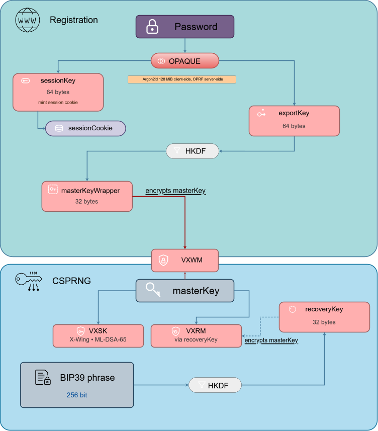
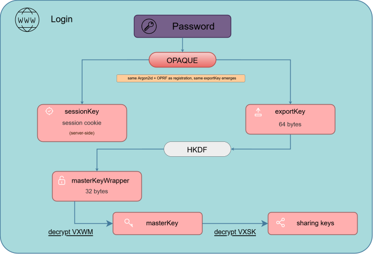

# VexaHub - Authentification et référence du matériel de clés

> **Statut :** (Brouillon) *Proposé*
>
> Ce document couvre le système d'authentification : le protocole **OPAQUE**, ce qui est **créé à l'inscription**, ce qui est **reconstruit à la connexion**, et la gestion des sessions.
>
> Pour la **spécification cryptographique complète**, voir la [spec crypto principale](CRYPTO.md).

## Table des matières

1. [Vue d'ensemble de l'authentification](#1-vue-densemble-de-lauthentification)
2. [Protocole OPAQUE](#2-protocole-opaque)
3. [Inscription](#3-inscription)
4. [Connexion](#4-connexion)
5. [Gestion des sessions](#5-gestion-des-sessions)
6. [Récupération de compte](#6-récupération-de-compte)
7. [Référence rapide du matériel de clés](#7-référence-rapide-du-matériel-de-clés)

## 1. Vue d'ensemble de l'authentification

VexaHub utilise **OPAQUE** ([RFC 9807](https://www.rfc-editor.org/info/rfc9807)) comme échange de clés authentifié par mot de passe. **OPAQUE** est un protocole à connaissance zéro : le serveur ne voit jamais le mot de passe de l'utilisateur, pas même son empreinte. Le mot de passe est utilisé **côté client** pour participer à une **Fonction Pseudo-Aléatoire Aveugle (OPRF)** avec le serveur, produisant un `exportKey` stable que seul le mot de passe correct peut dériver.

Cet `exportKey` est la racine de tout le matériel de clés côté client pour une session. Le serveur ne stocke qu'une enveloppe d'inscription opaque.

Il **ne peut pas** effectuer d'attaques par dictionnaire hors-ligne même avec un accès complet à la base de données.

### Pourquoi OPAQUE plutôt que SRP ou bcrypt ?

Avec le hachage de mot de passe standard `(ex. bcrypt ou Argon2id côté serveur)`, si la base de données est **compromise**, un attaquant obtient les empreintes de mots de passe et peut effectuer des **attaques** par force brute hors-ligne. Le coût n'est limité que par les paramètres de hachage (mémoire/temps), ce qui aide mais **n'empêche pas** les tentatives à grande échelle.

**Argon2id** prend en charge des entrées supplémentaires (comme un `poivre` secret), ce qui peut améliorer la sécurité s'il est stocké séparément. Cependant, cela déplace le problème vers la protection de ce secret côté serveur. Si la **base de données** et le **secret** sont tous deux **compromis**, les attaques hors-ligne redeviennent **possibles**.

**SRP** ([RFC 2945](https://www.rfc-editor.org/info/rfc2945)) améliore cela en **évitant** d'envoyer le mot de passe directement et en **résistant** à l'écoute passive, mais stocke toujours un vérificateur dérivé du mot de passe. Si la base de données de vérificateurs est **volée**, les attaquants peuvent monter des attaques par dictionnaire hors-ligne **contre** elle.

**OPAQUE** ([RFC 9807](https://www.rfc-editor.org/info/rfc9807)) va **plus loin**. Il utilise une **OPRF** `(Fonction Pseudo-Aléatoire Aveugle)` afin que le serveur ne voie **jamais** le mot de passe brut ni un vérificateur directement exploitable. Les données stockées sont **renforcées** par une clé secrète côté serveur (`serverSetup`). Sans cette clé, un dump de base de données seul **n'est pas** suffisant pour tester des candidats de mot de passe hors-ligne.

**OPAQUE** est également conçu pour **résister** aux attaques par précalcul et pour dissimuler le mot de passe même lors de l'inscription, tout en assurant la confidentialité persistante.

Ceci dit, si la **clé secrète du serveur** et la **base de données** sont toutes deux **compromises**, **OPAQUE** retombe au niveau de sécurité d'un schéma de hachage de mot de passe robuste. Son principal **avantage** est la défense en profondeur : il supprime le point de défaillance unique où une fuite de base de données seule permet le craquage **hors-ligne**.

Pour un système de stockage cloud **chiffré de bout en bout à connaissance zéro**, cette propriété est **particulièrement** importante. Le serveur **ne peut pas** tester efficacement des candidats de mot de passe ni forger des réponses qui l'aideraient à apprendre le matériel de clés dérivé du mot de passe de l'utilisateur. Cela réduit le risque d'attaques actives ou hors-ligne par le serveur lui-même et s'aligne mieux sur une conception **« à connaissance zéro »**, où le serveur **ne devrait pas** pouvoir dériver ou récupérer les clés de chiffrement des utilisateurs.

### Suite cryptographique (figée à la version 1 du protocole)

| Paramètre        | Valeur                                               |
|------------------|------------------------------------------------------|
| Groupe **OPRF**  | **Ristretto255**                                     |
| Groupe KE        | **Ristretto255**                                     |
| Hachage          | **SHA-512**                                          |
| Échange de clés  | **TripleDhKem** (`Triple DH` + hybride `ML-KEM-768`) |
| Étirement de clé | **Argon2id** (`m=128 Mio, t=3, p=4`)                 |

La variante `TripleDhKem` augmente le **3DH OPAQUE** standard avec un **saut KEM post-quantique**. Lors du **KE1**, le client génère une **paire de clés ML-KEM-768 éphémère** et envoie la clé d'encapsulation aux côtés de l'**éphémère DH**. Dans **KE2**, le serveur encapsule vers la **clé ML-KEM-768 du client**. Les **deux parties mélangent le secret partagé ML-KEM dans le calendrier de clés** aux côtés des **trois produits DH**. Résultat : les clés de session sont **résistantes aux attaques quantiques**. Un attaquant enregistrant des transcriptions de connexion aujourd'hui ne peut pas récupérer les clés de session avec un **futur ordinateur quantique cryptographiquement pertinent** (*CRQC*). L'**OPRF** lui-même reste en **Ristretto255** classique.

### `serverSetup`

Au premier déploiement, le serveur génère un blob `serverSetup` unique contenant la clé secrète **OPRF** (*le poivre global*) et la paire de clés statique **AKE** du serveur. Ce blob :

- Est chargé uniquement via la variable d'environnement `OPAQUE_SERVER_SETUP`.
- N'est jamais commis dans Git, jamais journalisé, jamais retourné dans aucune réponse **API**.
- Doit être sauvegardé chiffré dans au moins deux emplacements indépendants.
- En cas de perte, tous les comptes utilisateurs sont définitivement irrécupérables.

**Perte du `serverSetup` = perte permanente de tous les comptes utilisateurs.**

### Épinglage de la clé publique statique du serveur

Chaque client code en dur la clé publique statique du serveur au moment de la compilation (dérivée de `serverSetup`). À chaque complétion d'un flux **OPAQUE**, le client compare la `serverStaticPublicKey` reçue contre cette valeur épinglée. Une discordance interrompt immédiatement le flux et affiche un avertissement de sécurité. Cela protège contre un serveur substitué.

## 2. Protocole OPAQUE

OPAQUE produit deux sorties d'un échange réussi :

- **`exportKey`** (64 octets) côté client uniquement, stable à chaque connexion pour le même mot de passe. Jamais envoyé au serveur. La racine depuis laquelle `masterKeyWrapper` est dérivé.
- **`sessionKey`** (64 octets) négocié avec le serveur et utilisé pour créer le cookie de session **API**. Le serveur dérive le jeton de cookie à partir de celui-ci ; le `sessionKey` brut est effacé ensuite.

Les deux sont dérivés du mot de passe + de l'interaction **OPRF** et de l'échange de clés à **trois DH**. Aucun ne peut être reconstruit sans le mot de passe correct et le `serverSetup` du serveur.

## 3. Inscription

L'inscription est le seul moment où la majorité du **matériel de clés permanent est généré**. Tout ce qui est créé ici est soit stocké **côté serveur sous forme encapsulée (chiffrée)**, soit montré une fois à l'**utilisateur (phrase de récupération)** *puis* **éliminé**.

### 3.1 Flux d'inscription complet

> Voir le **diagramme** dans la documentation rendue.
>
> **Étapes** : saisie utilisateur -> échange **OPAQUE** ->
> vérification du PIN -> génération des clés (`masterKey`, **X-Wing**, **ML-DSA-65**) -> encapsulation des blobs
> (`VXWM`, `VXSK`, `VXRM`) -> confirmation de la phrase de récupération -> `POST /register/finish` -> **effacement**.

<!-- markdownlint-disable MD033 -->

<!-- markdownlint-enable MD033 -->

### 3.2 Ce qui est créé à l'inscription

| Élément                 | Comment                                                   | Stocké où                                                                         | Le serveur peut lire ? |
|-------------------------|-----------------------------------------------------------|-----------------------------------------------------------------------------------|------------------------|
| `registrationRecord`    | Sortie OPAQUE                                             | Serveur (BDD)                                                                     | Non (enveloppe opaque) |
| `masterKey`             | CSPRNG (32 octets)                                        | Serveur sous forme de `VXWM` (encapsulé)                                          | Non                    |
| Blob `VXWM`             | `masterKey` chiffré avec `masterKeyWrapper`               | Serveur (BDD)                                                                     | Non                    |
| Blob `VXRM`             | `masterKey` chiffré avec `recoveryKey`                    | Serveur (BDD)                                                                     | Non                    |
| Paire de clés X-Wing    | CSPRNG                                                    | Clé de désencapsulation dans `VXSK` ; clé d'encapsulation en clair sur le serveur | Clé publique uniquement|
| Paire de clés ML-DSA-65 | CSPRNG                                                    | Clé de signature dans `VXSK` ; clé de vérification en clair sur le serveur        | Clé publique uniquement|
| Blob `VXSK`             | Clés privées de partage chiffrées avec `masterKey`        | Serveur (BDD)                                                                     | Non                    |
| Phrase de récupération  | BIP39 (256 bits d'entropie)                               | Montrée une fois, jamais stockée                                                  | Jamais                 |

### 3.3 Ce que le serveur stocke (table Users)

```sql
CREATE TABLE users (
    id                       UUID PRIMARY KEY DEFAULT gen_random_uuid(),
    email                    CITEXT UNIQUE NOT NULL,
    locale                   TEXT NOT NULL DEFAULT 'en',
    opaque_protocol_version  SMALLINT NOT NULL DEFAULT 1,
    registration_record      BYTEA NOT NULL,        -- Enveloppe OPAQUE
    vxwm                     BYTEA NOT NULL,        -- masterKey encapsulé (mot de passe)
    vxrm                     BYTEA NOT NULL,        -- masterKey encapsulé (récupération)
    vxsk                     BYTEA NOT NULL,        -- clés de partage encapsulées
    sharing_public_xwing     BYTEA NOT NULL,        -- 1216 octets, en clair
    sharing_public_mldsa     BYTEA NOT NULL,        -- ~1952 octets, en clair
    reset_generation         INTEGER NOT NULL DEFAULT 0,
    created_at               TIMESTAMPTZ NOT NULL DEFAULT now(),
    updated_at               TIMESTAMPTZ NOT NULL DEFAULT now()
);
```

### 3.4 Dérivation des clés à l'inscription

<!-- markdownlint-disable MD033 -->

<!-- markdownlint-enable MD033 -->

## 4. Connexion

La connexion reconstruit le matériel de clés temporaire de session à partir du mot de passe de l'utilisateur et des blobs stockés sur le serveur. Aucun matériel de clés permanent ne change lors de la connexion.

La `masterKey` est désencapsulée et chargée dans le **Crypto Worker**, puis éliminée de la mémoire à la déconnexion ou après expiration.

### 4.1 Flux de connexion complet

> Voir le diagramme dans la documentation rendue. Étapes : saisie utilisateur -> échange **OPAQUE** ->
> vérification du PIN -> dérivation de `masterKeyWrapper` -> désencapsulation de `VXWM`/`VXSK` -> `POST /login/finish`
> -> cookie de session -> **effacement** -> chargement dans le Crypto Worker.

<!-- markdownlint-disable MD033 -->

<!-- markdownlint-enable MD033 -->

### 4.2 Ce qui est reconstruit à la connexion

Rien de permanent n'est créé lors de la connexion. Les éléments suivants sont dérivés de manière transitoire à partir du mot de passe correct et éliminés à la fin de la session :

| Élément                        | Dérivé de                                   | Réside où                                 | Éliminé quand                                           |
|--------------------------------|---------------------------------------------|-------------------------------------------|---------------------------------------------------------|
| `exportKey`                    | Échange OPAQUE                              | Mémoire client uniquement                 | Immédiatement après la dérivation de `masterKeyWrapper` |
| `masterKeyWrapper`             | HKDF(`exportKey`)                           | Mémoire client uniquement                 | Immédiatement après la désencapsulation de `masterKey`  |
| `masterKey`                    | Désencapsulé depuis `VXWM`                  | Crypto Worker uniquement                  | Expiration de session / déconnexion                     |
| Clé de désencapsulation X-Wing | Désencapsulée depuis `VXSK` via `masterKey` | Crypto Worker uniquement                  | Expiration de session / déconnexion                     |
| Clé de signature ML-DSA-65     | Désencapsulée depuis `VXSK` via `masterKey` | Crypto Worker uniquement                  | Expiration de session / déconnexion                     |
| `sessionKey`                   | Échange OPAQUE                              | Utilisé pour créer le cookie, puis effacé | Immédiatement                                           |

### 4.3 Dérivation des clés à la connexion

<!-- markdownlint-disable MD033 -->

<!-- markdownlint-enable MD033 -->

L'`exportKey` est stable : tant que le mot de passe est le même et que `serverSetup` n'a pas changé, la même valeur de 64 octets émerge de chaque connexion. C'est ainsi que le serveur peut stocker la `masterKey` encapsulée une fois et la rendre désencapsulable à chaque connexion future sans que le serveur ne connaisse jamais la clé d'encapsulation.

### 4.4 Cookie de session

Le serveur dérive un jeton de session HTTP depuis `sessionKey` et stocke son empreinte **SHA-256** dans Postgres. Le jeton brut est retourné au client sous forme de cookie. Attributs du cookie :

```rs
HttpOnly; Secure; SameSite=Strict; Path=/
```

Durée de vie absolue : 24 heures, renouvelée à l'activité. Le `sessionKey` brut est effacé côté client et serveur immédiatement après l'émission du cookie. Le serveur ne le stocke jamais.

## 5. Gestion des sessions

### 5.1 Session active (par défaut)

Une fois connectés, la `masterKey` et les clés privées de partage résident exclusivement dans un **Crypto Web Worker** dédié. Elles ne touchent jamais le tas du thread JavaScript principal.

Le Worker n'expose que des points d'accès d'opérations. Il ne retourne jamais de matériel de clés brut :

| Point d'accès du Worker | Ce qu'il fait                                                                  |
|-------------------------|--------------------------------------------------------------------------------|
| `encryptFileSegment`    | Retourne le texte chiffré                                                      |
| `decryptFileSegment`    | Retourne le segment en clair                                                   |
| `deriveCollectionKey`   | Retourne le résultat d'opération chiffré                                       |
| `wrapForSharing`        | Retourne le blob `VXSH` (inclut le champ de permission `"p"`)                  |
| `unwrapFromSharing`     | Retourne le résultat d'opération ; ne retourne jamais de matériel de clés brut |

**Délai d'inactivité :** 30 minutes. Le Worker est terminé et tout le matériel de clés en mémoire est effacé. L'utilisateur doit se réauthentifier. La fermeture de l'onglet du navigateur a le même effet.

### 5.2 Session persistante - « Se souvenir de moi » (opt-in uniquement)

Jamais activé par défaut. Lorsqu'il est choisi, un blob lié à l'appareil permet à l'utilisateur de reprendre la session sans ressaisir son mot de passe.

**Activation:**

```rs
1. Le client génère localKey (32 octets aléatoires, CSPRNG)
2. Le client chiffre masterKey avec localKey -> blob VXPS // (voir CRYPTO.md §5.6)
3. Le client stocke localKey dans IndexedDB
4. Client -> Serveur : POST /auth/persistent-session/create { vxps, deviceLabel }
   // Note d'implémentation : si le client plante entre les étapes 3 et 4,
   // localKey est orphelin dans IndexedDB. Sans danger : l'absence du cookie PS-AUTH
   // fait qu'il est silencieusement ignoré. PEUT être collecté au démarrage.
5. Le serveur stocke { userId, vxps, cookieHash, deviceLabel, createdAt, expiresAt }
6. Le serveur émet le cookie PS-AUTH (HttpOnly; Secure; SameSite=Strict; Max-Age=30d)
```

**Reprise:**

```rs
1. Le client détecte le cookie PS-AUTH ET localKey dans IndexedDB
   // Si PS-AUTH présent mais localKey absent (stockage effacé) : ignorer silencieusement,
   // afficher le formulaire de mot de passe. La session côté serveur reste valide jusqu'à expiration ou révocation.
2. Le client affiche l'invite « Reprendre en tant que <utilisateur> » (pas de formulaire de mot de passe)
3. Client -> Serveur : GET /auth/persistent-session/resume (cookie attaché automatiquement)
4. Le serveur valide le cookie, retourne { vxps, vxsk }
5. Le client récupère localKey depuis IndexedDB, déchiffre VXPS -> masterKey -> chargé dans le Worker
6. Le serveur émet un nouveau cookie de session active en parallèle du cookie persistant
```

**Révocation :**

- **Déconnexion** : le client supprime `localKey` d'IndexedDB + `DELETE /auth/persistent-session/{id}`
- **Déconnecter partout** : le client vide IndexedDB + le serveur efface toutes les `persistent_sessions` de l'utilisateur
- **Changement de mot de passe** : le serveur efface toutes les `persistent_sessions` ; le client doit réactiver « Se souvenir de moi »

**Compromis de sécurité (affiché lors de l'activation) :**

> **Se souvenir de moi** stocke une copie chiffrée de votre clé maître sur les serveurs **VexaHub** (blob `VXPS`), et la clé de déchiffrement (`localKey`) sur cet appareil dans `IndexedDB`. Ni l'un ni l'autre seul ne suffit à récupérer vos données.
>
> Un attaquant qui **simultanément** prend le contrôle total des serveurs VexaHub **et** capture votre cookie de session `PS-AUTH` **et** lit l'`IndexedDB` de votre appareil pourrait déchiffrer cette session mémorisée. En fonctionnement normal, vos données restent privées.
>
> Pour des **garanties strictes de connaissance zéro**, laissez **Se souvenir de moi** décoché et authentifiez-vous avec votre mot de passe à chaque session. Les clients bureau et mobile assurent des sessions persistantes à connaissance zéro **via le trousseau du système d'exploitation**. Le serveur **ne détient aucun matériel de clés dans les deux cas**.

**Niveaux de connaissance zéro :**

| Mode                                        | Vrai ZK ?                              | Le serveur détient         |
|---------------------------------------------|----------------------------------------|----------------------------|
| Web (sans `Se souvenir de moi`)             | ✅ Oui                                 | Rien côté session          |
| Web (`Se souvenir de moi`)                  | ⚠️ Compromis (opt-in, documenté)       | `vxps` (blob chiffré)      |
| Web (`Se souvenir de moi` + `WebAuthn` PRF) | ✅ Oui                                 | Rien                       |
| Bureau / Mobile                             | ✅ Oui                                 | Rien                       |

**Garde-fous obligatoires :**

- Opt-in strict uniquement. Aucune incitation.
- La page des paramètres liste chaque session persistante avec le label de l'appareil, l'heure de création, la dernière utilisation, et une révocation en un clic.
- Le changement de mot de passe révoque toutes les sessions persistantes côté serveur.
- Délai d'inactivité côté serveur : session supprimée après 30 jours d'inactivité.
- « Déconnecter partout » efface toutes les sessions persistantes côté serveur et la `localKey` IndexedDB locale.
- `localKey` n'est jamais stockée côté client en clair au-delà de l'instant où elle est utilisée pour déchiffrer le blob `VXPS`.

### 5.3 Schéma de base de données des sessions

```sql
CREATE TABLE sessions (
    id           UUID PRIMARY KEY,
    user_id      UUID NOT NULL REFERENCES users(id) ON DELETE CASCADE,
    cookie_hash  BYTEA NOT NULL,           -- SHA-256 de la valeur du cookie
    created_at   TIMESTAMPTZ NOT NULL DEFAULT now(),
    last_used_at TIMESTAMPTZ NOT NULL DEFAULT now(),
    expires_at   TIMESTAMPTZ NOT NULL,
    revoked_at   TIMESTAMPTZ,
    user_agent   TEXT,
    ip_network   CIDR                      -- /24 IPv4 ou /48 IPv6, bits d'hôte mis à zéro à l'insertion
);

CREATE TABLE persistent_sessions (
    id           UUID PRIMARY KEY,
    user_id      UUID NOT NULL REFERENCES users(id) ON DELETE CASCADE,
    vxps         BYTEA NOT NULL,
    cookie_hash  BYTEA NOT NULL,
    device_label TEXT NOT NULL,
    created_at   TIMESTAMPTZ NOT NULL DEFAULT now(),
    last_used_at TIMESTAMPTZ NOT NULL DEFAULT now(),
    expires_at   TIMESTAMPTZ NOT NULL,
    revoked_at   TIMESTAMPTZ
);

CREATE INDEX ON sessions (user_id) WHERE revoked_at IS NULL;
CREATE INDEX ON persistent_sessions (user_id) WHERE revoked_at IS NULL;
```

## 6. Récupération de compte

### 6.1 Phrase de récupération (non destructive)

À l'inscription, une phrase BIP39 de 24 mots (256 bits d'entropie) est générée et utilisée pour produire une seconde copie encapsulée de `masterKey`. Cela signifie qu'oublier un mot de passe n'implique pas de perdre toutes ses données.

```rs
seed        = BIP39.mnemonicToSeed(phrase, passphrase = "")
recoveryKey = HKDF-SHA-512(
    ikm  = seed,
    salt = 32 zero bytes,
    info = "vexahub:v1:recoveryKey:{user_uuid}",
    L    = 32
)
```

**HKDF** plutôt qu'**Argon2id** est utilisé ici car la phrase **BIP39** fournit déjà 256 bits d'entropie. Le renforcement mémoire ajouterait de la latence sans gain de sécurité significatif.

La phrase est montrée une fois à l'inscription, jamais stockée côté client, jamais transmise au serveur. L'utilisateur confirme des positions de mots spécifiques avant la fin de l'inscription. Il n'y a pas d'option pour passer cette étape.

**Flux de récupération (mot de passe oublié, phrase disponible) :**

1. L'utilisateur saisit **email + phrase de récupération**
2. Client -> Serveur : `GET /auth/recovery/lookup?email={email}` *(limité en débit)* <- { **vxrm**, **user_uuid** }
3. Le client redérive `recoveryKey` à partir de la phrase + **user_uuid**
4. Le client déchiffre `VXRM` -> `masterKey` (la même `masterKey` qu'avant)
5. L'utilisateur choisit un nouveau mot de passe
6. Le client lance une nouvelle inscription **OPAQUE** avec le nouveau mot de passe
7. Le client réencapsule `masterKey` avec le nouveau `masterKeyWrapper` -> nouveau `VXWM`
8. Client -> Serveur : `POST /auth/recovery/finish`
              { **registrationRecord**, **vxwm**, **vxsk** } *(remplacement atomique)*
9. Tous les fichiers, collections et partages existants restent valides. La `masterKey` n'a pas changé

### 6.2 Réinitialisation destructive

Lorsque le mot de passe et la phrase de récupération sont tous deux perdus. Déclenchée uniquement via un lien confirmé par email. Affiche un avertissement explicite de perte de données, puis efface atomiquement tous les fichiers et fait tourner tout le matériel de clés sous un nouveau `reset_generation`. Il n'y a pas de retour en arrière possible sur ce chemin.

### 6.3 Rotation de la phrase

Depuis les paramètres, un utilisateur authentifié peut régénérer sa phrase de récupération. La nouvelle phrase encapsule la `masterKey` existante ; l'ancien `VXRM` est remplacé de manière atomique. La `masterKey` elle-même ne change pas, aucun rechiffrement de fichiers n'est donc nécessaire.

## 7. Référence rapide du matériel de clés

### Ce qui existe uniquement à l'inscription

| Élément                 | Notes                                                                                       |
|-------------------------|---------------------------------------------------------------------------------------------|
| `masterKey`             | Généré une fois via CSPRNG. Jamais régénéré sauf en cas de réinitialisation destructive.    |
| Paire de clés X-Wing    | Permanente. Clé de désencapsulation dans `VXSK`.                                            |
| Paire de clés ML-DSA-65 | Permanente. Clé de signature dans `VXSK`.                                                   |
| Blob `VXWM`             | `masterKey` encapsulée liée au mot de passe. Remplacé lors d'un changement de mot de passe. |
| Blob `VXRM`             | `masterKey` encapsulée liée à la phrase de récupération.                                    |
| Blob `VXSK`             | Paire de clés de partage encapsulée. Réencapsulée lors d'un changement de mot de passe.     |
| Phrase de récupération  | Montrée une fois. Jamais stockée nulle part.                                                |

### Ce qui existe uniquement pendant une session

| Élément                                  | Origine                 | Éliminé quand                                            |
|------------------------------------------|-------------------------|----------------------------------------------------------|
| `exportKey`                              | Sortie OPAQUE           | Immédiatement après la dérivation de `masterKeyWrapper`  |
| `masterKeyWrapper`                       | HKDF(`exportKey`)       | Immédiatement après la désencapsulation de `masterKey`   |
| `sessionKey`                             | Sortie OPAQUE           | Immédiatement après l'émission du cookie                 |
| `masterKey` (actif)                      | Désencapsulé de `VXWM`  | Expiration de session / déconnexion / fermeture d'onglet |
| Clé de désencapsulation X-Wing (active)  | Désencapsulée de `VXSK` | Expiration de session / déconnexion / fermeture d'onglet |
| Clé de signature ML-DSA-65 (active)      | Désencapsulée de `VXSK` | Expiration de session / déconnexion / fermeture d'onglet |

### Ce que le serveur sait et ne sait pas

| Le serveur sait                                                      | Le serveur ne sait jamais                          |
|----------------------------------------------------------------------|----------------------------------------------------|
| Adresse email                                                        | Mot de passe (ni aucune empreinte de celui-ci)     |
| `registrationRecord` OPAQUE (enveloppe opaque)                       | `exportKey`                                        |
| Blobs `VXWM`, `VXRM`, `VXSK` (texte chiffré uniquement)              | `masterKeyWrapper`                                 |
| Clé d'encapsulation X-Wing (publique)                                | `masterKey`                                        |
| Clé de vérification ML-DSA-65 (publique)                             | `collectionKey`, `fileKey`                         |
| Empreinte du cookie de session                                       | Contenu des fichiers, noms de fichiers, types MIME |
| Blob `vxps` (sessions persistantes uniquement)                       | Phrase de récupération                             |
| UUIDs de fichiers/collections, tailles du texte chiffré, horodatages | Toutes les métadonnées en clair                    |
