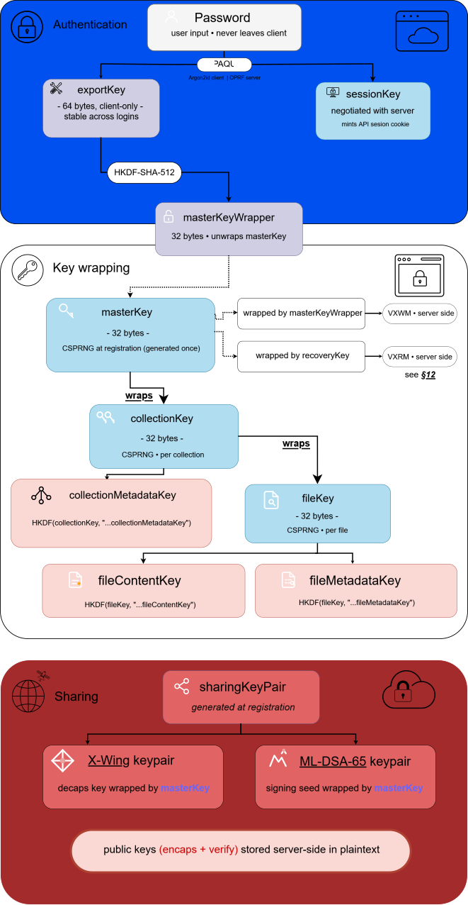

# VexaHub - Spécification cryptographique

> **Version du document:** 12
>
> **Version du protocole:** 1
>
> **Status:** (Brouillon) Accepté

**Voir aussi:** [Spécification cryptographique | Addendum](/fr/CRYPTO_ADDENDUM.md)

Ce document est l'unique source de vérité pour toutes les décisions cryptographiques de VexaHub. Toute modification des paramètres, algorithmes, chemins de dérivation ou formats binaires définis ici constitue un changement incompatible pour les comptes existants et **DOIT** incrémenter la version du protocole (voir [§13](#13-versionnage-du-protocole-et-migration)).

## 1. Vue d'ensemble

VexaHub est un service de stockage cloud **chiffré de bout en bout à connaissance zéro**. Le serveur n'a jamais accès aux mots de passe des utilisateurs, aux fichiers en clair, aux noms de fichiers, ni aux clés de chiffrement capables de déchiffrer les données des utilisateurs lors d'une utilisation normale.

Objectifs cryptographiques :

- Le serveur **ne peut pas** déchiffrer les fichiers des utilisateurs, même avec un accès complet à la base de données.
- Un attaquant ne volant que la base de données **ne peut pas** mener d'attaques par dictionnaire hors-ligne **(défense OPRF d'OPAQUE)**.
- Les changements de mot de passe **ne nécessitent pas** de rechiffrer les fichiers des utilisateurs.
- La mutation de fichiers est prise en charge **sans** vulnérabilités de réutilisation de nonce.
- Le partage entre utilisateurs est possible **sans** que le serveur n'apprenne le contenu partagé.
- **Résistance post-quantique** pour *l'échange de clés de partage*.
- **Cohérence** multiplateforme (web, bureau, futurs Android/iOS) via une implémentation Rust compilée vers les cibles **WASM**, **native** et **UniFFI**.

Objectifs explicitement non visés :

- La défense **contre** un serveur entièrement compromis agissant de connivence avec lui-même pour **attaquer un utilisateur** durant une session active. L'opt-in de session **persistante** ([§9.2](#92-sessions-persistantes-se-souvenir-de-moi-opt-in)) élargit cette surface et est documenté comme tel.
- La défense **contre** une **mise à jour client malveillante** poussée via le canal de distribution normal. Les builds **reproductibles** sont prévus dans les travaux futurs (voir [§18](#18-questions-ouvertes-et-travaux-futurs)).
- La défense **contre** un **attaquant** ayant le contrôle physique de l'appareil déverrouillé de l'utilisateur.

## 2. Primitives

| Objectif                         | Algorithme                                                        | Paramètres                                                                        |
|----------------------------------|-------------------------------------------------------------------|-----------------------------------------------------------------------------------|
| AKE authentifié par mot de passe | OPAQUE ([RFC 9807][opaque_rfc])                                   | Suite Ristretto255, `(3DH + ML-KEM-768)`                                          |
| Étirement de clé (dans OPAQUE)   | Argon2id                                                          | m = 131 072 Kio (128 Mio), t = 3, p = 4                                           |
| AEAD symétrique                  | XChaCha20-Poly1305                                                | Nonces de 24 octets, tags de 16 octets                                            |
| Dérivation de clé                | HKDF-SHA-512                                                      | `info` à séparation de domaine, sel zéro                                          |
| KEM hybride (Partage)            | X-Wing ([draft-connolly-cfrg-xwing-kem][xwing_draft])             | ML-KEM-768 + X25519, secret partagé de 32 octets                                  |
| KEM hybride (AKE OPAQUE)         | TripleDhKem (`opaque-ke`)                                         | 3DH + encapsulation ML-KEM-768 dans KE1/KE2                                       |
| Signatures numériques            | ML-DSA-65 (FIPS 204)                                              | Authenticité des invitations de partage, attestation d'appareil, rotation de clés |
| CSPRNG                           | CSPRNG du système d'exploitation                                  | `getrandom` (Rust), `crypto.getRandomValues` (web)                                |
| Hygiène mémoire                  | Crate `zeroize`                                                   | Tout le matériel de clés encapsulé dans `Zeroizing<T>`                            |

**Justification :**

- **Ristretto255** plutôt que **P-256** : groupe d'ordre premier, hash-to-curve plus simple, implémentations **temps-constant** mieux maintenues dans l'écosystème **Rust**.
- **Argon2id 128 Mio / t=3 / p=4** : au-dessus des recommandations **OWASP 2024** et des références du secteur (Bitwarden, 1Password se situent autour de 64 Mio), tout en restant en dessous du seuil de **~256 Mio** à partir duquel les allocations **WASM de Safari iOS** commencent à échouer. L'**OPRF d'OPAQUE** neutralise déjà les **attaques par précalcul** contre la base de données ; le coût d'**Argon2id** est une couche de **défense en profondeur** pour le cas où `serverSetup` est également **compromis**. Paramètres identiques et figés pour tous les utilisateurs à la version 1 du protocole. Aucune valeur de repli par utilisateur, aucun paramètre hétérogène.
- **XChaCha20-Poly1305** plutôt qu'**AES-GCM** : les nonces de 24 octets rendent la génération aléatoire de nonces sûre sans compteurs ; temps-constant sur toutes les plateformes ; aucune dépendance matérielle AES.
- **HKDF-SHA-512** : correspond au hash de la suite **OPAQUE**, universellement disponible, réservoir de sortie plus grand que **SHA-256** sans pénalité de performance dans ce contexte.
- **X-Wing** plutôt qu'un combineur **ML-KEM-768 + X25519** manuel : construction IND-CCA sécurisée formellement prouvée (IACR 2024) avec un combineur optimisé qui évite de hasher le texte chiffré ML-KEM. Sécurisé si **X25519** ou **ML-KEM-768** l'est. Élimine un combineur KDF personnalisé de notre surface d'attaque. Encore un **Internet-Draft IETF** ([draft-connolly-cfrg-xwing-kem][xwing_draft]) mais les algorithmes sous-jacents sont **finalisés par le NIST** et le format wire est stable.
- **TripleDhKem** plutôt que le **TripleDH** standard : la variante `TripleDhKem` de la crate `opaque-ke` augmente l'échange de clés **3DH d'OPAQUE** en faisant envoyer par le client une clé d'encapsulation **ML-KEM-768** dans **KE1** et en faisant encapsuler le serveur vers celle-ci dans **KE2**. Le secret partagé **ML-KEM** est mélangé dans le calendrier de clés aux côtés des **trois produits DH**. Cela ferme la menace de **collecte différée** sur les transcriptions de connexion. Un **attaquant** enregistrant des flux **OPAQUE** aujourd'hui **ne peut pas** dériver les clés de session avec un futur **CRQC**. L'OPRF **Ristretto255** reste classique ; un vol de **CRQC** + base de données + `serverSetup` permettrait des attaques hors-ligne sur les mots de passe, mais Argon2id 128 Mio reste comme dernière barrière. Il s'agit de l'**OPAQUE hybride le plus robuste** disponible aujourd'hui ; l'OPAQUE **entièrement** PQ ([draft-vos-cfrg-pqpake][pqpake_draft]) est prévu dans les **travaux futurs**.
- **ML-DSA-65** (Niveau 3 NIST) : correspond au niveau de sécurité de **ML-KEM-768** dans **X-Wing**. Sans signatures **PQ**, un **CRQC** pourrait forger des invitations de partage, des enregistrements d'appareils et des rotations de clés, compromettant le graphe de confiance **sans** jamais casser le chiffrement. Les tailles de signatures (~3,3 Ko) et les clés publiques (~1,95 Ko) sont plus grandes qu'**Ed25519** mais acceptables pour les opérations au niveau des métadonnées.

## 3. Hiérarchie des clés

<!-- markdownlint-disable MD033 -->

<!-- markdownlint-enable MD033 -->

L'intermédiaire `masterKeyWrapper` existe par souci d'uniformité avec toutes les autres dérivations et pour éviter d'utiliser `exportKey` directement comme clé `AEAD`. Il n'apporte aucune sécurité supplémentaire par rapport à une tranche directe d'`exportKey`, mais maintient la cohérence du graphe de dérivation.

### 3.1 Récapitulatif des clés

| Clé                                 | Taille | Origine                                         | Durée de vie                      | Le serveur voit     |
|-------------------------------------|--------|-------------------------------------------------|-----------------------------------|---------------------|
| password                            | var    | Saisie utilisateur                              | Frappe                            | Jamais              |
| exportKey                           | 64     | Sortie OPAQUE                                   | Session                           | Jamais              |
| masterKeyWrapper                    | 32     | HKDF(exportKey)                                 | Session                           | Jamais              |
| sessionKey                          | 64     | Sortie OPAQUE                                   | Session                           | Oui (pour cookie)   |
| masterKey                           | 32     | CSPRNG à l'inscription                          | Permanent                         | Encapsulé seulement |
| localKey                            | 32     | CSPRNG à l'activation de « Se souvenir de moi » | Jusqu'à révocation ou déconnexion | Jamais              |
| collectionKey                       | 32     | CSPRNG à la création de collection              | Jusqu'à rotation                  | Encapsulé seulement |
| fileKey                             | 32     | CSPRNG à la création de fichier                 | Jusqu'à rotation                  | Encapsulé seulement |
| recoveryKey                         | 32     | HKDF(graine BIP39)                              | Récupération                      | Jamais              |
| Clé de désencapsulation X-Wing      | 32     | CSPRNG à l'inscription                          | Permanent                         | Encapsulé seulement |
| Clé d'encapsulation X-Wing (pub)    | 1216   | Dérivée de la clé de désencapsulation           | Permanent                         | En clair            |
| Graine de signature ML-DSA-65       | 32     | CSPRNG à l'inscription                          | Permanent                         | Encapsulé seulement |
| Clé de vérification ML-DSA-65 (pub) | 1952   | Dérivée de la graine de signature               | Permanent                         | En clair            |

## 4. Séparation de domaine HKDF

Format : `vexahub:v{VERSION_PROTOCOLE}:{objectif}[:{contexte}]`.

**Politique de sel :** Toutes les dérivations HKDF utilisent un **sel zéro de 32 octets**, sauf `shareWrapKey` qui utilise un **sel aléatoire de 32 octets**.

Pour les dérivations où l'**IKM** est uniformément aléatoire (ex. `masterKey`, `exportKey`, `collectionKey`, `fileKey`), un sel zéro n'a aucun impact sur la sécurité lorsque `info` est unique par objectif, et simplifie l'interopérabilité multiplateforme.

Pour `shareWrapKey`, l'**IKM** est le secret partagé **X-Wing** (sortie d'**un combineur KEM**), et non une sortie **CSPRNG** brute. Si le combineur venait à produire une sortie biaisée en raison d'un défaut d'implémentation ou d'une faiblesse dans l'un des **KEM** constitutifs, un sel aléatoire fournit une **couche de défense supplémentaire significative**. Le sel est transmis aux côtés du texte chiffré **X-Wing** dans l'enregistrement de partage et **n'a pas besoin d'être secret**.

| Dérivation                                         | Chaîne `info`                                                                         | Longueur                     |
|----------------------------------------------------|---------------------------------------------------------------------------------------|------------------------------|
| masterKeyWrapper depuis exportKey                  | `vexahub:v1:masterKeyWrapper`                                                         | 32                           |
| collectionKeyWrap depuis masterKey                 | `vexahub:v1:collectionKeyWrap:{collection_uuid}`                                      | 32                           |
| fileKeyWrap depuis collectionKey                   | `vexahub:v1:fileKeyWrap:{file_uuid}`                                                  | 32                           |
| contentIdKey depuis masterKey (par collection)     | `vexahub:v1:contentIdKey:{collection_uuid}`                                           | 32                           |
| fileContentKey depuis fileKey                      | `vexahub:v1:fileContentKey`                                                           | 32                           |
| fileMetadataKey depuis fileKey                     | `vexahub:v1:fileMetadataKey`                                                          | 32                           |
| collectionMetadataKey depuis collectionKey         | `vexahub:v1:collectionMetadataKey`                                                    | 32                           |
| segmentNonce depuis fileContentKey                 | `vexahub:v1:segmentNonce:` ‖ uint32_be(generation) ‖ uint64_be(segment_index)         | 24                           |
| recoveryKey depuis la graine BIP39                 | `vexahub:v1:recoveryKey:{user_uuid}`                                                  | 32                           |
| shareWrapKey depuis le secret partagé X-Wing       | `vexahub:v1:shareWrap:{share_uuid}`                                                   | 32 (sel aléatoire 32 octets) |

> Les sels HKDF ne sont pas des secrets ; l'unicité est assurée exclusivement par le champ `info`.
>
> Un sel zéro simplifie l'interopérabilité multiplateforme et n'a aucun impact sur la sécurité lorsque `info` est unique par objectif.
>
> Tous les UUIDs intégrés dans les chaînes `info` HKDF **DOIVENT** être encodés en **binaire big-endian brut de 16 octets**, et non en texte avec tirets.
>
> Cela élimine toute ambiguïté de formatage entre plateformes et implémentations. Exemple : l'UUID `550e8400-e29b-41d4-a716-446655440000` est encodé en 16 octets `0x55 0x0e 0x84 ...`, et non en ASCII de 36 caractères.

La `collectionKey` dans `collectionMetadataKey` est unique par collection, donc aucun `collection_uuid` n'est nécessaire dans la chaîne `info`.

```rs
collectionMetadataKey = HKDF-SHA-512(
    ikm  = collectionKey,
    salt = 32 octets zéro,
    info = "vexahub:v1:collectionMetadataKey",
    L    = 32
)
```

La `collectionKeyWrapKey` et la `fileKeyWrapKey` sont dérivées uniquement pour encapsuler/désencapsuler leurs clés stockées respectives :

```rs
collectionKeyWrapKey = HKDF-SHA-512(
    ikm  = masterKey,
    salt = 32 octets zéro,
    info = "vexahub:v1:collectionKeyWrap:" || collection_uuid,
    L    = 32
)

fileKeyWrapKey = HKDF-SHA-512(
    ikm  = collectionKey,
    salt = 32 octets zéro,
    info = "vexahub:v1:fileKeyWrap:" || file_uuid,
    L    = 32
)
```

## 5. Formats de blob binaires

Tous les blobs chiffrés utilisent des formats binaires versionnés et auto-descriptifs, préfixés par 4 octets magiques, une version de format et un identifiant d'algorithme. Les parseurs **DOIVENT** vérifier les octets magiques, la version et l'algorithme avant le déchiffrement. Les valeurs inconnues **DOIVENT** provoquer une erreur, jamais un repli silencieux.

Identifiants d'algorithme :

- `0x01` -> XChaCha20-Poly1305
- `0x02` -> X-Wing (ML-KEM-768 + X25519)

Identifiants d'algorithme de signature (nouveaux, pour les enregistrements de partage) :

- `0x10` -> ML-DSA-65

### 5.1 `VXWM` - Clé maître encapsulée (dérivée du mot de passe)

```rs
Décalage  Taille  Champ
--------  ------  ---------------------------------------
0         4       Magique "VXWM" (0x56 0x58 0x57 0x4D)
4         1       Version de format (0x01)
5         1       Identifiant d'algorithme (0x01)
6         24      Nonce (aléatoire)
30        48      Texte chiffré (32 o masterKey + 16 o tag)
--------
Total : 78 octets
```

```rs
AAD : user_id (16 octets, UUID brut)
```

### 5.2 `VXRM` - Clé maître encapsulée (dérivée de la phrase de récupération)

Structure identique à `VXWM`, octets magiques distincts pour éviter toute utilisation croisée.

```rs
Décalage  Taille  Champ
0         4       Magique "VXRM" (0x56 0x58 0x52 0x4D)
4         1       Version de format (0x01)
5         1       Identifiant d'algorithme (0x01)
6         24      Nonce (aléatoire)
30        48      Texte chiffré (32 o masterKey + 16 o tag)
Total : 78 octets
```

```rs
AAD : user_id (16 octets, UUID brut)
```

### 5.3 `VXFC` - Segment de contenu de fichier

```rs
Décalage  Taille   Champ
0         4        Magique "VXFC"
4         1        Version de format (0x01)
5         1        Identifiant d'algorithme (0x01)
6         16       ID de fichier (UUID, octets bruts)
22        4        Génération de fichier (uint32 BE)
26        8        Index de segment (uint64 BE)
34        24       Nonce (dérivé de manière déterministe)
58        N+16     Texte chiffré + tag
```

```rs
AAD = version ‖ alg_id ‖ file_id ‖ generation ‖ segment_index
// 1 + 1 + 16 + 4 + 8 = 30 octets
```

L'**AAD** lié à chaque segment est le tuple de **30 octets** `version ‖ alg_id ‖ file_id ‖ generation ‖ segment_index`. Cela lie chaque texte chiffré à sa position et sa génération, empêchant les attaques de réordonnancement et de retour en arrière dans un fichier.

### 5.4 `VXFM` - Métadonnées de fichier

```rs
Décalage  Taille   Champ
0         4        Magique "VXFM"
4         1        Version de format (0x01)
5         1        Identifiant d'algorithme (0x01)
6         16       ID de fichier (UUID, octets bruts)
22        4        Génération de fichier (uint32 BE)
26        24       Nonce (aléatoire)
50        N+16     Texte chiffré (métadonnées encodées en CBOR) + tag
```

```rs
AAD = version ‖ alg_id ‖ file_id ‖ generation
// 1 + 1 + 16 + 4 = 22 octets
```

Schéma CBOR pour les métadonnées en clair (CBOR canonique, [RFC 8949 §4.2.1][cbor_rfc]) :

```rs
{
  "n":  tstr,           // nom de fichier
  "m":  tstr,           // type MIME
  "s":  uint,           // taille en clair en octets
  "sc": uint,           // nombre total de segments
  "ct": uint,           // heure de création, secondes Unix
  "mt": uint,           // heure de modification, secondes Unix
  "h":  bstr .size 32,  // hash BLAKE3 du contenu en clair (intégrité)
}
```

> **Contraintes sur le nom de fichier :** Le champ `"n"` **DOIT** être validé par le client avant le chiffrement :
>
> - UTF-8 valide, normalisé NFC.
> - Maximum **1024 octets** (encodé).
> - **NE DOIT PAS** contenir d'octets nuls ni de caractères de contrôle (U+0000-U+001F, U+007F).
> - **NE DOIT PAS** être vide.
>
> Le serveur ne voit jamais les noms de fichiers en clair. La validation est une responsabilité uniquement côté client.
>
> **Exigence de nonce :** Un nonce aléatoire frais **DOIT** être généré à chaque chiffrement `VXFM`, y compris lors du rechiffrement à l'incrément de génération. La `fileMetadataKey` est dérivée depuis `fileKey` sans `generation` dans le chemin de dérivation, ce qui signifie que la clé de métadonnées est **stable entre les générations**. La réutilisation d'un nonce sous la même `fileMetadataKey` est catastrophique. Elle compromet la confidentialité de **XChaCha20-Poly1305**.
>
> Les implémenteurs **NE DOIVENT PAS** mettre en cache ni réutiliser un nonce `VXFM` précédent.
>
> **Vérification du nombre de segments :** Avant de démarrer un téléchargement, le client **DOIT** lire `sc` depuis `VXFM` et vérifier que le nombre de segments reçus correspond. Une discordance indique une troncature ou une falsification et le client **DOIT** interrompre le téléchargement sans exposer de contenu partiel. Cela détecte la troncature avant de consommer la bande passante, contrairement à la vérification du hash **BLAKE3** au [§6.5.9](#659-vérification-dintégrité-finale) qui ne s'exécute qu'après le téléchargement complet.

Les clés CBOR inconnues **DOIVENT** être préservées lors du rechiffrement pour permettre des ajouts de champs rétrocompatibles.

> Les parseurs **DOIVENT** rejeter les entrées **CBOR** non canoniques. Tout blob ou charge utile non conforme à l'encodage déterministe du [RFC 8949 §4.2.1][cbor_rfc] **DOIT** provoquer une erreur critique, **jamais** une acceptation silencieuse ou une recanonicali­sation.

### 5.5 `VXCM` - Métadonnées de collection

```rs
Décalage  Taille  Champ
--------  ------  ---------------------------------------
0         4       Magique "VXCM"
4         1       Version de format (0x01)
5         1       Identifiant d'algorithme (0x01)
6         16      ID de collection (UUID, octets bruts)
22        24      Nonce (aléatoire, frais à chaque écriture)
46        N+16    Texte chiffré (métadonnées encodées en CBOR) + tag
```

```rs
AAD = version ‖ alg_id ‖ collection_id
```

Schéma CBOR :

```json
{
  "n": tstr,   // nom de collection
  "ct": uint,  // heure de création
  "mt": uint,  // heure de modification
}
```

> **Exigence de nonce :** La `collectionMetadataKey` est stable pour la durée de vie d'une `collectionKey`. Un nonce aléatoire frais **DOIT** être généré à chaque écriture `VXCM` (renommage, mise à jour d'horodatage). La réutilisation d'un nonce sous la même `collectionMetadataKey` est catastrophique.
>
> Lors de la rotation d'une `collectionKey` (révocation de partage), la `collectionMetadataKey` change et l'espace de nonces est réinitialisé, mais cela **ne relâche pas** l'exigence de nonce frais.

### 5.6 `VXPS` - Blob de session persistante

Stocké **côté serveur** dans `persistent_sessions`. La `localKey` (32 octets **CSPRNG**, générée à l'activation de « Se souvenir de moi ») est stockée exclusivement dans `IndexedDB` sur l'appareil de l'utilisateur et **n'est jamais transmise au serveur**.

```rs
Décalage  Taille  Champ
0         4       Magique "VXPS"
4         1       Version de format (0x01)
5         1       Identifiant d'algorithme (0x01)
6         24      Nonce (aléatoire)
30        48      Texte chiffré (32 o masterKey + 16 o tag)
Total : 78 octets
```

```rs
AAD = user_id ‖ session_id (32 octets, UUID brut)
```

> `session_id` est l'**UUID** de la ligne `persistent_sessions`, généré côté serveur à l'activation et retourné au client dans la réponse `POST /auth/persistent-session/create`.
>
> Le client **DOIT** le stocker aux côtés de `localKey` dans `IndexedDB` et l'inclure dans l'**AAD** à chaque chiffrement et déchiffrement `VXPS`. Cela lie cryptographiquement le blob à une session spécifique.
>
> Un blob `VXPS` d'une session révoquée **ne peut pas** être réutilisé dans une nouvelle.

### 5.7 `VXSK` - Clés de partage encapsulées

```rs
Décalage  Taille   Champ
0         4        Magique "VXSK"
4         1        Version de format (0x01)
5         1        Identifiant d'algorithme (0x01)
6         24       Nonce (aléatoire)
30        N+16     Texte chiffré (objet CBOR) + tag
```

```rs
AAD : user_id (16 octets, UUID brut)
```

Schéma CBOR :

```json
{
  "xw": bstr .size 32,    // clé de désencapsulation X-Wing (graine)
  "ds": bstr .size 32,    // graine ML-DSA-65 (et non la clé de signature étendue)
}
```

> Les parseurs **DOIVENT** rejeter les entrées **CBOR** non canoniques. Tout blob ou charge utile non conforme à l'encodage déterministe du [RFC 8949 §4.2.1][cbor_rfc] **DOIT** provoquer une erreur critique, **jamais** une acceptation silencieuse ou une recanonicali­sation.

### 5.8 `VXCK` - Clé de collection encapsulée (nouvelle section)

```rs
Décalage  Taille  Champ
--------  ------  ---------------------------------------
0         4       Magique "VXCK" (0x56 0x58 0x43 0x4B)
4         1       Version de format (0x01)
5         1       Identifiant d'algorithme (0x01)
6         24      Nonce (aléatoire)
30        48      Texte chiffré (32 o collectionKey + 16 o tag)
--------
Total : 78 octets
```

```rs
AAD : user_id ‖ collection_id (32 octets, UUIDs bruts)
```

### 5.9 `VXFK` - Clé de fichier encapsulée (nouvelle section)

```rs
Décalage  Taille  Champ
--------  ------  ---------------------------------------
0         4       Magique "VXFK" (0x56 0x58 0x46 0x4B)
4         1       Version de format (0x01)
5         1       Identifiant d'algorithme (0x01)
6         24      Nonce (aléatoire)
30        48      Texte chiffré (32 o fileKey + 16 o tag)
--------
Total : 78 octets
```

```rs
AAD : collection_id ‖ file_id (32 octets, UUIDs bruts)
```

### 5.10 `VXSH` - Clé de partage encapsulée

```rs
Décalage  Taille   Champ
--------  ------   ---------------------------------------
0         4        Magique "VXSH"
4         1        Version de format (0x02)
5         1        Identifiant d'algorithme KEM (0x02 = X-Wing)
6         24       Nonce (aléatoire)
30        N+16     Texte chiffré (CBOR { "k": bstr, "kind": "collection"|"file", "id": bstr }) + tag
--------
Total : 116 octets (partage de fichier) / 122 octets (partage de collection)
```

```rs
AAD : sender_id ‖ recipient_id (32 octets, UUIDs bruts)
```

```json
// Objet CBOR interne (canonique, RFC 8949 §4.2.1) :

{
  "k":    bstr .size 32,    // clé encapsulée (collectionKey OU fileKey)
  "p":    uint,             // masque de bits de permission (voir §11.x)
  "id":   bstr .size 16,    // collection_id ou file_id, UUID brut de 16 octets
  "kind": tstr ("collection" | "file"),
}

// L'encodage déterministe RFC 8949 §4.2.1 ordonne les clés de map selon
// l'ordre lexicographique par octets de leur encodage CBOR canonique, ce qui
// pour les clés de type texte se réduit à longueur-puis-lexicographique.
// Les clés s'encodent comme suit :

    "k"    -> 0x61 0x6b              (2 octets)
    "p"    -> 0x61 0x70              (2 octets)
    "id"   -> 0x62 0x69 0x64         (3 octets)
    "kind" -> 0x64 0x6b 0x69 0x6e 0x64 (5 octets)

"k" et "p" sont tous deux des encodages de 2 octets ; le départage est
lexicographique sur le second octet : 0x6b ('k') < 0x70 ('p').
L'ordre canonique est donc : "k" -> "p" -> "id" -> "kind".

Disposition :

    En-tête de map (4 entrées, 0xa4)                        : 1 octet
    Clé "k" (0x61 0x6b)                                     : 2 octets
    Valeur "k" : en-tête bstr(32) (0x58 0x20) + 32 données  : 2 + 32 = 34 octets
    Clé "p" (0x61 0x70)                                     : 2 octets
    Valeur "p" : uint(1) (0x01)                             : 1 octet
    Clé "id" (0x62 0x69 0x64)                               : 3 octets
    Valeur "id" : en-tête bstr(16) (0x50) + 16 données      : 1 + 16 = 17 octets
    Clé "kind" (0x64 0x6b 0x69 0x6e 0x64)                   : 5 octets
    Valeur "kind" : tstr "collection" (0x6a + 10 octets)    : 1 + 10 = 11 octets
    Valeur "kind" : tstr "file"        (0x64 + 4 octets)    : 1 +  4 =  5 octets

Texte en clair CBOR (partage de collection) :
    1 + 2 + 34 + 2 + 1 + 3 + 17 + 5 + 11 = 76 octets
Texte en clair CBOR (partage de fichier) :
    1 + 2 + 34 + 2 + 1 + 3 + 17 + 5 +  5 = 70 octets

Total du blob chiffré :
    Partage de collection : 6 (en-tête) + 24 (nonce) + 76 (texte en clair) + 16 (tag) = 122 octets
    Partage de fichier :    6 (en-tête) + 24 (nonce) + 70 (texte en clair) + 16 (tag) = 116 octets
```

L'ordre dans lequel l'encodeur *reçoit* les champs n'a pas d'importance ; ce qui compte, c'est que l'encodeur **CBOR canonique** les émette dans l'ordre longueur-puis-lexicographique. `serde_cbor` (avec l'option déterministe) et `cbor4ii` (avec la fonctionnalité `canonical`) produisent tous deux cet ordonnancement. Les vecteurs de test au [§14](#14-vecteurs-de-test) **DOIVENT** vérifier une sortie identique octet par octet entre les implémentations.

Il s'agit d'une **défense en profondeur** aux côtés de la signature **ML-DSA-65**. Si une vérification de signature est **accidentellement** omise en raison d'un bug, la liaison **AAD** **empêche** quand même le serveur de rediriger des partages entre utilisateurs.

> Les parseurs **DOIVENT** rejeter les entrées **CBOR** non canoniques. Tout blob ou charge utile non conforme à l'encodage déterministe du [RFC 8949 §4.2.1][cbor_rfc] **DOIT** provoquer une erreur critique, **jamais** une acceptation silencieuse ou une recanonicali­sation.

## 6. Chiffrement de fichier

### 6.1 Segmentation

Les fichiers sont divisés en segments de texte clair de taille fixe. Taille de segment MVP : **1 Mio** (1 048 576 octets). Le dernier segment peut être plus court. La taille de segment fixe permet des requêtes Range précises à l'octet sur le texte chiffré, des envois reprenables via `tus`, et un traitement parallèle.

Les fichiers de zéro octet sont **pris en charge**. Un fichier avec N=0 octets en texte clair produit zéro segment, `ciphertext_length = 0`, et `VXFM.sc = 0`. La vérification du nombre de segments **DOIT** passer pour `sc = 0` avec **zéro** segment reçu. Le hachage d'intégrité **BLAKE3** dans `VXFM` **DOIT** être calculé sur une entrée vide.

### 6.2 Dérivation de nonce par segment

Les nonces de segment sont dérivés de manière déterministe à partir de la génération du fichier et de l'index du segment :

```rs
nonce = HKDF-SHA-512(
    ikm  = fileContentKey,
    salt = 32 octets nuls,
    info = "vexahub:v1:segmentNonce:" ‖ uint32_be(generation) ‖ uint64_be(segment_index),
    L    = 24
)
```

### 6.3 Compteur de génération de fichier (mutabilité)

Chaque fichier porte un compteur `generation` commençant à `0` à la création. **Toute modification du contenu d'un fichier incrémente `generation` de 1** avant le re-chiffrement. La nouvelle génération est stockée côté serveur de manière atomique avec les nouveaux blobs de texte chiffré.

Cela prévient la vulnérabilité catastrophique de réutilisation de nonce XChaCha20-Poly1305 qui surviendrait autrement lors du re-chiffrement d'un segment modifié avec la même paire `(fileContentKey, segment_index)`. En incluant `generation` dans l'info HKDF, chaque modification produit un espace de nonce neuf.

**Invariants obligatoires :**

- Le serveur **DOIT** rejeter tout envoi dont la valeur `generation` est inférieure ou égale à la génération actuellement stockée pour ce fichier.
- Le serveur **DOIT** stocker `generation` dans la ligne du fichier et la retourner avec les métadonnées du fichier afin que les clients puissent vérifier la monotonicité.
- Lorsqu'un client envoie une nouvelle génération, tous les segments appartenant à cette génération **DOIVENT** être envoyés de manière atomique (commit transactionnel ou par étapes). Les envois de génération partiels **DOIVENT** être supprimés par le ramasse-miettes après un court TTL.
- Les clients **DOIVENT** refuser de déchiffrer un segment dont le champ `generation` dans l'en-tête `VXFC` ne correspond pas à la génération attendue issue des métadonnées du fichier.

Le champ `generation` est sur 32 bits, offrant 4 milliards de modifications par fichier. C'est effectivement illimité pour toute charge de travail réaliste.

### 6.4 Séparation des clés de contenu et de métadonnées

`fileContentKey` et `fileMetadataKey` sont dérivées du même `fileKey` via des chaînes d'info HKDF distinctes. Cela empêche toute réutilisation croisée de nonces entre les segments de contenu et les blobs de métadonnées.

> **Avertissement aux implémenteurs :** `fileMetadataKey` n'inclut **PAS** `generation` dans son chemin de dérivation. Elle est stable à travers toutes les générations d'un fichier. C'est voulu.
>
> La séparation de la clé de métadonnées des clés de contenu est l'objectif. Cependant, cela signifie que chaque chiffrement `VXFM` **DOIT** utiliser un nonce aléatoire neuf. Voir [§5.4](#54-vxfm---métadonnées-de-fichier) pour l'exigence de nonce explicite.

### 6.5 Identification du contenu et intégration des envois reprenables

VexaHub utilise le protocole d'envoi reprenable [tus 1.0.0][tus_protocol] pour tous les transferts de fichiers entre clients et serveur. Cette section spécifie comment la conception cryptographique s'intègre avec **tus**, et comment le **client** identifie le contenu du fichier d'une manière qui préserve la garantie **zéro-connaissance**.

### 6.5.1 Objectifs

- Permettre à un **client** de détecter qu'un envoi précédemment interrompu existe sur le serveur et de le reprendre depuis le bon décalage, **sans** renvoyer les segments déjà transférés.
- Permettre à un **client** de détecter que le fichier que l'utilisateur est sur le point d'envoyer **existe déjà** dans son compte, et proposer de le passer, le remplacer ou le dupliquer.
- Préserver la propriété **zéro-connaissance** : le serveur **NE DOIT PAS** être capable de déterminer le contenu en texte clair d'un fichier à partir de son identifiant de contenu, et **NE DOIT PAS** être capable de détecter que deux utilisateurs distincts possèdent le même fichier en texte clair.

### 6.5.2 Identifiant de contenu par utilisateur

Pour **chaque** fichier, le **client** calcule un identifiant de contenu sous forme de hachage à clé lié au `masterKey` de l'utilisateur :

```rs
contentIdKey = HKDF-SHA-512(
    ikm  = masterKey,
    salt = 32 octets nuls,
    info = "vexahub:v1:contentIdKey:" || collection_uuid,
    L    = 32
)

content_id = BLAKE3_keyed(contentIdKey, plaintext)   // 32 bytes
```

Propriétés :

- **Déterministe par utilisateur par collection** : le même texte clair produit le même `content_id` pour le même utilisateur dans la même collection, permettant une détection fiable de reprise.
- **Distinct selon les utilisateurs** : deux utilisateurs différents avec le même texte clair produisent des valeurs `content_id` différentes, car leur `masterKey` diffère.
- **Distinct selon les collections** : le même texte clair dans des collections différentes produit des valeurs `content_id` différentes, car le `collection_uuid` dans l'info HKDF diffère. Le serveur ne peut pas corréler le contenu entre les collections d'un utilisateur.
- **Non inversible** : le serveur ne peut pas retrouver le texte clair à partir de `content_id`.
- **Non testable contre un contenu connu** : le serveur ne peut pas pré-calculer les hachages de fichiers connus, car le hachage à clé nécessite `contentIdKey` que le serveur ne voit jamais.
- **Pas de recalcul lors d'une rotation de clé** : `contentIdKey` est dérivée de `masterKey` (qui ne tourne jamais), pas de `collectionKey`. La détection de reprise et de doublon reste pleinement fonctionnelle immédiatement après une révocation de partage et une rotation de `collectionKey`.

> **Compromis accepté :** Après une rotation de `collectionKey` lors d'une révocation de partage, les valeurs `content_id` au sein de la collection restent inchangées. Le serveur peut observer que le même ensemble de fichiers existe avant et après la rotation.
>
> Il s'agit d'une **mineure** fuite de métadonnées. Le serveur sait déjà que la collection existe, combien de fichiers elle contient, et leurs tailles de texte chiffré. Savoir que l'ensemble de fichiers n'a pas changé après une rotation de clé ne divulgue qu'une information supplémentaire négligeable.
>
> Le contenu des fichiers, les noms, et toutes les autres métadonnées restent entièrement protégés par les clés tournées.
>
> Dériver `contentIdKey` de `collectionKey` éliminerait cette fuite mais nécessiterait de télécharger et de re-hacher le texte clair complet de chaque fichier à chaque révocation. Ce qui est impraticable pour les grandes collections et constitue une pénalité UX sévère qui l'emporte sur le gain marginal de confidentialité.

Le **client** transmet `content_id` au **serveur** en clair dans le cadre des requêtes de recherche et de création d'envoi. Le **serveur** le stocke indexé **par utilisateur** mais **ne peut pas** l'utiliser pour une quelconque **analyse inter-utilisateurs**.

### 6.5.3 Pas de déduplication inter-utilisateurs

Par conception, **VexaHub** n'effectue **pas** de **déduplication inter-utilisateurs** du contenu stocké. Si deux **utilisateurs** envoient le même fichier, **deux blobs de texte chiffré distincts** sont **stockés**.

Il s'agit d'un **compromis** délibéré : la **déduplication inter-utilisateurs** est **incompatible** avec les garanties **zéro-connaissance** fortes car elle **divulgue** l'existence de contenu dupliqué entre **comptes** et crée un **oracle** pour la présence de contenu.

### 6.5.4 Calcul en flux

`BLAKE3_keyed` supporte le hachage **incrémental**. Le client **DOIT** calculer `content_id` de manière **en flux** au fur et à mesure qu'il lit le fichier **local**, sans jamais charger le **texte clair** complet en **mémoire**. Pour les fichiers **très** volumineux (plusieurs Gio), le client **DEVRAIT** afficher un indicateur de progression **"Préparation de l'envoi"** pendant cette phase, car elle **précède** l'envoi réel.

### 6.5.5 Intégration tus

VexaHub utilise le protocole de base [tus 1.0.0][tus_protocol] avec les extensions **Creation** et **Termination**. L'extension **Checksum** n'est **PAS** utilisée : les balises d'authentification **Poly1305** par segment fournissent déjà une intégrité **cryptographique**, et ajouter une **somme de contrôle** au niveau tus (md5/sha1/crc32) serait **redondant** et **plus faible**.

**Sémantique Upload-Length** : l'en-tête tus `Upload-Length` porte la longueur du **texte chiffré**, pas la longueur du texte clair. Le client calcule la longueur de texte chiffré attendue de manière déterministe à partir de la longueur du texte clair :

```rs
plaintext_size                        = N octets
SEGMENT_PLAINTEXT_SIZE                = 1 Mio = 1 048 576 octets
SEGMENT_HEADER_SIZE                   = 58 octets (en-tête VXFC, inclut file_id)
SEGMENT_TAG_SIZE                      = 16 octets (Poly1305)
SEGMENT_CIPHERTEXT_OVERHEAD           = SEGMENT_HEADER_SIZE + SEGMENT_TAG_SIZE = 74 octets
SEGMENT_CIPHERTEXT_SIZE_FULL          = SEGMENT_PLAINTEXT_SIZE + SEGMENT_CIPHERTEXT_OVERHEAD = 1 048 650 octets

full_segments                         = floor(N / SEGMENT_PLAINTEXT_SIZE)
last_segment_plaintext                = N mod SEGMENT_PLAINTEXT_SIZE
last_segment_ciphertext               = (last_segment_plaintext > 0)
                                          ? last_segment_plaintext + SEGMENT_CIPHERTEXT_OVERHEAD
                                          : 0

ciphertext_length = full_segments x SEGMENT_CIPHERTEXT_SIZE_FULL + last_segment_ciphertext
```

La taille du **texte clair** n'est **jamais** envoyée au **serveur**. Le **serveur** ne connaît **que** la taille du texte chiffré via `Upload-Length`.

### 6.5.6 Flux de recherche d'envoi

Avant de **créer** un nouvel envoi tus, le **client** interroge le **serveur** pour détecter un **envoi reprenable** ou un fichier **existant** validé :

```rs
GET /api/v1/uploads/lookup?content_id={hex}&collection_id={uuid}
Accept: application/vnd.vexahub.v1+json
```

Réponses du serveur :

- **404 Not Found** : Aucun envoi existant ou fichier validé ne correspond.

    Le client **DOIT** procéder avec un nouveau tus `POST /uploads` pour créer une nouvelle ressource d'envoi.

- **200 OK** avec `{ "kind": "incomplete", "tus_url": "...", "upload_offset": <int>, "generation": <int>, "expires_at": "..." }` :

    Un envoi incomplet existe pour cet utilisateur avec ce `content_id`. Le client DEVRAIT envoyer un tus `HEAD` vers `tus_url` pour confirmer le décalage, puis reprendre avec des requêtes `PATCH`.

- **200 OK** avec `{ "kind": "committed", "file_id": "...", "generation": <int> }` :

    Le fichier existe déjà entièrement validé dans le compte de l'utilisateur. Le client **DOIT** inviter l'utilisateur à choisir entre passer, remplacer (crée generation+1), ou dupliquer (crée un nouveau `file_id`).

Le serveur **DOIT** restreindre la recherche à l'utilisateur authentifié. Les recherches inter-utilisateurs par `content_id` **DOIVENT** retourner 404 même si une correspondance existe dans un autre compte.

### 6.5.7 Alignement de reprise

Un tus `PATCH` **PEUT** contenir n'importe quel nombre d'octets, et peut s'interrompre à n'importe quelle limite d'octet. Lorsqu'un envoi interrompu est repris via `HEAD` suivi de `PATCH`, le `Upload-Offset` rapporté par le serveur peut se trouver au milieu d'un segment crypto **VexaHub**. Le client **NE DOIT PAS** soumettre du texte chiffré commençant à ce décalage arbitraire, car `XChaCha20-Poly1305` ne supporte pas les écritures **AEAD** partielles. Un segment est une unité de chiffrement atomique unique.

Procédure de reprise :

1. Le client envoie `HEAD {tus_url}` et lit `Upload-Offset` (`O`).
2. Le client calcule l'index du segment qui contient l'octet `O` :

    ```rs
        segment_index = floor(O / SEGMENT_CIPHERTEXT_SIZE_FULL)
        segment_start = segment_index x SEGMENT_CIPHERTEXT_SIZE_FULL
    ```

3. Si `O > segment_start`, le serveur détient un segment partiel. Le client **DOIT** demander au serveur de tronquer l'envoi jusqu'à `segment_start` via l'endpoint personnalisé :

    ```rs
        POST /api/v1/uploads/{upload_id}/rewind
        { "to_offset": <segment_start> }
    ```

   Le serveur **DOIT** vérifier que le décalage demandé est aligné sur un segment, tronquer l'objet de stockage sous-jacent, mettre à jour `tus_uploads.upload_offset`, et répondre 204.
4. Le client reprend avec `PATCH` depuis `segment_start`, en re-dérivant chaque nonce de segment depuis `(generation, segment_index)` tel que défini en [§6.2](#62-dérivation-de-nonce-par-segment).

L'endpoint rewind ne fait **PAS** partie du standard tus. C'est une extension **VexaHub** nécessaire car tus seul ne peut pas exprimer la contrainte que les envois doivent être alignés sur les limites de segment **AEAD**.

#### 6.5.7.1 Alignement de la couche de stockage backend

**VexaHub** utilise un serveur backend pour persister les données d'envoi vers le stockage. Le serveur traduit en interne les requêtes tus `PATCH` en parties d'envoi multipart. Cette section spécifie les contraintes qui relient le modèle de segment cryptographique avec les mécanismes d'envoi **multipart du serveur**.

**Invariant côté client :** Chaque requête tus `PATCH` **DOIT** contenir un ou plusieurs segments de texte chiffré `VXFC` **complets**. Le client **NE DOIT PAS** envoyer un segment partiel dans un corps de `PATCH`. Ceci est imposé par le pipeline de chiffrement du client : le client chiffre un segment de texte clair complet en un blob `VXFC` et ne l'écrit dans le flux `PATCH` qu'ensuite. Le dernier `PATCH` d'un envoi PEUT contenir un segment final plus court que `SEGMENT_CIPHERTEXT_SIZE_FULL` (car le dernier segment de texte clair peut être plus court que 1 Mio), mais c'est tout de même un blob `VXFC` **complet**.

**Conséquence :** Si une interruption réseau survient en plein milieu d'un `PATCH`, les octets reçus par le serveur backend peuvent se terminer à un décalage arbitraire. Le serveur stocke les octets de queue qui tombent en dessous de la taille minimale de partie comme une **partie incomplète** (un objet `.part` séparé). Ces octets peuvent contenir zéro ou plusieurs segments `VXFC` complets suivis optionnellement d'un segment partiel. Les octets de segment partiel ne sont **pas utilisables**.

`XChaCha20-Poly1305` nécessite le texte chiffré complet et la balise pour déchiffrer.

**Alignement de la taille de partie :**

Le serveur **DOIT** sélectionner une taille de partie qui est un multiple de `SEGMENT_CIPHERTEXT_SIZE_FULL`. Cela garantit que les parties multipart complétées contiennent toujours un nombre exact de segments `VXFC` complets. Lorsque le serveur redimensionne automatiquement la taille de partie pour accommoder les fichiers volumineux, il **DOIT** arrondir la taille résultante au multiple supérieur de `SEGMENT_CIPHERTEXT_SIZE_FULL`. Si la taille de partie résultante dépasse la taille de partie maximale autorisée, le serveur **DOIT** rejeter l'envoi.

**Gestion des réponses `HEAD` (obligatoire) :**

Le serveur backend rapporte `Upload-Offset` comme `committed_parts_size + incomplete_part_size`. Pour les envois **VexaHub**, ce décalage peut tomber en milieu de segment lorsqu'une interruption est survenue en plein milieu d'un blob `VXFC`. Le serveur **DOIT** intercepter les réponses `HEAD` pour les envois **VexaHub** et appliquer la logique suivante :

1. Calculer `committed_offset` = somme des tailles des parties multipart complétées.
2. Obtenir `incomplete_part_size` depuis l'objet `.part`, ou `0` s'il n'en existe pas.
3. Si `(committed_offset + incomplete_part_size)` est divisible par `SEGMENT_CIPHERTEXT_SIZE_FULL`, OU est égal à `upload_length`, les octets de `.part` sont alignés sur les segments. Rapporter `Upload-Offset = committed_offset + incomplete_part_size`. Ne **PAS** supprimer `.part`.
4. Sinon, les octets de `.part` se terminent en milieu de segment. Supprimer l'objet `.part`. Rapporter `Upload-Offset = committed_offset`.

Cela garantit que chaque réponse `HEAD` rapporte un décalage aligné sur les segments, et que le mécanisme de préfixe du serveur ne se déclenche que lorsque les octets préfixés sont eux-mêmes des segments complets.

> **Pourquoi intercepter au moment du `HEAD` plutôt qu'à chaque `PATCH` ?**
>
> La méthode d'écriture du serveur backend préfixe automatiquement les octets de `.part` aux données du prochain `PATCH`. Ce comportement est correct lorsque `.part` contient des segments complets (les octets préfixés sont des blobs `VXFC` valides). Il est corrupteur uniquement lorsque `.part` contient un segment partiel en queue. Supprimer `.part` inconditionnellement avant chaque écriture supprimerait des segments complets valides et causerait un décalage entre le `Upload-Offset` rapporté par le serveur et l'état validé réel. Intercepter au moment du `HEAD` est précis : `.part` n'est supprimé que lorsque ses octets sont dangereux à préfixer, et le décalage rapporté est toujours aligné sur les segments.

**Procédure de rembobinage :**

L'endpoint de rembobinage existe pour les cas au-delà du nettoyage automatique au moment du `HEAD` : rembobinage explicite initié par le client (par ex. modification en cours d'envoi selon [§6.5.8](#658-transitions-de-génération-pendant-les-envois-en-cours)), ou rembobinage vers un décalage antérieur au `Upload-Offset` courant.

```sh
POST /api/v1/uploads/{upload_id}/rewind
{ "to_offset": <segment_start> }
```

Le serveur **DOIT** :

1. Vérifier que `to_offset` satisfait toutes les conditions suivantes :
   - `to_offset = 0`, OU `to_offset = k x SEGMENT_CIPHERTEXT_SIZE_FULL` pour un entier positif `k`.
   - `to_offset <= tus_uploads.upload_length`.
   - `to_offset <= tus_uploads.upload_offset`.

   Rejeter avec `HTTP 400 Bad Request` en cas d'échec.

2. Vérifier que le décalage demandé tombe sur ou après la limite de la dernière partie multipart complétée. Si le décalage demandé tombe **à l'intérieur** d'une partie complétée, retourner `HTTP 409 Conflict` avec un corps de réponse indiquant le décalage de rembobinage valide le plus ancien (le début de la dernière partie complétée). Avec des parties alignées sur les segments et des requêtes `PATCH` à segments complets, un rembobinage dans une partie complétée ne devrait jamais survenir. Le serveur **NE DOIT PAS** tenter de re-envoyer ou de reconstruire des parties.

3. Supprimer l'objet de partie incomplète (`{upload_id}.part`) s'il en existe un.

4. Mettre à jour `tus_uploads.upload_offset` à `to_offset`.

5. Répondre `204 No Content`.

**Verrouillage :** L'endpoint de rembobinage **DOIT** acquérir le même verrou par envoi utilisé par les opérations tus `PATCH` (via le **Locker** configuré). Le rembobinage et `PATCH` sur le même `upload_id` sont mutuellement exclusifs. Les requêtes de rembobinage concurrentes sur le même `upload_id` sont également mutuellement exclusives.

**État BLAKE3 côté client lors d'un rembobinage :**

Le calcul de `content_id` en [§6.5.4](#654-calcul-en-flux) traite les segments de texte clair de manière incrémentale au fur et à mesure que le client lit le fichier local. Lorsqu'un rembobinage survient, l'état du hacheur **BLAKE3** du client a consommé des segments de texte clair qui ne sont plus présents dans l'envoi.

Après toute opération de rembobinage (nettoyage automatique au moment du `HEAD` ou appel explicite à l'endpoint de rembobinage), le client **DOIT** :

1. Abandonner l'état du hacheur **BLAKE3** en cours.
2. Redémarrer le calcul de `content_id` depuis le début du texte clair local.
3. Re-chiffrer tous les segments depuis `to_offset / SEGMENT_CIPHERTEXT_SIZE_FULL` et au-delà, en dérivant des nonces par segment frais depuis `(generation, segment_index)` selon [§6.2](#62-dérivation-de-nonce-par-segment).

Le `content_id` recalculé **DOIT** correspondre à la valeur initialement enregistrée auprès du serveur en [§6.5.6](#656-flux-de-recherche-denvoi). Une non-correspondance indique que le texte clair local a changé pendant l'envoi ; le client **DOIT** traiter cela comme une transition de génération selon [§6.5.8](#658-transitions-de-génération-pendant-les-envois-en-cours) et démarrer un envoi neuf.

> Les implémentations **PEUVENT** optimiser en sauvegardant l'état du hacheur **BLAKE3** à chaque limite de segment et en le restaurant lors d'un rembobinage, éliminant le re-hachage complet. Il s'agit d'une amélioration de performance **non normative** ; la spec exige uniquement que le `content_id` résultant soit correct.

**Résumé des invariants :**

> Au moment où la méthode d'écriture du serveur backend commence à traiter tout `PATCH` pour un envoi **VexaHub** :
>
> - Soit aucun objet `.part` n'existe pour cet ID d'envoi, SOIT
> - L'objet `.part` contient exclusivement des segments `VXFC` complets (sa longueur en octets est divisible par `SEGMENT_CIPHERTEXT_SIZE_FULL`, ou est égale au décalage du segment de queue).

Une violation produit une corruption silencieuse des données qui n'est détectable qu'au moment du téléchargement via un échec d'authentification **AEAD** ou une non-correspondance d'intégrité **BLAKE3**.

### 6.5.8 Transitions de génération pendant les envois en cours

Si l'utilisateur modifie un fichier localement pendant qu'un envoi pour ce fichier est encore en cours, le client **DOIT** :

1. Envoyer `DELETE {tus_url}` (extension Termination de tus) pour supprimer l'envoi en cours côté serveur.
2. Recalculer `content_id` pour le nouveau texte clair.
3. Incrémenter le compteur `generation` du fichier de 1.
4. Créer un nouvel envoi tus via `POST /uploads` avec le nouveau `content_id`, le nouveau `Upload-Length`, et le `generation` incrémenté dans les métadonnées d'envoi.

Le serveur **NE DOIT PAS** autoriser deux envois concurrents pour la même paire `(user_id, file_id)`. La contrainte d'unicité définie en [§6.5.10](#6510-schéma-côté-serveur) l'impose.

### 6.5.9 Vérification d'intégrité finale

Après la complétion d'un téléchargement, le client **DOIT** recalculer `BLAKE3(plaintext)` et le comparer au champ `h` stocké dans le blob `VXFM` du fichier (voir [§5.4](#54-vxfm---métadonnées-de-fichier)). Une non-correspondance indique une corruption, une troncature ou une altération, et le client **DOIT** refuser de présenter le fichier à l'utilisateur, **DOIT** journaliser l'incident, et DEVRAIT proposer de réessayer le téléchargement.

Ce hachage BLAKE3 est le hachage de texte clair non à clé et sert uniquement de vérification d'intégrité sur un téléchargement reconstruit. Il est distinct de `content_id` en [§6.5.2](#652-identifiant-de-contenu-par-utilisateur), qui est à clé et sert d'identifiant par utilisateur pour la détection de reprise et de doublon.

### 6.5.10 Schéma côté serveur

```sql
CREATE TABLE tus_uploads (
    id            UUID PRIMARY KEY DEFAULT gen_random_uuid(),
    crypto_version SMALLINT NOT NULL DEFAULT 1,
    user_id       UUID NOT NULL REFERENCES users(id) ON DELETE CASCADE,
    file_id       UUID,                       -- NULL jusqu'au commit
    collection_id UUID NOT NULL REFERENCES collections(id) ON DELETE CASCADE,
    content_id    BYTEA NOT NULL,             -- 32 octets BLAKE3_keyed
    generation    INTEGER NOT NULL,
    upload_length BIGINT NOT NULL,            -- octets de texte chiffré
    upload_offset BIGINT NOT NULL DEFAULT 0,
    storage_path  TEXT NOT NULL,              -- ex. tus-incomplete/{id}
    created_at    TIMESTAMPTZ NOT NULL DEFAULT now(),
    updated_at    TIMESTAMPTZ NOT NULL DEFAULT now(),
    expires_at    TIMESTAMPTZ NOT NULL,       -- TTL pour les envois abandonnés
    completed_at  TIMESTAMPTZ                 -- NULL jusqu'au commit
);

-- Empêche deux envois concurrents du même contenu pour le même utilisateur
CREATE UNIQUE INDEX tus_uploads_user_content_active
    ON tus_uploads (user_id, content_id)
    WHERE completed_at IS NULL;

-- Empêche deux envois concurrents pour le même fichier logique
CREATE UNIQUE INDEX tus_uploads_user_file_active
    ON tus_uploads (user_id, file_id)
    WHERE completed_at IS NULL AND file_id IS NOT NULL;

CREATE INDEX tus_uploads_expires_active
    ON tus_uploads (expires_at)
    WHERE completed_at IS NULL;

CREATE INDEX tus_uploads_user_collection
    ON tus_uploads (user_id, collection_id);
```

> Le `crypto_version` sur un envoi tus **DOIT** correspondre au `crypto_version` qui sera validé dans la table `files`.
>
> Si un client met à niveau la version crypto en cours d'envoi (par ex. lors d'une migration de protocole), l'envoi en cours **DOIT** être abandonné et redémarré sous la nouvelle version.

La table `tus_uploads` gagne une colonne optionnelle `expected_current_generation` :

```sql
ALTER TABLE tus_uploads ADD COLUMN expected_current_generation INTEGER;
```

Sémantique :

- `NULL` pour les flux normaux de premier envoi (le fichier n'existe pas encore) et pour les flux normaux de modification où le client n'a pas demandé de concurrence optimiste.
- Défini à un `M` non NULL uniquement lorsque le client a demandé un écrasement avec CAS via le flux de résolution de conflit.
- Lorsque non NULL, la logique de commit du serveur vérifie `files.generation = expected_current_generation` dans la même transaction qui met à jour `files.generation` et le texte chiffré. Non-correspondance -> HTTP 409 avec la génération courante, envoi abandonné.
- Vérifié uniquement au commit, pas à chaque `PATCH`.

### 6.5.11 Collecte des ordures des envois abandonnés

Un job planifié **DOIT** périodiquement (recommandé : toutes les heures) supprimer les lignes de `tus_uploads` où `completed_at IS NULL AND expires_at < now()`, et **DOIT** supprimer l'objet correspondant à `storage_path` du backend de stockage. Le TTL par défaut pour un envoi incomplet est de **7 jours** à partir de `created_at`, renouvelé à 7 jours à chaque `PATCH` réussi. Les envois de longue durée de très grands fichiers restent donc actifs tant que l'utilisateur progresse, mais les envois véritablement abandonnés sont nettoyés en moins d'une semaine.

### 6.5.12 Ajouts au modèle de menace

| Capacité de l'attaquant                                                                           | Réponse VexaHub                                                                                                                                                                                                     |
|---------------------------------------------------------------------------------------------------|---------------------------------------------------------------------------------------------------------------------------------------------------------------------------------------------------------------------|
| Le serveur tente de tester la base de données pour du texte clair connu via le hachage            | Bloqué : `content_id` est à clé par `contentIdKey` par utilisateur, jamais vu par le serveur                                                                                                                        |
| Le serveur tente une déduplication inter-utilisateurs pour inférer des relations                  | Bloqué : des utilisateurs distincts produisent des `content_id` distincts pour un texte clair identique                                                                                                             |
| Le serveur tronque un envoi pour injecter un fichier plus court                                   | Détecté au téléchargement via le hachage BLAKE3 du texte clair dans `VXFM` ([§5.4](#54-vxfm---métadonnées-de-fichier), [§6.5.9](#659-vérification-dintégrité-finale))                                               |
| Le serveur réordonne les segments au sein d'une génération                                        | Bloqué par le **AAD** par segment liant `(version, alg, file_id, generation, segment_index)`                                                                                                                        |
| Le serveur échange les métadonnées VXFM entre fichiers                                            | Bloqué par le **AAD** liant `(version, alg, file_id, generation)` sur VXFM                                                                                                                                          |
| Le serveur échange les blobs d'enveloppement de clé entre utilisateurs                            | Bloqué par le **AAD** liant sur `VXWM`, `VXRM`, `VXSK` (`user_id`) et `VXPS` (`user_id ‖ session_id`)                                                                                                               |
| Le serveur tronque le téléchargement (supprime les segments de queue)                             | Détecté par le compte de segments `sc` dans `VXFM` avant la fin du téléchargement complet                                                                                                                           |
| Le serveur effectue un retour arrière vers une génération plus ancienne                           | Bloqué par l'application monotone de `generation` ([§6.3](#63-compteur-de-génération-de-fichier-mutabilité)) et la vérification côté client                                                                         |
| Le serveur tente de corréler des fichiers entre collections pour le même utilisateur              | Bloqué : `contentIdKey` est par collection, le même texte clair produit des `content_id` différents dans des collections différentes                                                                                |
| Le serveur observe des valeurs `content_id` inchangées après une rotation de `collectionKey`      | Accepté : fuite de métadonnées mineure (ensemble de fichiers inchangé), négligeable par rapport à ce que le serveur sait déjà (nombre de fichiers, tailles de texte chiffré). Le contenu reste entièrement protégé. |
| Le serveur met à niveau `permission` sur un enregistrement de partage pour accorder un accès élevé| Détecté : le destinataire **DOIT** vérifier que le `"p"` déchiffré correspond à la colonne `permission` visible par le serveur; non-correspondance -> partage rejeté                                                |

## 7. Protocole OPAQUE

### 7.1 Implémentation

VexaHub implémente **OPAQUE** ([RFC 9807][opaque_rfc]) dans des crates Rust, qui servent de source de vérité cryptographique pour tous les clients et le serveur. Les crates sont compilées vers :

- **WebAssembly** via `wasm-bindgen` pour la webapp **SvelteKit**.
- Liaison Rust **native** pour l'application desktop **Tauri**.
- Liaisons **NAPI-RS** pour le **backend**.
- Liaisons **UniFFI** pour les futurs clients **Android (Kotlin)** et **iOS (Swift)**.

Une **unique** implémentation produit des sorties **identiques octet par octet** sur toutes les cibles, vérifiées par les vecteurs de test inter-cibles en [§14](#14-vecteurs-de-test).

### 7.2 Suite cryptographique (figée à la version 1 du protocole)

- Groupe OPRF : Ristretto255
- Groupe KE : Ristretto255
- Hachage : SHA-512
- Échange de clés : TripleDhKem (Triple Diffie-Hellman + hybride ML-KEM-768)
- Fonction d'étirement de clé : Argon2id avec les paramètres en [§2](#2-primitives)

Cette suite cryptographique est identique sur chaque client et le serveur. Tout changement constitue une montée de version du protocole.

> La variante `TripleDhKem` étend l'échange de clés OPAQUE 3DH standard avec un saut KEM post-quantique. Lors de KE1, le client génère une paire de clés ML-KEM-768 éphémère et envoie la clé d'encapsulation aux côtés de l'éphémère DH standard. Dans KE2, le serveur encapsule vers la clé ML-KEM-768 du client et inclut le texte chiffré dans la réponse. Les deux parties absorbent le texte chiffré KEM dans le hachage de transcript et mélangent le secret partagé ML-KEM avec les trois produits DH lors de la dérivation des clés de session.
>
> Cela garantit que les clés de session sont résistantes aux quantiques : un attaquant doit casser à la fois le DH Ristretto255 et le ML-KEM-768 pour récupérer une clé de session depuis un transcript de connexion enregistré. L'OPRF (Ristretto255) reste classique. Voir [§17](#17-résumé-du-modèle-de-menace) pour le modèle de menace résiduel.

### 7.3 Configuration du serveur

Au premier déploiement, le serveur génère un `serverSetup` unique contenant la clé secrète **OPRF** (le poivre global) et la paire de clés **AKE** statique du serveur.

**Exigences de stockage :**

- Chargé dans le SERVEUR via la variable d'environnement `OPAQUE_SERVER_SETUP`.
- JAMAIS validé dans Git, JAMAIS journalisé, JAMAIS retourné dans une réponse API.
- Sauvegardé chiffré dans au moins deux emplacements indépendants (coffre-fort **Pass** + **sauvegarde** chiffrée hors ligne sur **stockage froid**).
- La rotation invalide tous les comptes existants et est traitée strictement comme une action de reprise après sinistre.

**La perte de `serverSetup` = perte permanente de tous les comptes utilisateurs.** La discipline de sauvegarde est **non négociable**.

### 7.4 Épinglage de la clé publique statique du serveur

Tous les clients épinglent la clé publique statique du serveur, dérivée de `serverSetup` et codée en dur au moment de la compilation. À chaque complétion de flux OPAQUE, le client compare le `serverStaticPublicKey` reçu avec la valeur épinglée. Une non-correspondance **DOIT** interrompre le flux et afficher un avertissement de sécurité à l'utilisateur.

Cela défend contre un serveur substitué, sous réserve que le canal de distribution du client ne soit pas compromis (voir [§17](#17-résumé-du-modèle-de-menace) et [§18](#18-questions-ouvertes-et-travaux-futurs)).

## 8. Flux d'inscription et de connexion

### 8.1 Inscription

1. Client : l'utilisateur saisit son email et son mot de passe.
2. Client : `opaque.client.startRegistration({ password })` -> `{ clientRegistrationState, registrationRequest }`.
3. Client -> Serveur : `POST /auth/register/start { email, registrationRequest }`.
4. Serveur : vérifie que l'email n'est pas déjà enregistré.
5. Serveur : `opaque.server.createRegistrationResponse({ serverSetup, userIdentifier: email, registrationRequest })` -> `{ registrationResponse }`.
6. Serveur -> Client : `{ registrationResponse, continuationToken }`.

    > Si le `continuationToken` expire (TTL de 60 secondes) avant que le client envoie `finishRegistration`, le serveur **DOIT** retourner HTTP 410 Gone. Le client **DOIT** redémarrer le flux d'inscription depuis l'**étape 1**.
    >
    > La fenêtre de **60 secondes** accommode le calcul **Argon2id** sur des cibles WASM bas de gamme (~3 secondes dans le pire cas) plus la latence réseau. Si la télémétrie montre que la fenêtre est trop serrée, elle peut être augmentée côté serveur **sans** montée de version du protocole.

7. Client : `opaque.client.finishRegistration(...)` -> `{ registrationRecord, exportKey, serverStaticPublicKey }`.
8. Client : vérifie que `serverStaticPublicKey` correspond à l'épingle codée en dur ; interrompt en cas de non-correspondance.
9. Client : dérive `masterKeyWrapper` depuis `exportKey`.
10. Client : génère `masterKey` (32 octets aléatoires depuis un CSPRNG).
11. Client : génère une paire de clés X-Wing et une paire de clés de signature ML-DSA-65.
12. Client : enveloppe `masterKey` avec `masterKeyWrapper` -> blob `VXWM`.
13. Client : enveloppe les clés privées de partage avec `masterKey` -> blob `VXSK`.
14. Client : génère une phrase de récupération BIP39 de 24 mots, dérive `recoveryKey`, enveloppe `masterKey` -> blob `VXRM` (voir [§12](#12-récupération-de-compte)).
15. Client : demande à l'utilisateur de confirmer la phrase de récupération en ressaisissant des positions de mots spécifiques.
16. Client -> Serveur : `POST /auth/register/finish { email, continuationToken, registrationRecord, vxwm, vxsk, vxrm, sharingPublicXwing, sharingPublicMldsa }`.
17. Serveur : stocke la ligne utilisateur de manière atomique.
18. Client : zéroïse `password`, `exportKey`, `masterKeyWrapper`, les clés privées en texte clair, la phrase de récupération, `recoveryKey`. Maintient `masterKey` et les clés privées de partage actifs dans le Crypto Worker.

### 8.2 Connexion

1. Client : l'utilisateur saisit son email et son mot de passe.
2. Client : `opaque.client.startLogin({ password })` -> `{ clientLoginState, startLoginRequest }`.
3. Client -> Serveur : `POST /auth/login/start { email, startLoginRequest }`.
4. Serveur : recherche l'utilisateur, charge `registrationRecord`.
5. Serveur : `opaque.server.startLogin(...)` -> `{ loginResponse, serverLoginState }`.
6. Serveur : stocke `serverLoginState` dans Valkey sous un `continuationToken` aléatoire avec un TTL de 60 secondes.

    > Si le `continuationToken` expire (TTL de 60 secondes) avant que le client envoie `finishLogin`, le serveur **DOIT** retourner HTTP 410 Gone. Le client **DOIT** redémarrer le flux de connexion depuis l'**étape 1**.
    >
    > La fenêtre de **60 secondes** accommode le calcul **Argon2id** sur des cibles WASM bas de gamme (~3 secondes dans le pire cas) plus la latence réseau. Si la télémétrie montre que la fenêtre est trop serrée, elle peut être augmentée côté serveur **sans** montée de version du protocole.

7. Serveur -> Client : `{ loginResponse, continuationToken, vxwm, vxsk }`.
8. Client : `opaque.client.finishLogin(...)` -> `{ finishLoginRequest, sessionKey, exportKey, serverStaticPublicKey }`.
9. Client : vérifie la clé épinglée.
10. Client : dérive `masterKeyWrapper`, analyse `VXWM`, déchiffre `masterKey`.

    > 10a. À chaque accès à un fichier, le client **DOIT** vérifier que le champ `generation` à l'intérieur du blob `VXFM` déchiffré correspond au `generation` stocké dans la réponse de métadonnées de fichier du serveur. Une **non-correspondance** indique que le serveur sert un blob de métadonnées périmé d'une génération précédente et le client **DOIT** rejeter le fichier.

11. Client : analyse `VXSK`, déchiffre les clés privées de partage avec `masterKey`.
12. Client -> Serveur : `POST /auth/login/finish { continuationToken, finishLoginRequest }`.
13. Serveur : récupère et supprime immédiatement `serverLoginState` de Valkey.
14. Serveur : `opaque.server.finishLogin(...)` -> `{ sessionKey }`.
15. Serveur : dérive un token de session HTTP depuis `sessionKey`, stocke une ligne de session hachée dans Postgres, retourne un cookie `HttpOnly; Secure; SameSite=Strict`.
16. Client : zéroïse `password`, `exportKey`, `masterKeyWrapper`. `masterKey` et les clés privées de partage sont chargés dans le Crypto Web Worker.

> **Note sur le changement de mot de passe :** `VXSK` est enveloppé sous `masterKey`, pas sous `masterKeyWrapper`. Comme les changements de mot de passe ré-enveloppent `masterKey` sous un nouveau `masterKeyWrapper` mais ne changent pas `masterKey` lui-même, le blob `VXSK` existant reste valide et n'a pas besoin d'être ré-enveloppé.
>
> Le serveur **DOIT** continuer à retourner le `VXSK` existant après un changement de mot de passe.

## 9. Gestion des sessions

### 9.1 Sessions actives (par défaut)

- `masterKey` et les clés de partage privées résident exclusivement à l'intérieur du Crypto Web Worker dédié, jamais dans l'heap JavaScript du thread principal.
- La communication principale <--> Worker utilise un protocole strict de demande/réponse (`encryptFileSegment`, `decryptFileSegment`, `deriveCollectionKey`, `wrapForSharing`, `unwrapFromSharing`). Le Worker ne renvoie jamais de matériau de clé brut, seulement les résultats des opérations.
- Délai d'inactivité : 30 minutes. À l'expiration, le Worker est terminé et tout le matériau de clé en mémoire est mis à zéro ; l'utilisateur doit se réauthentifier.
- Cookie de session : durée de vie absolue de 24 heures, renouvelé en cas d'activité, `HttpOnly; Secure; SameSite=Strict`.
- Fermer l'onglet détruit le Worker et la `masterKey`. Sans session persistante, la prochaine visite nécessite une nouvelle connexion.
- Le script Worker est servi en même origine sous strictes entêtes de sécurité (CSP) du web ([§16](#16-en-têtes-de-sécurité-web)), pas d'inline, pas d'éval au-delà de `wasm-unsafe-eval`.

> **Définition de l'activité :** La minuterie d'inactivité est réinitialisée par l'un des événements suivants :
>
> - n'importe quelle interaction de l'utilisateur qui déclenche une demande **API** authentifiée (liste de fichiers, parcourir la collection, récupérer les métadonnées, téléverser, télécharger).
> - n'importe quel message envoyé au **Crypto Worker** (chiffrer, déchiffrer, envelopper, développer).
>
> Le thread principal est responsable de la signalisation du Worker sur activité de l'**API**. Le Worker **DOIT** exposer un message `resetInactivityTimer()` que le thread principal appelle à chaque réponse **API** authentifiée. La minuterie du Worker fonctionne indépendamment et n'est pas accessible au thread principal en dehors de ce signal.

### 9.2 Sessions persistantes ("Se souvenir de moi", opt-in)

Un mécanisme de reprise lié à l'appareil. **JAMAIS** activé par défaut.

#### Activation

1. Le client génère `localKey` (**32 bytes aléatoires** *via* **CSPRNG**).
2. Le client chiffre `masterKey` avec `localKey` -> blob `VXPS` (voir [§5.6](#56-vxps---blob-de-session-persistante)).
3. Le client stocke `localKey` dans l'**IndexedDB**.
4. Le client envoie `POST /auth/persistent-session/create { vxps, deviceLabel }`.

    > **Note de mise en oeuvre:** Si le client **crash** ou **perd** la connection entre l'**étape 3** *et* l'**étape 4**,
    > `localKey` est laissé orpheline dans l'`IndexedDB` sans session côté serveur associée. Cela est sans conséquence :
    > lors de la prochaine visite, l'absence de cookie `PS-AUTH` fait ignorer silencieusement le `localKey` orphané. Les implémentations **PEUT** effectuer une purge des entrées `localKey` orphelines au démarrage.

5. Le serveur stocke `{ userId, vxps, cookieHash, deviceLabel, createdAt, expiresAt }` dans `persistent_sessions`.
6. Server délivre un cookie `PS-AUTH` : `HttpOnly; Secure; SameSite=Strict; Max-Age=30d`.

#### Reprise

1. Le client détecte la cookie `PS-AUTH` **et** `localKey` dans l'`IndexedDB`.

    >
    > Si `PS-AUTH` est présent mais `localKey` est absent de l'`IndexedDB` (ex. **stockages effacés**), la session persistante **DOIT** être discrètement abandonnée et le formulaire de mot de passe affiché. La session côté serveur reste valide **jusqu'à son expiration** ou **jusqu'à révocation explicite**.
    >

2. Le client propose une fenêtre "Reprendre en tant que `<user>`" au lieu d'un formulaire de mot de passe.
3. `GET /auth/persistent-session/resume` (cookie auto-attachée).
4. Le serveur valide le cookie, retourne `{ vxps, vxsk }`.
5. Le client récupère `localKey` de l'`IndexedDB`, déchiffre `VXPS` -> charge `masterKey` dans le **Crypto Worker**.
6. Le serveur délivre un **une nouvelle cookie de session active** en plus de la persistante.

#### Revocation

- **Se déconnecter**: le client supprime `localKey` de l'`IndexedDB` + `DELETE /auth/persistent-session/{id}`.
- **Déconnecter de partout**: le client vide l'`IndexedDB` + le serveur éfface toutes les `persistent_sessions` de l'utilisateur.
- **Changement de mot de passe**: le serveur éfface toutes les `persistent_sessions`; le client doit réactiver "Se souvenir de moi".

#### Compromis de sécurité (doit être divulgué lors de l'activation/opt-in)

> **Se souvenir de moi** stocke une copie chiffrée de votre clé maîtresse sur les serveurs **VexaHub** (blob `VXPS`), et la clé de déchiffrement (`localKey`) sur cet appareil dans l'`IndexedDB`. Aucun des deux éléments ne suffit individuellement à récupérer vos données.
>
> Un attaquant qui **simultanément** prend le contrôle complet des serveurs VexaHub **et** capture votre cookie de session `PS-AUTH` **et** lit les données de votre appareil de l'`IndexedDB` pourrait déchiffrer cette session mémorisée. Sous une opération normale, vos données restent privées.
>
> Pour **des garanties de zéro connaissance strictes**, laissez **Se souvenir de moi** décocher et authentifiez-vous avec votre mot de passe à chaque session. Les clients desktop "PC" et mobile atteignent des sessions persistantes à zéro connaissance **via le coffre-fort du système d'exploitation**. Le serveur ne conserve **aucun matériel de clé dans les deux cas**.

#### 9.2.1 Niveaux de zéro-connaissance

| Mode                                        | Zéro-connaissance                   | Le serveur détient    |
|---------------------------------------------|-------------------------------------|-----------------------|
| Web (sans `Se souvenir de moi`)             | ✅ Oui                              | Rien                  |
| Web (`Se souvenir de moi`)                  | ⚠️ Compromis documenté (opt-in)     | `vxps` (blob chiffré) |
| Web (`Se souvenir de moi` + `WebAuthn` PRF) | ✅ Oui                              | Rien                  |
| Bureau / Mobile                             | ✅ Oui                              | Rien                  |

#### 9.2.2 WebAuthn PRF (futur, non trivial)

Les navigateurs prenant en charge l'extension WebAuthn `prf` peuvent dériver un secret lié à l'appareil depuis une clé d'accès ou un authentificateur matériel qui ne quitte jamais l'appareil, remplaçant entièrement `localKey`.

La prise en charge début 2026 est désormais large :

- Chrome, Edge, Brave et Samsung Internet via les clés d'accès Google Password Manager (100 % de succès PRF à la création dans les tests communautaires du T1 2026)
- Firefox 148+
- Safari via Apple Passwords / iCloud Keychain
- Windows Hello après la mise à jour de février 2026 (KB5077181)

> La principale lacune restante concerne les authentificateurs itinérants (YubiKeys) sur iOS/macOS.
>
> Apple a reconnu le problème mais n'a pas encore livré de correctif.

L'implémentation nécessite une clé d'accès enregistrée par appareil et un repli gracieux vers le modèle `localKey` standard pour les combinaisons non prises en charge. Suivi au [§18](#18-questions-ouvertes-et-travaux-futurs).

#### 9.2.3 Mesures de protection obligatoires

- Opt-in strict.
- Page de paramètres listant chaque session persistante avec le label de l'appareil, l'heure de création, la dernière utilisation, et une révocation en un clic.
- Le changement de mot de passe révoque toutes les sessions persistantes.
- Délai d'inactivité côté serveur : `localKey` supprimée après 30 jours d'inactivité.
- « Déconnecter partout » efface les sessions persistantes côté serveur et le blob IndexedDB local.
- `localKey` n'est JAMAIS stockée côté client en clair au-delà de l'instant où elle est utilisée pour déchiffrer le blob `VXPS`.

### 9.3 Schémas de session

```sql
CREATE TABLE sessions (
    id           UUID PRIMARY KEY,
    user_id      UUID NOT NULL REFERENCES users(id) ON DELETE CASCADE,
    cookie_hash  BYTEA NOT NULL,           -- SHA-256 de la valeur du cookie
    created_at   TIMESTAMPTZ NOT NULL DEFAULT now(),
    last_used_at TIMESTAMPTZ NOT NULL DEFAULT now(),
    expires_at   TIMESTAMPTZ NOT NULL,
    revoked_at   TIMESTAMPTZ,
    user_agent   TEXT,
    ip_network   CIDR
);

CREATE TABLE persistent_sessions (
    id           UUID PRIMARY KEY,
    user_id      UUID NOT NULL REFERENCES users(id) ON DELETE CASCADE,
    vxps         BYTEA NOT NULL,
    cookie_hash  BYTEA NOT NULL,
    device_label TEXT NOT NULL,
    created_at   TIMESTAMPTZ NOT NULL DEFAULT now(),
    last_used_at TIMESTAMPTZ NOT NULL DEFAULT now(),
    expires_at   TIMESTAMPTZ NOT NULL,
    revoked_at   TIMESTAMPTZ
);

CREATE INDEX ON sessions (user_id) WHERE revoked_at IS NULL;
CREATE INDEX ON persistent_sessions (user_id) WHERE revoked_at IS NULL;
```

### 9.4 Mise en cache des clés côté client dans le Crypto Worker

Le Crypto Worker conserve la `masterKey` et les clés privées de partage pour la durée d'une session. Les valeurs de `collectionKey` et `fileKey` sont désencapsulées à la demande et mises en cache dans le Worker avec une politique d'éviction bornée. Cette section définit cette politique.

#### 9.4.1 Structure du cache

Le Worker maintient deux caches LRU distincts :

- **Cache de clés de collection** : indexé par `collection_id`, contient les valeurs de `collectionKey` désencapsulées.
- **Cache de clés de fichier** : indexé par `file_id`, contient les valeurs de `fileKey` désencapsulées.

Les deux caches résident exclusivement en **mémoire du Worker**. Ils ne sont jamais sérialisés, jamais écrits dans **IndexedDB**, jamais transmis au thread principal.

#### Limites par défaut (sujettes à l'implémentation)

| Plateforme       | Cache de collection | Cache de fichier | Justification                                                                     |
|------------------|---------------------|------------------|-----------------------------------------------------------------------------------|
| Web (navigateur) | 32                  | 128              | Mémoire d'onglet contrainte ; modèle de zéroïsation le moins fiable               |
| Mobile (UniFFI)  | 64                  | 256              | Mémoire d'appareil contrainte ; zéroïsation native fiable                         |
| Bureau (Tauri)   | 128                 | 512              | Ensembles de travail plus grands ; zéroïsation native ; moins de pression mémoire |

Les implémentations **PEUVENT** remplacer ces valeurs par défaut pour des raisons d'expérience utilisateur (ex. un client bureau avec des milliers de fichiers se retrouverait en situation de cache-miss permanent avec 128 collections). Les remplacements **DOIVENT** être documentés dans le modèle de sécurité de la plateforme. Les implémentations **NE DOIVENT PAS** rendre les caches non bornés. Les implémentations **NE DOIVENT PAS** augmenter les limites uniquement pour éviter d'implémenter la logique d'éviction.

#### Exigences REQUISES indépendantes de la plateforme

- Les deux caches **DOIVENT** avoir une limite supérieure explicite appliquée par éviction LRU.
- Le Worker **DOIT** exécuter un minuteur d'éviction en inactivité en plus du délai d'inactivité de session. **Après 60 secondes d'inactivité du cache** (aucune opération de chiffrement/déchiffrement/encapsulation/désencapsulation touchant ce cache), le Worker **DOIT** évincer l'intégralité du cache et zéroïser toutes les entrées en une seule opération. L'objectif de sécurité est de minimiser la durée de vie du matériel de clés dans le tas pendant les périodes d'inactivité.
- L'éviction en inactivité est indépendante du délai d'inactivité de session de 30 minutes. Le délai de session termine le Worker et zéroïse tout ; l'éviction en inactivité réduit proactivement l'ensemble de travail durant une session active.
- L'éviction **DOIT** zéroïser le matériel de clés (`Uint8Array.fill(0)` sur le web, drop `Zeroizing<T>` sur natif) avant de libérer la référence.

#### Pourquoi l'éviction en inactivité est importante sur le web

Le GC JavaScript peut avoir déjà copié les octets de clés vers d'autres régions du tas avant qu'un `fill(0)` explicite ne s'exécute. Le mécanisme de zéroïsation réel sur le web est la **terminaison du Worker**, qui désalloue le tas du Worker. L'éviction en inactivité réduit la population de clés exposées aux copies GC durant une session active. Il s'agit d'une défense en profondeur, non d'une garantie. Le modèle de menace au [§17](#17-résumé-du-modèle-de-menace) reconnaît cela.

#### 9.4.2 Récupération et désencapsulation des clés à la demande

Lorsque le Worker reçoit une demande d'opération pour un `file_id` ou `collection_id` qu'il ne détient pas en cache, il procède comme suit.

Le thread principal maintient un cache réseau de blobs chiffrés (`VXCK`, `VXFK`) reçus du serveur. Ce cache contient uniquement du texte chiffré. Le thread principal ne voit jamais de matériel de clés en clair. Lorsque le Worker a besoin d'un blob, il signale au thread principal, qui retourne soit le blob depuis son cache réseau, soit le récupère depuis le serveur.

**Pour une `collectionKey` :**

1. Le Worker signale au thread principal de fournir le blob `VXCK` pour `collection_id`.
2. Le thread principal retourne le blob (depuis le cache réseau ou une récupération fraîche depuis le serveur).
3. Le Worker dérive `collectionKeyWrapKey` depuis `masterKey` et `collection_id`.
4. Le Worker désencapsule `collectionKey` et la stocke dans le cache LRU de clés de collection.
5. `collectionKeyWrapKey` est zéroïsée immédiatement après désencapsulation.

**Pour une `fileKey` :**

1. Le Worker s'assure d'abord que la `collectionKey` parente est en cache, la récupérant selon la procédure ci-dessus si nécessaire.
2. Le Worker signale au thread principal de fournir le blob `VXFK` pour `file_id`.
3. Le thread principal retourne le blob (depuis le cache réseau ou une récupération fraîche depuis le serveur).
4. Le Worker dérive `fileKeyWrapKey` depuis `collectionKey` et `file_id`.
5. Le Worker désencapsule `fileKey` et la stocke dans le cache LRU de clés de fichier.
6. `fileKeyWrapKey` est zéroïsée immédiatement après désencapsulation.

Le thread principal n'est jamais informé de quelle clé est dérivée ni pour quelle opération. Il ne voit que des demandes de récupération de blobs et des réponses de blobs.

#### 9.4.3 Éviction du cache

Les deux caches utilisent l'éviction LRU. Lorsqu'un cache atteint sa taille maximale et qu'une nouvelle entrée doit être ajoutée, l'entrée la moins récemment utilisée est évincée et son matériel de clés est explicitement zéroïsé avant la libération de la mémoire.

Les clés sont également évincées immédiatement dans les situations suivantes :

- Délai d'inactivité de session (30 minutes d'inactivité) : l'intégralité du cache est vidée et le Worker est terminé.
- Déconnexion : l'intégralité du cache est vidée avant la terminaison du Worker.
- Changement de mot de passe : l'intégralité du cache est vidée. L'utilisateur se réauthentifie et les clés sont récupérées à la demande dans la nouvelle session.
- Révocation de partage reçue du serveur lors d'une synchronisation : le `collection_id` ou `file_id` affecté est évincé immédiatement du cache qui le contient.
- Discordance de `reset_generation` détectée à la connexion : l'intégralité du cache est vidée avant que le Worker ne traite d'autres requêtes.

#### 9.4.4 Concurrence dans le Worker

Le Worker traite une seule opération de désencapsulation à la fois par clé. Les demandes d'opérations concurrentes pour la même paire `(collection_id, file_id)` sont mises en file d'attente et résolues contre la même valeur mise en cache une fois disponible. Le Worker n'initie jamais deux opérations de désencapsulation concurrentes pour la même clé.

### 9.5 Ordre de récupération des clés à la connexion et au premier accès à un fichier

La connexion ([§8.2](#82-connexion)) désencapsule `masterKey` et les clés privées de partage de manière anticipée. Tout autre matériel de clés est récupéré paresseusement au premier accès.

#### 9.5.1 Modèle de récupération paresseuse

Aucune `collectionKey` ni `fileKey` n'est désencapsulée au moment de la connexion. Le Worker ne détient que `masterKey` et les clés de partage après la connexion. Cela maintient la connexion rapide indépendamment du nombre de collections et fichiers de l'utilisateur, et évite de charger le matériel de clés pour des collections que l'utilisateur pourrait ne jamais visiter dans cette session.

#### 9.5.2 Flux d'accès au premier fichier

Lorsque l'utilisateur ouvre un fichier pour la première fois dans une session :

1. Le thread principal envoie une demande de déchiffrement au Worker incluant `file_id` et `collection_id`.
2. Le Worker vérifie le cache de clés de fichier. En cas de cache-miss, le Worker vérifie le cache de clés de collection.
3. En cas de cache-miss sur les clés de collection, le Worker signale au thread principal de récupérer le blob `VXCK` depuis le serveur.
4. Le thread principal récupère `VXCK` et le transmet au Worker. Le thread principal ne voit jamais la clé en clair.
5. Le Worker désencapsule `collectionKey` et la met en cache.
6. Le Worker signale au thread principal de récupérer le blob `VXFK` depuis le serveur.
7. Le thread principal récupère `VXFK` et le transmet au Worker.
8. Le Worker désencapsule `fileKey` et la met en cache.
9. Le Worker procède à l'opération de déchiffrement et ne retourne que le résultat de l'opération au thread principal.

Lors des accès ultérieurs au même fichier dans la session, les étapes 2 à 8 sont entièrement ignorées si les deux clés sont encore en cache.

#### 9.5.3 Indication de prérécupération de collection

Le thread principal PEUT envoyer une indication de prérécupération au Worker lorsque l'utilisateur navigue dans une collection, pour préchauffer le cache de clés de collection avant l'ouverture d'un fichier. Une indication de prérécupération amène le Worker à désencapsuler et mettre en cache uniquement la `collectionKey` de cette collection. Elle ne **déclenche PAS** la désencapsulation de valeurs de `fileKey` dans la collection, puisque l'utilisateur n'a encore accédé à aucun fichier spécifique.

Les indications de prérécupération sont une optimisation des performances uniquement. Le Worker traite une indication de prérécupération de manière identique à un cache-miss de clé de collection déclenché par une vraie opération. Les indications de prérécupération **NE DOIVENT PAS** être envoyées pour des collections vers lesquelles l'utilisateur n'a pas explicitement navigué.

### 9.6 Comportement hors ligne et sur bureau

#### 9.6.1 Clients web

Les clients web ne maintiennent aucun stockage local persistant de matériel de clés en clair ni de contenu de fichier en clair. Lorsqu'un client web passe hors ligne en cours de session :

- Le Worker continue de détenir `masterKey`, les clés de partage, et toutes les valeurs de `collectionKey` et `fileKey` mises en cache en mémoire.
- Les opérations sur les clés déjà mises en cache continuent de fonctionner pour le contenu dont le texte chiffré a déjà été téléchargé dans le navigateur.
- Les opérations nécessitant une récupération depuis le serveur échoueront avec une erreur réseau. Le client **DOIT** présenter cela à l'utilisateur comme une erreur hors ligne, non comme un échec de déchiffrement.
- Le délai d'inactivité continue de s'exécuter. Si l'utilisateur est hors ligne pendant 30 minutes, le Worker est terminé et le matériel de clés est zéroïsé normalement. La réauthentification nécessite un accès réseau.

Les clients web **NE DOIVENT PAS** tenter de mettre en cache le contenu de fichier en clair ni le matériel de clés désencapsulé dans IndexedDB, localStorage, ou tout autre stockage navigateur. Le seul stockage navigateur persistant utilisé par VexaHub est le blob `VXPS` ([§5.6](#56-vxps---blob-de-session-persistante)) pour les sessions persistantes et le cookie de session.

#### 9.6.2 Clients bureau (Tauri)

Les clients bureau utilisent le trousseau du système d'exploitation pour stocker `masterKey` entre les sessions, permettant de véritables sessions persistantes à zéro connaissance sans implication du serveur. L'entrée du trousseau est créée à la première connexion et mise à jour lors d'un changement de mot de passe.

**Entrée du trousseau :**

```rs
service:  "vexahub"
account:  user_id
secret:   masterKey (32 octets bruts)
```

L'entrée du trousseau est protégée par le système d'exploitation et accessible uniquement au processus VexaHub. Elle n'est jamais écrite sur disque directement par VexaHub.

**Reprise de session sur bureau :**

1. L'application démarre et lit `masterKey` depuis le trousseau du système d'exploitation.
2. L'application envoie une requête au serveur en utilisant le cookie de session stocké pour récupérer `vxsk`.
3. Si le serveur retourne 401 (session expirée ou révoquée), l'application **DOIT** supprimer le cookie mis en cache, inviter l'utilisateur à ressaisir son mot de passe, et exécuter le flux de connexion OPAQUE complet ([§8.2](#82-connexion)). L'entrée du trousseau pour `masterKey` reste valide et n'a pas besoin d'être remplacée sauf si le flux de changement de mot de passe est déclenché.
4. Après récupération réussie, l'application déchiffre `VXSK` en utilisant `masterKey` pour récupérer les clés privées de partage.
5. Le Worker est initialisé avec `masterKey` et les clés de partage. Aucune saisie de mot de passe n'est requise.

Si l'entrée du trousseau est absente (première installation, ou après que l'utilisateur l'a manuellement effacée), l'utilisateur est invité à s'authentifier avec son mot de passe indépendamment de l'état du cookie.

**Fonctionnement hors ligne sur bureau :**

Les clients bureau PEUVENT maintenir un cache local chiffré de contenu de fichiers et de métadonnées pour l'accès hors ligne. Si un cache local est implémenté :

- Le contenu des fichiers **DOIT** être stocké sous forme de segments de texte chiffré `VXFC` originaux, et non en clair. Le déchiffrement s'effectue dans le Worker au moment de l'accès.
- Les métadonnées des fichiers **DOIVENT** être stockées sous forme de blob `VXFM` original, et non en CBOR en clair.
- L'index du cache local (quels fichiers sont mis en cache, leurs tailles et générations) PEUT être stocké en clair, car cette information est déjà connue du serveur.
- À la reconnexion, le client **DOIT** récupérer les valeurs de `generation` actuelles pour tous les fichiers mis en cache et évincer ceux dont la génération mise en cache est antérieure à la génération actuelle du serveur. Les textes chiffrés périmés **NE DOIVENT PAS** être servis à l'utilisateur.
- Le cache local **DOIT** être entièrement supprimé à la déconnexion et en cas de discordance de `reset_generation`.

> **Argon2id sur Tauri :**
>
> Le contexte webview de Tauri n'utilise pas les en-têtes d'isolation d'origine navigateur. `crossOriginIsolated` tel que vérifié via `window.crossOriginIsolated` n'est pas applicable dans le moteur de rendu Tauri.
>
> Argon2id s'exécute via l'implémentation Rust native sur Tauri avec `p = 4` tel que spécifié au [§2](#2-primitives). Le chemin WASM n'est pas utilisé sur Tauri.
>
> La vérification de démarrage `crossOriginIsolated` ([§16.2](#162-autres-en-têtes)) **DOIT** être ignorée sur les cibles Tauri. Les builds Tauri **DOIVENT** plutôt vérifier au démarrage que l'implémentation Argon2id native est active et que le paramètre de parallélisme correspond à la valeur spécifiée.

### 9.7 Comportement multi-onglets sur le web

Plusieurs onglets navigateur pour la même origine ne partagent pas les Web Workers. Chaque onglet crée son propre Crypto Worker, détient sa propre copie de `masterKey` dans la mémoire du Worker, et gère ses propres caches de clés indépendamment.

#### 9.7.1 Implications

- `masterKey` peut exister en mémoire dans plusieurs Workers simultanément lorsque l'utilisateur a plusieurs onglets ouverts. Il s'agit d'une conséquence acceptée du modèle de sécurité web. Le nombre de copies en mémoire est borné par le nombre d'onglets ouverts.
- Le délai d'inactivité de chaque Worker s'exécute indépendamment. Un onglet laissé inactif pendant 30 minutes terminera son Worker et zéroïsera son matériel de clés, même si d'autres onglets restent actifs.
- Il n'y a aucune communication inter-onglets de matériel de clés. Les onglets **NE DOIVENT PAS** utiliser `BroadcastChannel`, `SharedArrayBuffer`, ou tout autre mécanisme inter-onglets pour transmettre du matériel de clés entre Workers.

#### 9.7.2 Invalidation de session entre onglets

Le cookie de session est partagé entre tous les onglets automatiquement par le navigateur. Lorsqu'un utilisateur se déconnecte explicitement dans un onglet, le client **DOIT** :

1. Appeler le point d'accès de déconnexion du serveur pour invalider la ligne de session dans Postgres.
2. Terminer son propre Worker et zéroïser son matériel de clés.
3. Diffuser un signal de déconnexion aux autres onglets via `BroadcastChannel` (nom du canal : `"vexahub:session"`).

Les autres onglets écoutant sur `"vexahub:session"` **DOIVENT** terminer leurs Workers et zéroïser leur matériel de clés immédiatement à la réception du signal de déconnexion, puis rediriger vers l'écran de connexion.

Les onglets qui manquent la diffusion (par exemple, un onglet ouvert dans une autre fenêtre de navigateur sans accès `BroadcastChannel` partagé) rencontreront un 401 lors de leur prochaine requête API en raison du cookie de session invalidé. À la réception d'une réponse 401 à toute requête API authentifiée, un onglet **DOIT** terminer son Worker, zéroïser le matériel de clés, et rediriger vers l'écran de connexion.

Un 401 reçu lors d'une opération normale (sans suite à une diffusion de déconnexion) doit être traité de la même manière : la session a expiré ou a été révoquée côté serveur, et le client doit se réauthentifier.

### 9.8 Service Worker de téléchargement

Un Service Worker dédié (`downloadSW.ts`) est enregistré en même origine pour gérer les téléchargements de fichiers volumineux sous forme de flux. Il agit comme un proxy entre le Crypto Worker et le mécanisme de téléchargement natif du navigateur, permettant de télécharger des fichiers de taille arbitraire sans mettre l'intégralité du texte en clair en mémoire tampon.

**Rôle :** recevoir les segments de texte en clair déchiffrés du Crypto Worker et les transmettre au navigateur sous forme d'un flux de réponse HTTP standard. Le Service Worker de téléchargement ne détient aucune clé cryptographique et n'observe jamais `masterKey`, `fileKey`, ni aucun autre matériel secret.

#### 9.8.1 Flux de téléchargement

1. Le thread principal demande au Crypto Worker de déchiffrer le blob `VXFM` du fichier et de retourner `sc` (nombre total de segments). Le Crypto Worker déchiffre `VXFM` en utilisant `fileMetadataKey` (dérivée de `fileKey`) et ne retourne que `sc` et `h` au thread principal. Aucun matériel de clés brut ne quitte le Worker. Au fur et à mesure que les segments sont reçus, le thread principal suit le décompte courant et **DOIT** interrompre le téléchargement si le nombre de segments reçus ne correspond pas à `sc` (voir [§5.4](#54-vxfm---métadonnées-de-fichier)). Cela détecte la troncature côté serveur avant la fin du téléchargement complet.
2. Le thread principal initie un téléchargement et enregistre une URL de flux à usage unique auprès du Service Worker de téléchargement via `postMessage`.
3. Le navigateur navigue vers cette URL ; le Service Worker intercepte la requête et retourne une réponse `ReadableStream`.
4. Le thread principal crée un `MessageChannel` et transfère un port au Crypto Worker et l'autre au Service Worker de téléchargement, chacun via `postMessage` avec transfert de propriété `Transferable`. Cette étape d'amorçage **DOIT** passer par le thread principal : un Worker dédié ne peut pas envoyer un `MessagePort` directement à un Service Worker sans le thread principal comme intermédiaire. Après le transfert des ports, le thread principal ne détient plus de port et ne joue plus de rôle dans le chemin de données en clair. Le thread principal conserve son canal `postMessage` existant vers le Crypto Worker pour la livraison des blobs de texte chiffré (étape 5a) et pour recevoir le hash `BLAKE3` final (étape 7) ; seul le texte en clair est maintenu hors du tas du thread principal.
5. Pour chaque segment, le Crypto Worker :
   a. Signale au thread principal de fournir le blob de texte chiffré `VXFC` pour le segment. Le thread principal le récupère depuis le serveur via une requête d'intervalle d'octets sur le chemin de stockage du fichier (voir [§6.1](#61-segmentation)) et retransmet le texte chiffré au Worker. Le thread principal ne voit jamais le texte en clair.
   b. Le déchiffre via `decryptFileSegment`.
   c. Met à jour l'état de son hacheur `BLAKE3` incrémental avec les octets en clair (voir [§9.8.5](#985-vérification-dintégrité-durant-le-flux)).
   d. Transfère l'`ArrayBuffer` en clair au Service Worker via le port `MessageChannel` en utilisant le transfert de propriété `Transferable`.
6. Le Service Worker enfile chaque `ArrayBuffer` reçu dans son contrôleur `ReadableStream` et le transmet au navigateur. Chaque buffer est éligible au GC dès que le navigateur le consomme depuis le flux.
7. Après le transfert de tous les segments, le Crypto Worker finalise le hash `BLAKE3` et l'envoie au thread principal via le canal `postMessage` existant du Worker (et non le port `MessageChannel`, qui appartient au Service Worker). Le thread principal le vérifie contre le champ `h` dans `VXFM` (voir [§6.5.9](#659-vérification-dintégrité-finale)) avant de signaler au Service Worker de fermer le flux.
8. Si la vérification `BLAKE3` échoue, le thread principal **DOIT** ordonner au Service Worker d'interrompre le flux immédiatement, **DOIT** afficher une erreur à l'utilisateur, et **NE DOIT PAS** laisser le téléchargement partiel accessible.

> **Pourquoi un canal direct Crypto Worker -> Service Worker :** acheminer le texte en clair via le thread principal exposerait le contenu déchiffré du fichier au tas JavaScript du thread principal, créant une surface en clair inutile. Le chemin direct via `MessageChannel` confine le texte en clair au Crypto Worker et au Service Worker après l'amorçage initial des ports, aucun des deux n'étant accessible au JavaScript du thread principal.

#### 9.8.2 Contraintes de sécurité

- Le Service Worker de téléchargement **NE DOIT PAS** recevoir de matériel de clés. Sa seule entrée est constituée de segments `ArrayBuffer` en clair reçus via le port `MessageChannel`.
- Toutes les communications entre le Crypto Worker et le Service Worker **DOIVENT** utiliser `postMessage` avec transfert de propriété `Transferable`. `SharedArrayBuffer` **NE DOIT PAS** être utilisé sur aucune branche de ce pipeline.
- L'URL de flux à usage unique enregistrée auprès du Service Worker **DOIT** être limitée à la session authentifiée et **DOIT** être invalidée immédiatement après la fin ou l'interruption du téléchargement. Elle **NE DOIT PAS** être devinable ni réutilisable entre sessions.
- Le script du Service Worker **DOIT** être servi en même origine sous la CSP définie au [§16](#16-en-têtes-de-sécurité-web). L'enregistrement du Service Worker est régi par `script-src 'self'` (et non `worker-src`, qui couvre uniquement les Workers dédiés et partagés). La directive `script-src 'self'` existante au §16.1 couvre le chargement du script du Service Worker. Aucun script en ligne, pas d'eval.
- Le Service Worker **NE DOIT PAS** mettre en cache aucun corps de réponse. La réponse synthétisée **DOIT** inclure `Cache-Control: no-store`.
- Les ports `MessageChannel` des deux côtés **DOIVENT** être fermés et déréférencés après la fin ou l'interruption du téléchargement, afin que le canal ne puisse pas être réutilisé pour injecter des données dans un futur flux de téléchargement.

#### 9.8.3 Relation avec COOP/COEP

Le Service Worker de téléchargement partage le même groupe de contexte de navigation que le Crypto Worker sous `Cross-Origin-Opener-Policy: same-origin` + `Cross-Origin-Embedder-Policy: require-corp` (voir [§16.2](#162-autres-en-têtes)).

Ces en-têtes **DOIVENT** rester en place. Leur objectif dans cette architecture est la **mitigation des canaux auxiliaires de type Spectre**, non l'accès à `SharedArrayBuffer` (qui n'est utilisé nulle part dans le pipeline de téléchargement). Sans isolation inter-origines, une page d'une autre origine partageant le même processus de rendu pourrait utiliser des minuteurs haute résolution pour mener des attaques par canal auxiliaire de synchronisation contre la mémoire WASM du Crypto Worker, qui contient `masterKey`, `collectionKey` et `fileKey` en direct lors des opérations de déchiffrement actives.

> **Justification de COOP/COEP dans ce code :** l'isolation inter-origines place l'application dans son propre processus de rendu, empêchant les pages d'autres origines d'utiliser des canaux auxiliaires de synchronisation de type Spectre pour lire le tas WASM du Crypto Worker, qui contient `masterKey`, `collectionKey` et `fileKey` en direct lors des opérations de déchiffrement actives. `SharedArrayBuffer` n'est utilisé nulle part dans ce code. Voir [§16.2](#162-autres-en-têtes) pour les définitions autoritatives des en-têtes et [§16.7](#167-restrictions-dutilisation-de-sharedarraybuffer) pour l'interdiction SAB.

#### 9.8.4 Pipeline de segments et parallélisme

Le thread principal **PEUT** maintenir un pool borné de requêtes de récupération de texte chiffré en vol (recommandé : 2 à 4 segments concurrents) pour mettre en pipeline la latence de récupération réseau contre la latence de déchiffrement. Les blobs de texte chiffré récupérés sont mis en file d'attente sur le thread principal et transmis au Crypto Worker un par un. Le Crypto Worker déchiffre les segments séquentiellement dans sa boucle d'événements mono-threadée ; le pipeline réside uniquement côté thread principal et n'introduit pas d'accès concurrent aux clés dans le Worker.

La taille du pool **DOIT** être bornée. Une prérécupération non bornée accumulerait le texte chiffré dans la mémoire du thread principal sans limite et compromettrait la contre-pression du flux de téléchargement du navigateur.

#### 9.8.5 Vérification d'intégrité durant le flux

`BLAKE3` prend en charge le hachage incrémental. Le Crypto Worker **DOIT** maintenir un état de hacheur `BLAKE3` courant tout au long du téléchargement et y injecter chaque segment de texte en clair déchiffré immédiatement après le déchiffrement, avant de transférer le segment au Service Worker. Cela évite de mettre en mémoire tampon l'intégralité du texte en clair pour une passe de hachage post-téléchargement, satisfaisant [§6.5.9](#659-vérification-dintégrité-finale) sans compromettre le modèle mémoire en flux.

Le hash finalisé est envoyé au thread principal uniquement après le transfert du dernier segment. Le thread principal **DOIT** le vérifier contre `VXFM.h` avant de signaler la fin du flux. Le Service Worker **NE DOIT PAS** fermer le flux avec succès avant de recevoir un signal de complétion explicite du thread principal ; il **DOIT** maintenir le flux ouvert (sans transmettre de données supplémentaires) pendant la vérification du hash.

#### 9.8.6 Interaction avec l'éviction en inactivité durant les téléchargements

Le minuteur d'éviction en inactivité du Crypto Worker (voir [§9.4.3](#943-éviction-du-cache)) se déclenche après **60 secondes d'inactivité du cache**. Chaque appel à `decryptFileSegment` touchant une clé mise en cache constitue une activité du cache et réinitialise le minuteur. En cas de cache-miss, le minuteur n'est pas réinitialisé tant que la clé n'est pas entièrement désencapsulée et stockée.

Il y a une fenêtre au début d'un cache-miss où le minuteur continue de s'exécuter. Sur des connexions réseau lentes, l'intervalle entre segments peut également dépasser 60 secondes, amenant le Worker à évincer `collectionKey` et `fileKey` en cours de téléchargement et à faire échouer l'appel de déchiffrement suivant.

Pour éviter cela, le Crypto Worker **DOIT** suspendre l'éviction en inactivité pour toute clé participant activement à un téléchargement. Concrètement :

- Lorsqu'un téléchargement commence, le Crypto Worker **DOIT** marquer la `fileKey` concernée (et sa `collectionKey` parente) comme **épinglée pour téléchargement**.
- Les clés épinglées pour téléchargement **NE DOIVENT PAS** être évincées par le minuteur d'éviction en inactivité pour la durée du téléchargement, indépendamment de l'intervalle entre segments.
- Le statut d'épinglage pour téléchargement **DOIT** être effacé dès que le téléchargement se termine, est interrompu, ou que le flux est fermé. Selon ce qui survient en premier.
- Le délai d'inactivité de session de 30 minutes n'est **pas** suspendu. Si le délai de session se déclenche durant un téléchargement, le Worker est terminé, le flux de téléchargement est interrompu, et l'utilisateur doit se réauthentifier.
- Seules les clés directement requises pour le téléchargement actif sont épinglées. Le minuteur d'éviction en inactivité continue d'évincer normalement toutes les autres clés mises en cache.

## 10. Stockage côté serveur

### 10.1 Table des utilisateurs

```sql
CREATE TABLE users (
    id                       UUID PRIMARY KEY DEFAULT gen_random_uuid(),
    email                    CITEXT UNIQUE NOT NULL,
    locale                   TEXT NOT NULL DEFAULT 'en',
    opaque_protocol_version  SMALLINT NOT NULL DEFAULT 1,
    registration_record      BYTEA NOT NULL,
    vxwm                     BYTEA NOT NULL,
    vxrm                     BYTEA NOT NULL,
    vxsk                     BYTEA NOT NULL,
    sharing_public_xwing     BYTEA NOT NULL,   -- 1216 octets, clé d'encapsulation X-Wing
    sharing_public_mldsa     BYTEA NOT NULL,   -- ~1952 octets, clé de vérification ML-DSA-65
    reset_generation         INTEGER NOT NULL DEFAULT 0,
    created_at               TIMESTAMPTZ NOT NULL DEFAULT now(),
    updated_at               TIMESTAMPTZ NOT NULL DEFAULT now()
);
```

### 10.2 Tables des fichiers et collections

```sql
CREATE TABLE collections (
    id              UUID PRIMARY KEY DEFAULT gen_random_uuid(),
    user_id         UUID NOT NULL REFERENCES users(id) ON DELETE RESTRICT,
    parent_id       UUID REFERENCES collections(id) ON DELETE RESTRICT,
    vxcm            BYTEA NOT NULL,
    trashed_at      TIMESTAMPTZ,
    created_at      TIMESTAMPTZ NOT NULL DEFAULT now(),
    updated_at      TIMESTAMPTZ NOT NULL DEFAULT now()
);

CREATE INDEX ON collections (user_id) WHERE trashed_at IS NULL;
CREATE INDEX ON collections (parent_id) WHERE trashed_at IS NULL;
CREATE INDEX ON collections (user_id) WHERE trashed_at IS NOT NULL;

CREATE TABLE files (
    id                      UUID PRIMARY KEY DEFAULT gen_random_uuid(),
    user_id                 UUID NOT NULL REFERENCES users(id) ON DELETE RESTRICT,
    collection_id           UUID NOT NULL REFERENCES collections(id) ON DELETE RESTRICT,
    generation              INTEGER NOT NULL DEFAULT 0,
    content_id              BYTEA,
    upload_length           BIGINT,
    crypto_version          SMALLINT NOT NULL DEFAULT 1,
    content_key_generation  INTEGER NOT NULL DEFAULT 0,
    pending_key_rotation    BOOLEAN NOT NULL DEFAULT FALSE,
    trashed_at              TIMESTAMPTZ,
    created_at              TIMESTAMPTZ NOT NULL DEFAULT now(),
    updated_at              TIMESTAMPTZ NOT NULL DEFAULT now()
);

CREATE INDEX ON files (user_id, collection_id) WHERE trashed_at IS NULL;
CREATE INDEX ON files (collection_id) WHERE pending_key_rotation = TRUE;
CREATE INDEX ON files (user_id) WHERE trashed_at IS NOT NULL;
```

> **Note sur `trashed_at` :** la **v8** introduit `trashed_at` sur `files` et `collections` pour une expérience de corbeille symétrique. Voir [§19.1](#191-suppression-de-fichier) (**corbeille de fichiers**) et [§19.2](#192-suppression-de-collection) (**corbeille de collections**).

### 10.3 Tables des clés de fichiers et collections

```sql
CREATE TABLE collection_keys (
    id              UUID PRIMARY KEY DEFAULT gen_random_uuid(),
    collection_id   UUID NOT NULL REFERENCES collections(id) ON DELETE RESTRICT,
    user_id         UUID NOT NULL REFERENCES users(id) ON DELETE RESTRICT,
    vxck            BYTEA NOT NULL,
    key_generation  INTEGER NOT NULL DEFAULT 0,
    created_at      TIMESTAMPTZ NOT NULL DEFAULT now(),
    rotated_at      TIMESTAMPTZ
);

CREATE UNIQUE INDEX collection_keys_active
    ON collection_keys (collection_id, user_id, key_generation);

CREATE INDEX collection_keys_owner_active
    ON collection_keys (collection_id, user_id, key_generation DESC);

CREATE TABLE file_keys (
    id              UUID PRIMARY KEY DEFAULT gen_random_uuid(),
    file_id         UUID NOT NULL REFERENCES files(id) ON DELETE RESTRICT,
    collection_id   UUID NOT NULL REFERENCES collections(id) ON DELETE RESTRICT,
    vxfk            BYTEA NOT NULL,
    key_generation  INTEGER NOT NULL DEFAULT 0,
    created_at      TIMESTAMPTZ NOT NULL DEFAULT now(),
    rotated_at      TIMESTAMPTZ
);

CREATE UNIQUE INDEX file_keys_active
    ON file_keys (file_id, key_generation);

CREATE INDEX file_keys_lookup
    ON file_keys (file_id, key_generation DESC);
```

> **Plusieurs lignes `file_keys` par fichier :** ce modèle permet à plusieurs lignes `file_keys` de coexister pour le même `file_id` pendant la fenêtre entre la rotation de clé et le rechiffrement du contenu. L'index `key_generation DESC` permet la recherche de la « clé la plus récente ». Le GC côté serveur des anciennes lignes est décrit au [§11.1.1](#1111-rechiffrement-optionnel-du-contenu-après-révocation).

### 10.4 Ce que le serveur sait et ne sait pas

**Sait :** adresse email, `registrationRecord` (enveloppe opaque), blobs de clés encapsulées, clés publiques de partage, existence des fichiers et taille du texte chiffré, UUIDs des fichiers et collections, hiérarchie, horodatages, locale, `vxps` (blob de session persistante chiffré) pour toutes les sessions persistantes actives uniquement.

**Ne sait pas :** mot de passe, `masterKey`, `exportKey`, `masterKeyWrapper`, `collectionKey`, `fileKey`, contenu des fichiers, noms de fichiers, types MIME, toutes les métadonnées en clair.

## 11. Partage (KEM hybride X-Wing + signatures ML-DSA-65)

> Le partage encapsule une `collectionKey` ou une `fileKey` de sorte que seul le destinataire puisse la désencapsuler, et authentifie l'invitation afin que le destinataire puisse vérifier qu'elle provient bien de l'expéditeur déclaré. Et non du serveur ou d'un attaquant.

Flux d'envoi :

1. L'expéditeur récupère la clé d'encapsulation **X-Wing** et la clé de vérification **ML-DSA-65** du destinataire depuis le serveur.
2. L'expéditeur encapsule : `(ctXwing, sharedSecret) = X-Wing.Encaps(recipientPubXwing)`.
3. L'expéditeur dérive :

    ```rs
            shareWrapKey = HKDF-SHA-512(
            ikm  = sharedSecret,
            salt = 32 octets aléatoires (stockés dans l'enregistrement de partage),
            info = "vexahub:v1:shareWrap:" || share_uuid,
            L    = 32
        ).
    ```

4. L'expéditeur encapsule la clé cible (collection ou fichier) avec `shareWrapKey` via **XChaCha20-Poly1305** -> blob `VXSH`.
5. L'expéditeur construit la **charge utile signée** : encodage CBOR canonique de `{ share_uuid, sender_id, recipient_id, ctXwing, vxsh, permission, timestamp }`.
6. L'expéditeur signe la charge utile avec sa clé de signature **ML-DSA-65** en utilisant la chaîne de contexte `"vexahub:v1:share"` -> `signature`. Les signatures sont **déterministes** (aucun aléa par signature).
7. L'expéditeur envoie `{ signedPayload, signature }` au serveur.

Flux de réception :

1. Le destinataire récupère l'enregistrement de partage.
2. Le destinataire récupère la clé de vérification **ML-DSA-65** de l'expéditeur **indépendamment** depuis le serveur (pas depuis l'enregistrement de partage ! Cela empêche le serveur de substituer à la fois la charge utile et la clé).
3. Le destinataire vérifie `signature` contre la clé de vérification de l'expéditeur avec le contexte `"vexahub:v1:share"`. **Rejet en cas d'échec. Ne pas procéder au déchiffrement.**
4. Le destinataire désencapsule : `sharedSecret = X-Wing.Decaps(privXwing, ctXwing)`.
5. Le destinataire dérive `shareWrapKey` et désencapsule `VXSH`.
6. Le destinataire stocke la clé partagée dans sa propre étendue.

> La sécurité se dégrade uniquement si **X25519 et ML-KEM-768 sont tous deux** compromis (garantie hybride X-Wing). L'authenticité du partage se dégrade uniquement si ML-DSA-65 est compromis. La signature couvre l'intégralité de la charge utile de l'invitation, y compris `recipient_id` et `ctXwing`, empêchant le serveur de rediriger des partages vers d'autres utilisateurs ou de substituer le matériel de clé encapsulé.
>
> **Note de conception critique :** la signature ML-DSA-65 se trouve **en dehors** du blob `VXSH` chiffré, au niveau de la couche transport. Le destinataire **DOIT** vérifier la signature avant de faire confiance au texte chiffré ou de le déchiffrer. Si la signature se trouvait à l'intérieur de l'enveloppe chiffrée, un serveur malveillant pourrait substituer l'ensemble du paquet `{ctXwing, vxsh}` et la falsification ne serait découverte qu'après déchiffrement (ce qui serait trop tard).
>
> Lors du partage d'une **collection**, le blob `VXSH` encapsule la `collectionKey`. Le destinataire stocke son propre blob `VXCK` encapsulé par sa `masterKey`. Lors du partage d'un **fichier**, le blob `VXSH` encapsule la `fileKey`. Le destinataire stocke son propre blob `VXFK` encapsulé par une `collectionKey` dans son étendue.
>
> Les parseurs **DOIVENT** rejeter les entrées **CBOR** non canoniques. Tout blob ou charge utile non conforme à l'encodage déterministe du [RFC 8949 §4.2.1][cbor_rfc] **DOIT** provoquer une erreur critique, **jamais** une acceptation silencieuse ou une recanonicali­sation.

La signature ne fait pas partie du blob `VXSH`. Elle est stockée à ses côtés dans l'enregistrement de partage en base de données :

```sql
CREATE TABLE shares (
    id              UUID PRIMARY KEY DEFAULT gen_random_uuid(),
    sender_id       UUID NOT NULL REFERENCES users(id),
    recipient_id    UUID NOT NULL REFERENCES users(id),
    ct_xwing        BYTEA NOT NULL,         -- texte chiffré X-Wing (1120 octets)
    vxsh            BYTEA NOT NULL,         -- blob de clé encapsulée chiffré
    hkdf_salt       BYTEA NOT NULL,         -- 32 octets, aléatoire, pour la dérivation de shareWrapKey
    sig_algorithm   SMALLINT NOT NULL,      -- 0x10 = ML-DSA-65
    signature       BYTEA NOT NULL,         -- signature ML-DSA-65 sur la charge utile canonique
    signed_payload  BYTEA NOT NULL,         -- CBOR canonique des champs signés
    permission      INTEGER NOT NULL,
    created_at      TIMESTAMPTZ NOT NULL DEFAULT now(),
    CONSTRAINT shares_permission_check CHECK (permission > 0 AND permission <= 7)
);
```

### 11.1 Révocation de partage

La révocation supprime l'accès d'un destinataire et effectue une rotation des clés afin que le nouveau contenu soit cryptographiquement inaccessible à l'utilisateur révoqué.

**Révocation de partage de collection :**

1. L'expéditeur appelle `DELETE /api/v1/shares/{share_id}`.

2. Le serveur définit `revoked_at = now()`. Le destinataire révoqué **obtient immédiatement un 403**.

3. L'expéditeur génère une nouvelle `collectionKey` via **CSPRNG**, incrémente `key_generation`.

4. L'expéditeur réencapsule la nouvelle `collectionKey` avec `collectionKeyWrapKey` -> nouveau blob `VXCK`.

5. L'expéditeur génère une nouvelle `fileKey` via **CSPRNG** pour chaque fichier de la collection. La nouvelle `fileKey` est encapsulée sous le nouveau `fileKeyWrapKey` (dérivé de la nouvelle `collectionKey`) et stockée comme nouvelle ligne `VXFK` dans `file_keys` avec `key_generation` = `M+1` (où M était le `key_generation` actuel avant la révocation). Les anciennes lignes `VXFK` à `key_generation` <= `M` sont **CONSERVÉES** indéfiniment sauf si le propriétaire **opte pour le rechiffrement du contenu** ([§11.1.1](#1111-rechiffrement-optionnel-du-contenu-après-révocation)). La conservation permet au propriétaire de déchiffrer le contenu existant sous l'ancienne `fileKey` ; **sans rechiffrement**, l'ancienne ligne `VXFK` est permanente.

6. L'expéditeur rechiffre tous les blobs de métadonnées `VXFM` sous les nouvelles valeurs de `fileMetadataKey` (dérivées de la nouvelle `fileKey` via la chaîne d'info **HKDF** standard). Les métadonnées sont petites, c'est synchrone.

7. L'expéditeur repartage la nouvelle `collectionKey` avec tous les destinataires restants via de nouvelles invitations **X-Wing** + **ML-DSA-65**.

8. Le contenu des fichiers **n'est PAS rechiffré par défaut**. Les fichiers sont marqués `pending_key_rotation = TRUE`. Le compteur de `generation` du fichier **n'est PAS** incrémenté (il suit les modifications utilisateur, **pas les rotations de clés**). La `fileKey` réelle utilisée pour le contenu reste l'ancienne jusqu'à ce que le **propriétaire opte explicitement pour le rechiffrement** ([§11.1.1](#1111-rechiffrement-optionnel-du-contenu-après-révocation)).

**Révocation de partage de fichier :**

1. L'expéditeur appelle `DELETE /api/v1/shares/{share_id}`.
2. Le serveur définit `revoked_at = now()`. Le **destinataire révoqué obtient immédiatement un 403**.
3. L'expéditeur génère une nouvelle `fileKey` via **CSPRNG**, incrémente `key_generation`.
4. L'expéditeur réencapsule la nouvelle `fileKey` avec `fileKeyWrapKey` -> nouveau blob `VXFK`.
5. L'expéditeur rechiffre le blob de métadonnées `VXFM` sous la nouvelle `fileMetadataKey`. Immédiat.
6. L'expéditeur repartage avec les destinataires restants via de nouvelles invitations.
7. Le contenu du fichier **n'est PAS rechiffré par défaut**. Le fichier est marqué `pending_key_rotation = TRUE` ; les anciennes lignes `VXFK` à `key_generation` <= `M` sont conservées aux côtés du nouveau `VXFK` à `key_generation` = `M+1`. Le compteur de `generation` du fichier **n'est PAS** incrémenté. Le rechiffrement n'a lieu que si le propriétaire **opte pour cette option** ([§11.1.1](#1111-rechiffrement-optionnel-du-contenu-après-révocation)).

**Garanties et limitations :**

| Propriété                                                                                                        | Statut                                                                                                                             |
|------------------------------------------------------------------------------------------------------------------|------------------------------------------------------------------------------------------------------------------------------------|
| L'utilisateur révoqué ne peut pas accéder au contenu via l'API                                                   | ✅ Immédiat, appliqué par le serveur                                                                                               |
| Le nouveau contenu après rotation utilise des clés fraîches                                                      | ✅ Au niveau collection et fichier                                                                                                 |
| Les métadonnées sont rechiffrées immédiatement                                                                   | ✅ Petits blobs, synchrone                                                                                                         |
| Le contenu des fichiers est rechiffré par défaut                                                                 | ❌ Désactivé par défaut, opt-in via ([§11.1.1](#1111-rechiffrement-optionnel-du-contenu-après-révocation))                         |
| Le contenu des fichiers est rechiffré lors de l'opt-in                                                           | ✅ Progressif, pausable par l'utilisateur, avec interface de progression                                                           |
| Révocation au niveau fichier sans affecter les autres fichiers de la collection                                  | ✅ Rotation indépendante de fileKey                                                                                                |
| L'utilisateur révoqué ne peut pas déchiffrer le contenu déjà téléchargé                                          | ❌ Limitation inhérente à l'E2EE                                                                                                   |
| L'utilisateur révoqué ne peut pas déchiffrer une exfiltration en stockage froid s'il a conservé d'anciennes clés | ⚠️ Uniquement si le rechiffrement est activé et terminé                                                                            |
| Le compteur de `generation` du fichier est préservé lors de la rotation de clé                                   | ✅ La génération est un compteur de mutation, pas un compteur de rotation                                                          |

**Mesures de protection obligatoires :**

- Le serveur **DOIT** rejeter toute demande de données d'un destinataire dont le partage a `revoked_at IS NOT NULL`.
- Le client **DOIT** supprimer les clés mises en cache pour les partages révoqués à la prochaine synchronisation.
- L'interface de l'expéditeur **DOIT** indiquer que la révocation ne peut pas annuler les accès antérieurs et que la rotation des clés est en cours.

**Schéma :**

```sql
ALTER TABLE shares ADD COLUMN revoked_at TIMESTAMPTZ;
CREATE INDEX ON shares (recipient_id) WHERE revoked_at IS NULL;

ALTER TABLE files ADD COLUMN pending_key_rotation BOOLEAN NOT NULL DEFAULT FALSE;
CREATE INDEX ON files (collection_id) WHERE pending_key_rotation = TRUE;
```

#### 11.1.1 Rechiffrement optionnel du contenu après révocation

Le comportement par défaut lors d'une révocation est **la rotation des clés uniquement** : les valeurs de `collectionKey` et de `fileKey` par fichier sont renouvelées, les blobs de métadonnées sont rechiffrés immédiatement, mais le contenu des fichiers reste chiffré sous l'ancienne `fileKey`. Le propriétaire conserve les anciennes lignes `VXFK` pour pouvoir lire le contenu existant ; les destinataires révoqués perdent l'accès au niveau de l'**API**.

Cela protège contre une future compromission du serveur, à la **condition forte** que le destinataire révoqué n'ait pas conservé une copie locale de l'ancienne clé. Les destinataires ayant gardé des copies locales de fichiers ne peuvent pas voir ces copies invalidées rétroactivement ; il s'agit d'une limitation inhérente à l'**E2EE**.

Le propriétaire **PEUT** opter pour un rechiffrement complet du contenu via un paramètre :

> **Rechiffrer les fichiers après révocation d'un partage** *(désactivé par défaut)*
>
> Lorsque vous révoquez un accès, rechiffrez également le contenu des fichiers sous de nouvelles clés. Cela signifie qu'une *éventuelle* compromission de nos serveurs ne pourrait pas exposer d'anciens contenus aux personnes avec qui vous avez précédemment partagé, même si elles ont conservé une copie de leur ancienne clé de chiffrement. Cela nécessite de re-téléverser les fichiers concernés et peut prendre du temps pour les grandes collections.

#### Points de déclenchement

Le rechiffrement opt-in peut être activé de deux manières :

1. **Paramètre ACTIVÉ (global au compte, persistant) :** dans les paramètres utilisateur sous *Sécurité -> Rechiffrer les fichiers après révocation d'un partage*. Lorsqu'il est activé, chaque future révocation planifie automatiquement le rechiffrement pour la collection concernée. Désactivé par défaut.

2. **Déclenchement manuel par collection (ponctuel) :** indépendamment du paramètre, la notification par collection *« N fichiers utilisent d'anciennes clés de chiffrement. [Rechiffrer maintenant] »* déclenche le rechiffrement pour cette collection uniquement. Cela fonctionne que le paramètre global soit activé ou non.

Le paramètre contrôle le comportement automatique ; le déclenchement manuel est toujours disponible.

#### Comportement selon la taille des fichiers

Le rechiffrement s'applique à **tous les fichiers marqués `pending_key_rotation = TRUE`, quelle que soit leur taille**. Un fichier de 10 Go est rechiffré de la même manière qu'un fichier de 10 Ko : téléchargement, déchiffrement sous l'ancienne `fileKey`, rechiffrement sous la nouvelle `fileKey`, téléversement via tus.

Pour les fichiers volumineux, c'est coûteux. Un fichier de **10 Go** implique de télécharger **10 Go** et de téléverser **10 Go**. Le flux de rechiffrement progressif gère cela :

- La concurrence est limitée à 1 fichier à la fois, de sorte qu'un fichier volumineux ne bloque pas indéfiniment les autres (les autres fichiers attendent leur tour, mais chacun se termine avant que le suivant ne commence).
- L'utilisateur peut mettre en pause à tout moment. Une pause en cours de fichier laisse ce fichier dans l'état `pending_key_rotation = TRUE` ; la reprise redémarre ce fichier depuis le début (l'état partiel tus pour les téléversements de rechiffrement n'est pas préservé entre les pauses).
- Le rechiffrement respecte la même planification en priorité basse que la synchronisation en arrière-plan : il ne s'exécute que lorsque le client est en ligne et que l'utilisateur n'interagit pas activement.

L'interface de progression **DOIT** afficher à la fois le nombre de fichiers et la progression en octets du fichier courant pour les fichiers volumineux :

> Rechiffrement de la collection : 47 / 1000 fichiers (en cours : rapport.pdf, 2,3 Go / 5,1 Go)

Cela fixe des attentes correctes : l'utilisateur comprend qu'un fichier volumineux est en cours et peut mettre en pause s'il a besoin de récupérer sa bande passante.

#### Comportement lorsque le paramètre est DÉSACTIVÉ (par défaut)

- Les clés sont renouvelées, les métadonnées rechiffrées, le contenu reste sous les anciennes clés.
- `pending_key_rotation = TRUE` est défini sur les fichiers concernés mais aucun travail côté client n'est déclenché.
- Le propriétaire voit une notification par collection : *« N fichiers utilisent d'anciennes clés de chiffrement. »* avec une action *« Rechiffrer maintenant »* intégrée.
- L'indicateur reste jusqu'à ce qu'il soit effacé explicitement (par fichier ou par collection entière), ou jusqu'à ce que le propriétaire active le paramètre.

#### Comportement lorsque le paramètre est ACTIVÉ

- Après une révocation, le client planifie le rechiffrement progressif de tous les fichiers `pending_key_rotation = TRUE` de la collection.
- Le rechiffrement s'exécute en arrière-plan lorsque le client est en ligne et inactif. **La concurrence est limitée à 1 fichier à la fois** pour éviter de saturer la bande passante de téléversement de l'utilisateur.
- Un élément d'interface persistant affiche la progression : `« Rechiffrement de la collection : 47 / 1000 fichiers »`.
- L'utilisateur PEUT mettre en pause et reprendre à tout moment. La pause laisse les fichiers concernés dans l'état `pending_key_rotation = TRUE` ; la reprise continue à partir du fichier suivant.

#### Procédure de rechiffrement pour un seul fichier

Soit `M` la `key_generation` actuelle (la plus haute) dans `file_keys` pour ce `file_id`, et `R` la `key_generation` sous laquelle le contenu du fichier est actuellement chiffré. Après une révocation, `R < M`. Après plusieurs révocations sans exécution de rechiffrement, `R` peut être plusieurs générations derrière `M`. Le booléen signale seulement « ce fichier n'est pas encore à `M` » ; la valeur exacte de `R` est déterminée au moment du rechiffrement en inspectant le texte chiffré ou en la suivant côté serveur comme champ de métadonnées optionnel.

1. Le client lit les lignes `file_keys` pour ce `file_id`. La clé actuelle est à `key_generation = M`. Le contenu du fichier est chiffré sous la fileKey à `key_generation = R`, avec `R <= M`.
2. Le client désencapsule les deux fileKeys : celle à `R` (utilisée pour déchiffrer le contenu existant) et celle à `M` (utilisée pour chiffrer le contenu rechargé).
3. Le client télécharge le texte chiffré existant et le déchiffre en utilisant `fileContentKey_R = HKDF(fileKey_R, ...)` avec la `generation` de fichier existante.
4. Le client rechiffre sous `fileContentKey_M = HKDF(fileKey_M, ...)`. **Le compteur de `generation` du fichier ne change PAS**! La nouvelle `fileContentKey` fournit un espace de nonces frais, de sorte que les nonces de segments sont distincts du chiffrement précédent même au même `(generation, segment_index)`.
5. Le client téléverse via le flux tus standard. Les métadonnées du téléversement signalent qu'il s'agit d'un re-téléversement de rotation de clé, pas d'une modification utilisateur.
6. À la validation, le serveur procède atomiquement : remplace le texte chiffré au chemin de stockage, définit `pending_key_rotation = FALSE` sur la ligne du fichier, supprime toutes les lignes `file_keys` pour ce `file_id` où `key_generation < M`.

#### Suivi de R côté serveur

Pour éviter que les clients n'aient à inspecter le texte chiffré pour découvrir `R`, la table `files` DEVRAIT inclure une colonne `content_key_generation` suivant la génération de clé sous laquelle le texte chiffré actuel a été chiffré :

> La colonne `content_key_generation` est définie dans le schéma canonique au [§10.2](#102-tables-des-fichiers-et-collections). Pour les déploiements existants migrant depuis la v7, appliquer :
>
> ```sql
> ALTER TABLE files ADD COLUMN content_key_generation INTEGER NOT NULL DEFAULT 0;
> ```

À chaque validation de téléversement réussie, le serveur définit `content_key_generation = key_generation_used_for_upload`. Lors d'une rotation, cette colonne n'est pas modifiée (la rotation ne rechiffre pas le contenu). Le client lit `content_key_generation` pour savoir quel `R` récupérer dans `file_keys`.

#### Conservation des `collection_keys` et `file_keys` du propriétaire

Les anciennes lignes de génération du propriétaire dans `collection_keys` et `file_keys` **DOIVENT** être conservées jusqu'à ce que tous les fichiers qui en dépendent aient été rechiffrés vers une génération plus récente ou ne les référencent plus. Plus précisément :

- Une ligne `file_keys` à `key_generation = K` PEUT être supprimée lorsqu'aucune ligne `files` dans sa collection n'a `content_key_generation = K`.
- Une ligne `collection_keys` à `key_generation = K` PEUT être supprimée lorsqu'aucune ligne `file_keys` n'existe avec le même `collection_id` et `key_generation = K`.

Ce GC s'exécute côté serveur et est déclenché par les validations de rechiffrement. Il ne nécessite pas de coordination avec le client.

Les lignes des destinataires révoqués dans `collection_keys` sont supprimées au moment de la révocation. Cela est indépendant de la conservation du propriétaire.

#### Pourquoi le booléen est suffisant

Plusieurs révocations entre des exécutions de rechiffrement ne nécessitent pas d'état supplémentaire. Le client rechiffre toujours vers la `key_generation = M` actuelle, quel que soit le nombre de rotations survenues entre la définition de l'indicateur et l'exécution du rechiffrement. Les générations intermédiaires sont ignorées. Le booléen signale seulement « ce fichier n'est pas encore à la dernière génération » ; la génération source réelle `R` est lue depuis `files.content_key_generation` et la cible `M` est lue depuis la dernière ligne `file_keys`.

### 11.2 Validation de l'horodatage du partage

Le champ `timestamp` dans la charge utile de partage signée est un epoch Unix en secondes (UTC), défini par l'expéditeur au moment de la signature.

**Application côté serveur :**

- Le serveur **DOIT** rejeter les téléversements de partage où `timestamp` est antérieur ou postérieur de plus de **5 minutes** à l'heure du serveur. Cela empêche la réutilisation d'anciennes charges utiles signées et tient compte d'un décalage horaire raisonnable.
- Le serveur enregistre `created_at` indépendamment. Le `timestamp` signé et le `created_at` du serveur sont tous deux disponibles pour le destinataire.

**Application côté destinataire :**

- Le destinataire **DOIT** rejeter les enregistrements de partage où le `timestamp` signé diffère du `created_at` du serveur de plus de **5 minutes**. Cela détecte un serveur malveillant conservant une charge utile signée valide et la rejouant ultérieurement.

**Décalage horaire :**

- La fenêtre de 5 minutes accommode la dérive NTP typique sur les appareils grand public. Des fenêtres plus strictes risquent de provoquer des rejets erronés sur les clients mobiles avec une synchronisation temporelle médiocre.
- La fenêtre s'applique symétriquement : `|timestamp - server_time| <= 300` secondes au téléversement, `|timestamp - created_at| <= 300` secondes à la vérification.

### 11.3 Rotation de la paire de clés de partage

Un utilisateur authentifié **PEUT** effectuer une rotation de ses paires de clés de partage à **tout** moment, par exemple s'il suspecte que sa clé de signature a été **observée**.

1. Le client génère une nouvelle paire de clés **X-Wing** et une nouvelle paire de clés **ML-DSA-65**.
2. Le client encapsule les nouvelles clés privées sous `masterKey` -> nouveau blob `VXSK`.
3. Client -> Serveur : `POST /auth/sharing-keys/rotate { vxsk, sharingPublicXwing, sharingPublicMldsa }`.
4. Le serveur remplace atomiquement `vxsk`, `sharing_public_xwing`, `sharing_public_mldsa`, et définit `revoked_at = now()` sur **tous les partages** sortants en attente pour cet utilisateur.
5. Le client **repartage** toutes les collections ou fichiers avec les destinataires concernés en utilisant la nouvelle clé de signature.

> Les partages entrants déjà acceptés et stockés par les destinataires ne sont pas affectés. Le destinataire a désencapsulé et stocké la clé localement au moment de l'acceptation.
>
> Un changement de mot de passe ne **déclenche PAS** automatiquement une rotation de la paire de clés de partage.
>
> La rotation est une action utilisateur explicite disponible depuis les paramètres de sécurité.

### 11.4 Déplacement de fichier entre collections

Déplacer un fichier entre collections nécessite de réencapsuler la `fileKey` sous la hiérarchie de clés de la collection de destination. Une simple mise à jour de `collection_id` sur la ligne du fichier **n'est pas suffisante**.

Le blob `VXFK` reste encapsulé sous la `collectionKey` source et serait inaccessible aux destinataires de la collection de destination, tout en restant accessible aux destinataires révoqués de la collection source.

**Flux de déplacement :**

1. Le client récupère le blob `VXFK` source, désencapsule `fileKey` en utilisant `fileKeyWrapKey` dérivée de la `collectionKey` source.
2. Le client dérive `fileKeyWrapKey` depuis la `collectionKey` de destination :

    ```rust
    fileKeyWrapKey = HKDF-SHA-512(
        ikm  = destinationCollectionKey,
        salt = 32 octets zéro,
        info = "vexahub:v1:fileKeyWrap:" || file_uuid,
        L    = 32
    )
    ```

3. Le client encapsule la même `fileKey` sous le nouveau `fileKeyWrapKey` -> nouveau blob `VXFK`.
4. Client -> Serveur : `POST /api/v1/files/{file_id}/move` :

    ```json
    {
        "destination_collection_id": "...",
        "vxfk": "<nouveau blob VXFK>"
    }
    ```

5. Le serveur procède atomiquement :
   - Met à jour `files.collection_id` vers `destination_collection_id`.
   - Remplace la ligne `file_keys` par le nouveau blob `VXFK`, en incrémentant `key_generation`.
   - Définit `files.updated_at = now()`.

**Le serveur DOIT vérifier avant de valider :**

- L'utilisateur authentifié possède les deux collections, source et destination.
- La collection de destination existe et n'est pas la même que la collection source.
- Le nouveau blob `VXFK` est bien formé (octets magiques, version de format et identifiant d'algorithme corrects).

**Implications pour le partage :**

Déplacer un fichier ne le repartage pas automatiquement avec les destinataires de la collection de destination. Le fichier existe dans la collection de destination mais seul le propriétaire peut le déchiffrer jusqu'à un partage explicite. C'est le comportement correct. Hériter automatiquement des partages de la collection de destination serait une surprise pour le propriétaire comme pour les destinataires existants.

Si le fichier était précédemment partagé avec des destinataires de la collection source, ces partages restent dans la table `shares` mais la `fileKey` qu'ils ont désencapsulée au moment de l'acceptation reste valide.

La `fileKey` elle-même n'a pas changé, seulement son encapsulation. Les destinataires ayant déjà accepté le partage conservent l'accès au contenu qu'ils ont déjà. C'est cohérent avec la limitation E2EE reconnue au [§11.1](#111-révocation-de-partage).

Si le propriétaire souhaite révoquer l'accès des destinataires de la collection source après un déplacement, il doit explicitement effectuer une rotation de la `fileKey` conformément au [§11.1](#111-révocation-de-partage).

**Garanties :**

| Propriété                                                                                               | Statut                                                                                 |
|---------------------------------------------------------------------------------------------------------|----------------------------------------------------------------------------------------|
| Les destinataires de la collection de destination peuvent accéder au fichier après le déplacement       | ❌ Pas automatique (partage **explicite** requis)                                      |
| Les destinataires de la collection source perdent l'accès API après le déplacement                      | ✅ Le serveur applique le périmètre `collection_id` sur toutes les requêtes de fichier |
| Les destinataires de la collection source ayant déjà accepté le partage conservent la clé               | ⚠️ Limitation inhérente à l'E2EE, cohérent avec [§11.1](#111-révocation-de-partage)    |
| `VXFK` est correctement encapsulé sous la `collectionKey` de destination                                | ✅ Le client réencapsule avant la validation du déplacement                            |
| Le déplacement est atomique. Aucune fenêtre où le fichier est accessible sous la mauvaise encapsulation | ✅ Le serveur valide `collection_id` et le nouveau `VXFK` en une seule transaction     |

**Schéma :** Aucun changement de schéma requis. La table `file_keys` existante avec `key_generation` gère naturellement le nouveau blob `VXFK`.

#### 11.4.1 Sémantique de `content_id` lors des déplacements

Lorsqu'un fichier est déplacé entre collections, son `content_id` stocké **n'est pas** recalculé. Le `content_id` a été dérivé en utilisant le `contentIdKey` de la collection source et reste lié à cette dérivation. Le serveur **DOIT** conserver la valeur `content_id` existante sur la ligne du fichier lors d'un déplacement ; le client **NE DOIT PAS** tenter de la recalculer.

#### Conséquences

- **La reprise d'un téléversement en cours ciblant le fichier déplacé** fonctionne normalement. Le téléversement a été créé avec le `content_id` de la collection source et l'utilise comme clé de recherche tout au long de la durée de vie du téléversement, quel que soit le collection dans laquelle se trouve actuellement le fichier.
- **La détection future de doublons dans la collection de destination ne correspond pas à ce fichier.** Si l'utilisateur téléverse le même contenu en clair dans la collection de destination ultérieurement, le point d'accès de recherche ([§6.5.6](#656-flux-de-recherche-denvoi)) retourne **404** et le client le traite comme un nouveau fichier. L'utilisateur se retrouve avec deux copies. Dégradation de fonctionnalité, pas un problème de sécurité.
- **La reprise d'un futur re-téléversement du contenu en clair du fichier déplacé dans la collection de destination** ne correspond pas non plus, pour la même raison.

#### Pourquoi ne pas recalculer

Recalculer `content_id` lors d'un déplacement nécessite que le client lise l'intégralité du contenu en clair via `BLAKE3_keyed` sous le `contentIdKey` de la collection de destination. Pour un fichier de **5 Go**, cela implique de télécharger l'intégralité du texte chiffré, de le déchiffrer, de le rehasher, puis de téléverser le nouveau `content_id`, et cela uniquement pour mettre à jour une colonne de base de données qui contrôle la déduplication. Le coût **n'est pas** justifié.

#### Exigence d'interface

Les clients **DEVRAIENT** avertir l'utilisateur au moment du déplacement si le fichier est volumineux (seuil recommandé : **100 Mio**) :

> Déplacer des fichiers volumineux entre dossiers peut empêcher la détection de doublons pour ce fichier à l'avenir. Si vous téléversez à nouveau le même fichier dans le nouveau dossier, il sera traité comme une copie séparée.

Informatif uniquement. Aucune action technique requise.

### 11.5 Modification concurrente depuis deux appareils

Le [§6.5.8](#658-transitions-de-génération-pendant-les-envois-en-cours) couvre le cas où un utilisateur modifie un fichier pendant qu'un téléversement est en cours sur le **même appareil**. Cette section couvre la modification **concurrente** depuis **deux appareils distincts**.

L'application de la `generation` monotone par le serveur ([§6.3](#63-compteur-de-génération-de-fichier-mutabilité)) **empêche** déjà la réutilisation de nonce : si **deux** appareils partent tous deux de `generation = N` et **tentent tous deux** de téléverser `generation = N+1`, celui qui arrive en second est **rejeté** avec `HTTP 409 Conflict`. Aucune **corruption** de texte chiffré ni **réutilisation** de nonce n'est possible. La seule question est ce que fait l'appareil rejeté ensuite.

#### 11.5.1 Détection

Lorsqu'un **client** reçoit `HTTP 409` lors d'un téléversement de génération, il **DOIT** traiter cela comme un signal de modification concurrente et entrer dans le flux de résolution de conflit ci-dessous.

Le client **NE DOIT PAS** réessayer silencieusement avec une génération incrémentée. Car le faire **écraserait** les modifications de l'appareil gagnant à l'insu de l'utilisateur.

#### 11.5.2 Flux de résolution

Le client dispose de deux chemins selon que sa version locale est plus récente que la version validée par le serveur, ce qu'il ne peut pas déterminer cryptographiquement (les deux sont des générations valides du point de vue du serveur). Le client **DOIT** donc toujours présenter un conflit à l'utilisateur et le laisser décider.

**Procédure de résolution de conflit :**

1. Le client reçoit HTTP 409 lors du téléversement de `generation = N+1`.
2. Le client récupère les métadonnées actuelles du fichier depuis le serveur : `GET /api/v1/files/{file_id}` -> `{ generation: N+1, ... }` (la génération validée par l'appareil gagnant).
3. Le client récupère et déchiffre le `VXFM` gagnant pour obtenir le nom de fichier validé.
4. Le client présente à l'utilisateur une boîte de dialogue de conflit :

    ```sh
    Ce fichier a été modifié sur un autre appareil.

    Version du serveur : "rapport.pdf"  - enregistré à l'instant
    Votre version :      "rapport.pdf"  - modifications locales non enregistrées

    [ Conserver la version du serveur ]   [ Conserver ma version ]   [ Conserver les deux ]
    ```

5. L'utilisateur choisit l'un des trois résultats :

   **Conserver la version du serveur :**
   1. Le client abandonne les modifications locales.
   2. Le client envoie `DELETE {tus_url}` pour annuler le téléversement en cours.
   3. Aucune opération cryptographique requise.

   **Conserver ma version (écraser) :**
   1. Le client envoie `DELETE {tus_url}` pour annuler le téléversement échoué.
   2. Le client récupère la `generation` actuelle du fichier depuis le serveur, valeur `M`.
   3. Le client rechiffre le contenu local sous l'espace de nonces de génération `M+1`.
   4. Le client crée un nouveau téléversement tus via `POST /uploads` avec les champs de métadonnées `generation = M+1` ET `expected_current_generation = M`. Le serveur **DOIT** persister `expected_current_generation = M` sur la ligne `tus_uploads` résultante.
   5. Le client téléverse le texte chiffré via des requêtes `PATCH` comme d'habitude. La valeur `expected_current_generation` **n'est PAS** revérifiée à chaque PATCH (ce qui serait sujet aux courses et inutile) ; elle est vérifiée exactement une fois, à la validation.
   6. À la validation, le serveur vérifie : si `files.generation != tus_uploads.expected_current_generation`, le serveur retourne HTTP 409 avec la génération actuelle réelle dans le corps de la réponse et abandonne le téléversement. Le client **DOIT** réentrer dans la résolution de conflit depuis l'étape 1, ET l'utilisateur **DOIT** être reinvité car sa décision précédente était basée sur un état périmé.
   7. Après validation réussie, le serveur valide atomiquement : incrémente `files.generation` à `M+1`, remplace le texte chiffré, retourne 204.

   **Conserver les deux (copie en conflit) :**
   - Le client envoie `DELETE {tus_url}` pour annuler le téléversement échoué.
   - Le client crée un **nouveau fichier** à partir de la version locale :
     - Génère un nouveau `file_id` via le serveur : `POST /api/v1/files` dans la même collection.
     - Le serveur génère un nouveau `file_id`, le client génère une nouvelle `fileKey` via CSPRNG.
     - Le client encapsule la nouvelle `fileKey` -> nouveau blob `VXFK` sous la `collectionKey` de destination.
     - Le client construit `VXFM` pour la copie en conflit avec un nom de fichier modifié :

        ```sh
            "{nom_original} (copie en conflit - {label_appareil} - {date})"
        ```

        Le nom de fichier est chiffré dans `VXFM` et le serveur ne le voit jamais.
     - Le client téléverse la copie en conflit sous `generation = 0` avec le nouveau `file_id`.
   - L'utilisateur dispose désormais de deux fichiers : la version validée par le serveur et sa version locale comme nouveau fichier. Les deux sont entièrement accessibles et indépendamment modifiables à l'avenir.

#### 11.5.3 Propriétés cryptographiques de la copie en conflit

Une copie en conflit est un nouveau fichier à part entière. Elle possède :

- Son propre `file_id` (nouvel UUID).
- Sa propre `fileKey` (CSPRNG, indépendante de la clé du fichier original).
- Son propre blob `VXFK` encapsulé sous la `collectionKey` de la collection.
- `generation = 0`.
- Son propre `content_id` calculé avec le `contentIdKey` à portée de collection.

Aucun matériel de clés n'est partagé entre le fichier original et la copie en conflit. Ils sont cryptographiquement indépendants dès leur création.

#### 11.5.4 Application côté serveur

Le serveur **DOIT** :

- Retourner `HTTP 409 Conflict` lorsqu'un client téléverse une génération <= la génération actuellement stockée, avec un corps de réponse identifiant le conflit :

```json
  {
    "error": "generation_conflict",
    "current_generation": 4
  }
```

- **Ne jamais** accepter silencieusement une génération **hors ordre**. L'invariant monotone du [§6.3](#63-compteur-de-génération-de-fichier-mutabilité) est absolu.
- Permettre au client de créer un nouveau fichier dans la même collection sans indicateur de conflit particulier. Une copie en conflit n'est qu'un nouveau fichier du point de vue du serveur.

#### 11.5.5 Garanties

| Propriété                                                               | Statut                                                                |
|-------------------------------------------------------------------------|-----------------------------------------------------------------------|
| Réutilisation de nonce impossible lors de modifications concurrentes    | ✅ L'application de la génération monotone rejette la seconde écriture|
| L'appareil perdant est notifié du conflit                               | ✅ HTTP 409 avec la génération actuelle retournée                     |
| Les données utilisateur ne sont jamais silencieusement écrasées         | ✅ Boîte de dialogue de conflit requise avant tout choix destructif   |
| La copie en conflit est cryptographiquement indépendante                | ✅ Nouveau `file_id`, nouvelle `fileKey`, nouveau `VXFK`              |
| Le serveur apprend le nom de fichier en conflit                         | ❌ Jamais (le nom de fichier est à l'intérieur du `VXFM` chiffré)     |
| Dernière écriture gagnante automatique                                  | ❌ Explicitement interdit (toujours présenté à l'utilisateur)         |

### 11.6 Permissions de partage

Le **CBOR** interne de `VXSH` inclut un champ `"p"` encodant les permissions de partage sous forme de masque de bits. Le champ est couvert par la signature **ML-DSA-65** et sert de liaison inviolable sur l'intention de l'expéditeur.

| Bit  | Masque | Capacité                                                      | Version du protocole |
|------|--------|---------------------------------------------------------------|----------------------|
| 0    | `0x01` | `view` (déchiffrer et lire le contenu partagé)                | 1                    |
| 1    | `0x02` | `edit` (téléverser et modifier le contenu du fichier)         | 1                    |
| 2    | `0x04` | `reshare` (inviter d'autres utilisateurs sur la ressource)    | 1                    |
| 3-31 | -      | **Réservé**                                                   | 1                    |

À la **version 1 du protocole**, `view` (`0x01`) est la seule capacité implémentée. Les bits `1-2` sont définis mais **pas encore actifs**. Les bits `3-31` sont réservés. Les parseurs **DOIVENT** rejeter les partages où `"p"` est absent, zéro, ou a un bit au-delà du bit 2 défini.

Le destinataire **DOIT** vérifier que la valeur `"p"` déchiffrée correspond à la colonne `permission` visible par le serveur. Une discordance indique une falsification par le serveur et le partage **DOIT** être rejeté.

Les permissions sont appliquées **uniquement au niveau de la couche serveur**. Détenir une `collectionKey` ou une `fileKey` **n'accorde pas** de capacités au-delà de ce que le serveur autorise. Le serveur rejette les requêtes `PATCH` des destinataires en lecture seule (`view`) indépendamment de leur matériel de clés.

La liaison cryptographique de `"p"` dans `VXSH` sert de preuve d'inviolabilité sur l'intention de l'expéditeur, pas de porte de capacité cryptographique.

Les futurs bits de permission sont définis en incrémentant la version du protocole. Les bits inconnus dans un partage reçu **DOIVENT** être traités comme une erreur, jamais silencieusement ignorés.

**Schéma :**

```sql
ALTER TABLE shares ADD COLUMN permission INTEGER NOT NULL DEFAULT 1;

-- Version 1 du protocole : seul view (0x01) est valide.
-- Élargir cette contrainte lors de la définition de nouveaux bits dans une future version du protocole.
ALTER TABLE shares ADD CONSTRAINT shares_permission_check
    CHECK (permission > 0 AND permission <= 7);
```

L'utilisation d'une contrainte nommée plutôt qu'un `CHECK` en ligne permet une future migration via `DROP CONSTRAINT shares_permission_check` et l'ajout d'un remplacement sans toucher à la définition de la colonne.

## 12. Récupération de compte

### 12.1 Phrase de récupération (non destructive)

À l'inscription, le client génère une phrase BIP39 de 24 mots (256 bits d'entropie) et dérive une `recoveryKey` pour encapsuler une copie de `masterKey`.

```rs
// Dérivation de graine BIP-39 standard. Les implémentations DOIVENT utiliser
// la dérivation standard ; ne pas réimplémenter.
seed = PBKDF2-HMAC-SHA512(
    password   = utf8(NFKD(phrase)),
    salt       = utf8("mnemonic"),       // phrase secrète BIP-39 vide
    iterations = 2048,
    L          = 64
)

recoveryKey  = HKDF-SHA-512(
    ikm  = seed,
    salt = 32 octets zéro,
    info = "vexahub:v1:recoveryKey:" || user_uuid,
    L    = 32
)
```

Notes :

- La phrase mnémotechnique **DOIT** être **normalisée NFKD** avant d'être passée à **PBKDF2** en tant qu'**octets UTF-8**. Il s'agit du standard **BIP-39**, pas d'une spécificité VexaHub.
- Le sel est la chaîne **ASCII** littérale `"mnemonic"` (sans suffixe de phrase secrète, puisque la **phrase secrète BIP-39** est vide).
- Le nombre d'itérations est 2048 (standard **BIP-39**, non ajustable).
- La sortie est de **64 octets** ; **HKDF** dérive ensuite la `recoveryKey` de **32 octets**.

L'implémentation de référence dans `crates/core/src/bip39.rs` utilise la crate `bip39` avec les paramètres par défaut. Les implémentations sur d'autres plateformes **DOIVENT** vérifier que leur bibliothèque **BIP-39** produit une sortie de graine identique octet par octet pour les vecteurs de test au [§14](#14-vecteurs-de-test).

**HKDF** (et non **Argon2id**) est utilisé ici car la phrase **BIP39** fournit déjà **256 bits** d'entropie. Une fonction à mémoire intensive ajouterait de la latence sans améliorer sensiblement la marge de sécurité contre tout attaquant réaliste.

La phrase est montrée une fois, **jamais persistée** côté client, **jamais transmise** au serveur. L'utilisateur **doit** confirmer des positions de mots spécifiques avant la fin de l'inscription.

Flux de récupération (mot de passe oublié, phrase disponible) :

1. L'utilisateur saisit son email et sa phrase de récupération.

2. Le client envoie l'email à `POST /auth/recovery/lookup`. Le serveur **DOIT** répondre en **temps constant** qu'l'email soit enregistré ou non :

    > - **Enregistré :** retourne `{ vxrm, user_uuid }`.
    > - **Non enregistré :** retourne un faux `{ vxrm, user_uuid }` déterministe dérivé comme spécifié ci-dessous.
    >
    > **Canonicalisation des emails (appliquée à l'inscription ET à la dérivation fictive) :**
    >
    > ```rs
    > email_canonical = NFC_normalize(lowercase(email))
    > ```
    >
    > Aucune suppression de points, aucune gestion de tags plus, aucun alias spécifique au fournisseur. `Foo@Example.COM` et `foo@example.com` désignent le même compte. La fonction de canonicalisation **DOIT** être une implémentation partagée unique dans `crates/core` invoquée depuis le chemin d'inscription et le chemin de VXRM fictif ; toute divergence ici est un bug critique.
    >
    > **Dérivation de VXRM fictif :**
    >
    > ```rs
    > fake_vxrm_body = HKDF-SHA-512(
    >     ikm  = recovery_enumeration_secret,
    >     salt = 32 octets zéro,
    >     info = "vexahub:v1:fakeVxrm:" || utf8(email_canonical),
    >     L    = 72
    > )
    > fake_vxrm = bytes("VXRM") || 0x01 || 0x01 || fake_vxrm_body
    > // 6 (en-tête) + 72 (nonce + texte chiffré + octets de tag) = 78 octets,
    > // correspondant exactement à la disposition réelle de VXRM.
    > ```
    >
    > **Dérivation de user_uuid fictif :**
    >
    > ```rs
    > fake_user_uuid = HKDF-SHA-512(
    >     ikm  = recovery_enumeration_secret,
    >     salt = 32 octets zéro,
    >     info = "vexahub:v1:fakeUserUuid:" || utf8(email_canonical),
    >     L    = 16
    > )
    > ```
    >
    > Le `recovery_enumeration_secret` est une valeur aléatoire séparée de 32 octets générée au premier déploiement et stockée aux côtés de `serverSetup`. Il **NE DOIT PAS** être dérivé de `serverSetup` ni d'aucun autre matériel de clés. La perte de `recovery_enumeration_secret` ne compromet pas les données des utilisateurs ; sa rotation change les réponses fictives retournées pour les emails inconnus mais n'a aucun effet sur les utilisateurs enregistrés.
    >
    > **Gestion AAD côté client :**
    >
    > Le client utilise le `user_uuid` retourné directement comme **AAD** lors de la tentative de déchiffrement du `vxrm` retourné. Le client **NE tente PAS** de vérifier si `user_uuid` est « réel » ou « fictif » avant le déchiffrement. Il ne peut pas le faire, et toute tentative de différenciation crée un oracle de synchronisation. Les réponses réelles et fictives produisent toutes deux une discordance de tag sur une entrée incorrecte, indiscernables pour le client. Le client **DOIT** afficher un message d'erreur générique unique (« Phrase de récupération incorrecte ») lors d'un échec **AEAD** quelle qu'en soit la cause.

3. Le client redérive `recoveryKey`, désencapsule `masterKey`.

    > **En cas d'échec d'authentification AEAD :** le client **DOIT** afficher un message générique unique tel que « Phrase de récupération incorrecte » quelle que soit la cause sous-jacente.
    >
    > Le client **NE DOIT PAS** afficher des messages distincts pour « email introuvable » vs « phrase incorrecte ». Les deux sont indiscernables à cette couche et le texte d'erreur doit le refléter.

4. L'utilisateur choisit un nouveau mot de passe.
5. Le client effectue une nouvelle inscription **OPAQUE**.
6. Le client réencapsule la même `masterKey` avec le nouveau `masterKeyWrapper`.
7. Le serveur remplace `registration_record`, `vxwm` et `vxsk` atomiquement.
8. Tous les fichiers, collections et partages existants restent valides.

> La phrase secrète BIP39 est intentionnellement laissée vide (`""`). Dans les portefeuilles de cryptomonnaies, la phrase secrète sert de « 25ème mot » pour créer des portefeuilles cachés.
>
> **VexaHub** n'a pas cette exigence. La phrase de 24 mots fournit déjà 256 bits d'entropie, et ajouter une phrase secrète créerait un second secret que l'utilisateur devrait mémoriser en plus de la phrase elle-même, ce qui annulerait l'intérêt d'un mécanisme de récupération.
>
> Une phrase secrète oubliée rendrait la récupération impossible même avec les 24 mots corrects.

### 12.2 Réinitialisation destructive

> Disponible lorsque le **mot de passe et la phrase sont tous deux perdus**. Déclenchée par un lien **confirmé par email**, affiche un **avertissement** de perte de données non ambigu, puis de manière atomique :
>
> 1. Supprime **tous** les fichiers, collections, clés de collection, clés de fichier et partages de l'utilisateur.
> 2. Incrémente `reset_generation` sur la ligne utilisateur. Cette valeur est retournée aux clients à la connexion et **DOIT** être vérifiée contre la valeur mise en cache localement par les clients avec un état local persistant (bureau, mobile, web avec « Se souvenir de moi »). Une discordance indique qu'une réinitialisation **destructive** a eu lieu sur un autre appareil et le client **DOIT** effacer tous les caches locaux et le matériel de clés. Les clients web sans sessions persistantes ne sont pas affectés. Ils repartent **de zéro** à chaque connexion.
>
> 3. Génère une nouvelle `masterKey`, de nouvelles paires de clés de partage, de nouveaux `VXWM`, `VXSK`, `VXRM` sous une nouvelle inscription **OPAQUE**.
>
> L'utilisateur repart de zéro avec un compte **vide**.

### 12.3 Rotation de la phrase

Les utilisateurs authentifiés peuvent régénérer leur phrase de récupération depuis les paramètres. La nouvelle phrase encapsule la `masterKey` existante ; l'ancien `vxrm` est remplacé atomiquement.

### 12.4 Mesures de protection

- L'étape de confirmation de la phrase à l'inscription est obligatoire. Aucune option pour passer cette étape.
- La phrase est affichée une fois, jamais journalisée, jamais persistée.
- Le point d'accès de recherche de récupération est soumis à une limitation agressive par IP et par email.
- La réinitialisation destructive nécessite une vérification par jeton email.

## 13. Versionnage du protocole et migration

Chaque ligne utilisateur porte `opaque_protocol_version`. Chaque blob porte un octet de version de format. Version actuelle du protocole : **1**.

Les changements incompatibles (l'un quelconque des suivants) nécessitent un incrément de version :

- Paramètres **Argon2id**
- Suite cryptographique **OPAQUE**
- Chaînes `info` **HKDF**
- Formats binaires des blobs
- Algorithme d'encapsulation

**Modèle de migration** : les nouvelles et anciennes versions du protocole coexistent dans le code. À la prochaine connexion sous l'ancienne version, le client invite l'utilisateur, effectue une nouvelle inscription **OPAQUE** sous les nouveaux paramètres, réencapsule `masterKey`, et met à jour la ligne utilisateur atomiquement. Les utilisateurs qui ne se reconnectent jamais restent sur l'ancienne version **jusqu'à l'annonce d'une fenêtre de migration forcée**.

> **Gestion des blobs entre versions :**
>
> Un client **v1** **NE DOIT PAS** rechiffrer un blob dont l'octet de `format version` indique une version supérieure à celle qu'il implémente. Dans ce cas, le client **DOIT** refuser l'opération et inviter l'utilisateur à mettre à jour avant de continuer.
>
> La règle de préservation des clés **CBOR** inconnues du [§5.4](#54-vxfm---métadonnées-de-fichier) s'applique entre versions de protocole : lorsqu'un client de version inférieure rechiffre un blob qu'il peut analyser, il **DOIT** préserver verbatim toutes les clés **CBOR** inconnues dans la sortie rechiffrée.
>
> **La rotation de clés ne fait PAS incrémenter `crypto_version`.**
>
> `crypto_version` suit quel **schéma de dérivation de clés et paramètres de version de protocole** a produit les clés du fichier. Il change **uniquement lors d'une migration de protocole** (ex. **v1** -> **v2** si les **paramètres Argon2id changent**, ou si le **format wire X-Wing change**).
>
> La rotation de clés lors du [§11.1](#111-révocation-de-partage) (**révocation de partage**) génère de nouvelles clés sous la **même** version de protocole. Le compteur `key_generation` sur `collection_keys` / `file_keys` s'incrémente ; `crypto_version` sur la ligne `files` ne change pas.
>
> Exemples :
>
> - Fichier créé sous le protocole **v1** -> `files.crypto_version = 1`, `key_generation = 0`.
> - Le propriétaire révoque un partage, effectue une rotation de clés -> `key_generation = 1`, `crypto_version` inchangé.
> - Le protocole migre de **v1** à **v2**, le propriétaire rechiffre -> `crypto_version = 2`, `key_generation` peut également s'incrémenter mais pour des raisons indépendantes.
>
> En conséquence : la paire `(crypto_version, key_generation)` d'un fichier identifie de manière unique quelle encapsulation est actuellement en vigueur. Les deux doivent être vérifiés lors de la récupération de clé ; une discordance indique un bug ou une migration en cours.

Ce qui **NE PEUT PAS** être modifié sans rechiffrer les données utilisateur : la `masterKey` elle-même, les chemins de dérivation de génération de fichier, la dérivation de nonce de segment. La rotation de `serverSetup` invalide tous les comptes.

> Le champ `crypto_version` sur la table `files` suit quelle **version** du protocole a été utilisée pour chiffrer chaque fichier.
>
> Cela permet aux fichiers chiffrés sous différentes **versions** du protocole de coexister pendant une **fenêtre de migration**. L'octet de `format version` du blob décrit la disposition binaire ; `crypto_version` décrit quel schéma de dérivation de clés et quels paramètres ont été utilisés.
>
> Pour la **version 1** du protocole, ces deux notions sont effectivement identiques. Elles divergent uniquement lors d'une **migration** de la **version N** vers la **version N+1**, où les anciens fichiers conservent `crypto_version = N` jusqu'à leur rechiffrement.

## 14. Vecteurs de test

La cohérence inter-cibles est vérifiée par des vecteurs de test **JSON** dans `crates/core/tests/vectors/`, exécutés par :

- Rust natif via `cargo test`
- WASM via `wasm-bindgen-test`
- Node via le build NAPI
- Futur **Android** via des tests instrumentés
- Futur **iOS** via **XCTest**

Catégories de vecteurs :

1. Dérivations **HKDF** (chaque chemin à séparation de domaine du [§4](#4-séparation-de-domaine-hkdf))
2. Allers-retours de `VXWM`, `VXRM`, `VXFC`, `VXFM`, `VXSK`, `VXPS`, `VXSH`, `VXCM`, `VXCK`, `VXFK` avec des clés et nonces fixes
3. Dérivation de nonce de segment sur plusieurs générations et indices
4. Inscription et connexion **OPAQUE** avec des graines de générateur aléatoire déterministes de test uniquement
5. Encapsulation/désencapsulation **ML-KEM-768** contre les tests de réponse connue **FIPS 203**
6. Vecteurs de construction **AAD** pour `VXFC` (avec `file_id`) et `VXFM` (avec `file_id`)
7. Vecteurs de construction **AAD** pour les blobs d'encapsulation de clés :

   - `VXWM`, `VXRM`, `VXSK` - `user_id` (16 octets)
   - `VXPS` - `user_id ‖ session_id` (32 octets)
   - `VXCK` - `user_id ‖ collection_id` (32 octets)
   - `VXFK` - `collection_id ‖ file_id` (32 octets)

8. Vecteurs de dérivation de `content_id` avec `collection_uuid` lié dans l'info **HKDF**
9. Vecteurs de **vérification du nombre de segments** (champ `sc` de `VXFM` vs nombre réel de segments), y compris le cas du fichier de zéro octet (`sc = 0`, zéro segments, hash **BLAKE3** sur une entrée vide).
10. Vecteurs de signature déterministe **ML-DSA-65** : tuple fixe `(signing_seed, message, chaîne de contexte "vexahub:v1:share")` avec la sortie de signature attendue. Vérifie à la fois le déterminisme et l'utilisation correcte de la chaîne de contexte. Une discordance indique que l'implémentation utilise une **API** de signature aléatoire ou une liaison de contexte incorrecte.

> Les vecteurs de test pour `VXSH` **DOIVENT** être mis à jour pour inclure `"p": 0x01` dans le texte en clair CBOR. Les vecteurs existants sans `"p"` sont invalides à la **version 1 du protocole** et **DOIVENT** être rejetés par les parseurs conformes.

Une **discordance** de vecteur est un **bloqueur** de version.

## 15. Zéroïsation des clés

Tout le matériel de clés est encapsulé dans `Zeroizing<T>` (Rust) et **explicitement** écrasé sur les frontières JS/WASM via `Uint8Array.fill(0)` après utilisation. Les environnements d'exécution gérés par GC (JS, Kotlin, Swift) **ne peuvent pas** garantir un effacement complet ; il s'agit d'une limitation reconnue documentée dans le modèle de menace.

Points de zéroïsation **obligatoires** : après chaque flux **OPAQUE** (`password`, `exportKey`, `masterKeyWrapper`), à l'expiration de session, à la déconnexion, lors d'un changement de mot de passe.

> `collectionKeyWrapKey` et `fileKeyWrapKey` sont éphémères.
>
> Dérivés en ligne pour une seule opération d'**encapsulation** ou de **désencapsulation** et **jamais** stockés. `Zeroizing<T>` gère l'effacement **automatiquement** lorsqu'ils sortent de portée en **Rust**.
>
> Les **clés épinglées pour téléchargement** (`fileKey` et `collectionKey` parente, voir [§9.8.6](#986-interaction-avec-léviction-en-inactivité-durant-les-téléchargements)) ne sont pas zéroïsées immédiatement à la fin du téléchargement.
>
> La suppression de l'épingle les ramène à l'éviction LRU normale ; la zéroïsation se produit au moment de l'éviction conformément à la politique ci-dessus. Le délai d'inactivité de session de 30 minutes zéroïse toutes les clés mises en cache indépendamment de l'état d'épinglage.

## 16. En-têtes de sécurité web

### 16.1 Politique de sécurité du contenu

La **CSP** est définie au niveau du **serveur HTTP** pour la webapp compilée en statique :

```r
Content-Security-Policy:
    default-src 'self';
    connect-src 'self' https://api.vexahub.com;
    script-src 'self' 'wasm-unsafe-eval';
    style-src 'self';
    style-src-attr 'none';
    img-src 'self' data: blob:;
    font-src 'self';
    media-src 'self' blob:;
    worker-src 'self';
    object-src 'none';
    base-uri 'self';
    form-action 'self';
    frame-ancestors 'none';
    upgrade-insecure-requests;
    report-uri https://reports.vexahub.com/csp;
```

`connect-src 'self' https://api.vexahub.com` couvre toutes les requêtes **API** incluant les flux **OPAQUE**, les métadonnées de fichiers, les points d'accès de partage, et le **protocole de téléversement tus** (`POST`/`PATCH`/`HEAD`/`DELETE` sur `https://api.vexahub.com/uploads/...`). La webapp sur `app.vexahub.com` ne se connecte à aucune autre origine. Si le point d'accès de téléversement tus déménage vers un nom d'hôte séparé (ex. `uploads.vexahub.com`), il **DOIT** être ajouté à `connect-src`.

> Il est possible que nous n'utilisions pas d'origine différente ; `self` uniquement pourrait être notre option finale.

`'unsafe-inline'` est exclu de `style-src`. Le pipeline de compilation **DOIT** émettre tout le contenu de feuilles de style vers des fichiers groupés externes servis depuis la même origine. Les blocs `<style>` en ligne et les attributs `style` en ligne **sont interdits dans les compilations de production**.

#### Configuration de production SvelteKit

```js
// svelte.config.js
import adapter from '@sveltejs/adapter-static';

export default {
    kit: {
        adapter: adapter(),
        // 0 (défaut) = toujours externe, jamais en ligne.
        // NE PAS définir à une valeur non nulle ou à Infinity.
        inlineStyleThreshold: 0,
        // La CSP est appliquée aux DEUX couches (défense en profondeur) :
        // - Le serveur HTTP sert la CSP en en-tête de réponse (faisant autorité).
        // - SvelteKit injecte une CSP <meta http-equiv> correspondante dans
        //   index.html pour lier la politique à l'artefact de compilation
        //   même si servi depuis un proxy mal configuré.
        // Les deux politiques DOIVENT correspondre ; toute divergence est un bloqueur de version.
        csp: {
            mode: 'hash',
            directives: {
                'default-src':       ['self'],
                'connect-src':       ['self', 'https://api.vexahub.com'],
                'script-src':        ['self', 'wasm-unsafe-eval'],
                'style-src':         ['self'],
                'style-src-attr':    ['none'],
                'img-src':           ['self', 'data:', 'blob:'],
                'font-src':          ['self'],
                'media-src':         ['self', 'blob:'],
                'worker-src':        ['self'],
                'object-src':        ['none'],
                'base-uri':          ['self'],
                'form-action':       ['self'],
                'frame-ancestors':   ['none'],
                'upgrade-insecure-requests': true,
                'report-uri':        ['https://reports.vexahub.com/csp'],
            },
        },
    },
};
```

`inlineStyleThreshold: 0` est la valeur par défaut ; la déclarer explicitement évite toute dérive de configuration future. La CSP est appliquée à la FOIS au niveau de l'en-tête de réponse HTTP (faisant autorité) et au niveau `<meta http-equiv>` de SvelteKit (lie la politique à l'artefact de compilation). Puisque la compilation émet zéro style en ligne et zéro script en ligne, `mode: 'hash'` ne produit aucune entrée de hash supplémentaire qui interagirait avec `'unsafe-inline'` (le problème dans `sveltejs/kit#9368` ne se manifeste que lorsque du contenu en ligne est présent). Les deux définitions de politique **DOIVENT** rester synchronisées ; la CI **DOIT** les comparer à chaque version.

#### Mise en garde sur le mode développement

`vite dev` injecte des styles via des blocs `<style>` en ligne et le runtime HMR. **Les compilations de développement NE correspondent PAS à la CSP de production et NE DOIVENT PAS être utilisées pour des tests externes.** L'application de la CSP ne concerne que les compilations de staging et de production. Le pipeline CI **DOIT** vérifier que le bundle de production (`build/`) ne contient pas d'éléments `<style>` en ligne avant chaque version :

```bash
# Faire échouer la compilation si des éléments <style> en ligne apparaissent dans la sortie de production.
if grep -rEln '<style[^>]*>' build/ | grep -v '\.css$'; then
    echo "Violation CSP : <style> en ligne trouvé dans la compilation de production"
    exit 1
fi
```

#### Pourquoi ne pas séparer `style-src-elem` / `style-src-attr`

`style-src-attr 'none'` interdit déjà les attributs `style="..."` en ligne. La directive `style-src` sans `style-src-elem` explicite se replie sur `style-src` pour les éléments `<style>` et `<link rel="stylesheet">`. C'est intentionnellement restrictif.

`'wasm-unsafe-eval'` autorise la compilation **WebAssembly** uniquement, **PAS** JavaScript `eval()`.

### 16.2 Autres en-têtes

```r
Strict-Transport-Security: max-age=63072000; includeSubDomains; preload
X-Content-Type-Options: nosniff
Referrer-Policy: strict-origin-when-cross-origin
Permissions-Policy: accelerometer=(), camera=(), geolocation=(), gyroscope=(), magnetometer=(), microphone=(), payment=(), usb=()
Cross-Origin-Opener-Policy: same-origin
Cross-Origin-Embedder-Policy: require-corp
Cross-Origin-Resource-Policy: same-origin
X-Frame-Options: DENY
```

`COOP: same-origin` + `COEP: require-corp` activent l'isolation inter-origines, qui est **REQUISE** pour la mitigation des canaux auxiliaires de type Spectre. Sans isolation inter-origines, une page d'une autre origine partageant le même processus de rendu peut utiliser des minuteurs haute résolution pour lire le tas WASM du Crypto Worker, qui contient `masterKey`, `collectionKey` et `fileKey` en direct lors des opérations actives. Voir [§9.8.3](#983-relation-avec-coopcoep) pour le modèle de menace complet.

`SharedArrayBuffer` n'est utilisé nulle part dans ce code (voir [§16.7](#167-restrictions-dutilisation-de-sharedarraybuffer)). `COOP`/`COEP` sont conservés exclusivement pour l'isolation de processus. La vérification de l'état d'isolation inter-origines (`crossOriginIsolated === true`) **DOIT** être effectuée au démarrage de l'application et présentée comme une erreur si elle est fausse. Le message d'erreur **DOIT** faire référence à l'isolation de la mémoire WASM, pas à la dégradation du parallélisme Argon2id.

Si `crossOriginIsolated === false`, l'application **DOIT** se bloquer entièrement et refuser de continuer. La dégradation silencieuse n'est pas acceptable.

> `Cross-Origin-Embedder-Policy: require-corp` bloque les futurs intégrations tierces. Acceptable pour l'instant. À réévaluer avant l'ajout de tout intégration externe.

### 16.3 Cookies

Tous les cookies d'authentification : `HttpOnly; Secure; SameSite=Strict; Path=/`. Aucun caractère générique de sous-domaine en production.

### 16.4 Type de média API

```r
Content-Type: application/vnd.vexahub.v1+json
Accept:       application/vnd.vexahub.v1+json
```

Les types de médias inconnus ou incompatibles donnent HTTP 406. Permet une future migration vers `vnd.vexahub.v2+json`.

### 16.5 Scripts tiers

Aucun. Auto-hébergement de tous les assets incluant polices, icônes et analytique (Umami).

### 16.6 Rapport de violations CSP

Les violations sont envoyées par POST à `https://reports.vexahub.com/csp`, limitées en débit par IP, stockées dans Bugsink, jamais exposées à des lectures non authentifiées.

### 16.7 Restrictions d'utilisation de SharedArrayBuffer

`SharedArrayBuffer` **N'EST PAS utilisé** dans ce code. `COOP`/`COEP` sont conservés exclusivement pour l'isolation Spectre du **tas WASM du Crypto Worker** (voir [§9.8.3](#983-relation-avec-coopcoep) et [§16.2](#162-autres-en-têtes)).

`SharedArrayBuffer` **NE DOIT PAS** être introduit pour le transport de matériel de clés entre Workers ou entre un Worker et le thread principal.

Le matériel de clés traverse les frontières de threads exclusivement via `postMessage` avec transfert de propriété `Transferable`, qui fournit une sémantique de propriétaire unique strict : l'expéditeur perd l'accès au moment du transfert, et un seul thread détient le buffer à tout moment. `SharedArrayBuffer` ne fournit aucune telle garantie et est incompatible avec le modèle d'isolation du **Crypto Worker**.

## 17. Résumé du modèle de menace

| Capacité de l'attaquant                                                            | Réponse de VexaHub                                                                                                                                                                                                                                                                                                                                                                                            |
|------------------------------------------------------------------------------------|---------------------------------------------------------------------------------------------------------------------------------------------------------------------------------------------------------------------------------------------------------------------------------------------------------------------------------------------------------------------------------------------------------------|
| Capture instantanée de la base de données                                          | Aucun déchiffrement possible ; l'OPRF bloque les attaques hors-ligne sur les mots de passe                                                                                                                                                                                                                                                                                                                    |
| Compromission complète du serveur, sans interception de sessions actives           | Impossible de déchiffrer les données existantes ; peut observer les futurs textes chiffrés                                                                                                                                                                                                                                                                                                                    |
| Compromission du serveur + cookie de session actif volé                            | Peut déchiffrer le blob persistant de cette session si l'utilisateur a opté pour cette option (compromis documenté [§9.2](#92-sessions-persistantes-se-souvenir-de-moi-opt-in))                                                                                                                                                                                                                               |
| MITM réseau avec TLS valide                                                        | Bloqué par l'épinglage de clé publique statique                                                                                                                                                                                                                                                                                                                                                               |
| Mise à jour client malveillante                                                    | Non défendu ; builds reproductibles prévus au [§18](#18-questions-ouvertes-et-travaux-futurs)                                                                                                                                                                                                                                                                                                                 |
| Compromission physique de l'appareil (déverrouillé)                                | Non défendu au-delà des protections au niveau du système d'exploitation                                                                                                                                                                                                                                                                                                                                       |
| XSS dans la webapp                                                                 | CSP stricte (pas d'`unsafe-inline`), isolation du Worker, pas d'eval au-delà de WASM                                                                                                                                                                                                                                                                                                                          |
| `serverSetup` compromis                                                            | Argon2id 128 Mio impose toujours un coût significatif aux attaques par dictionnaire hors-ligne                                                                                                                                                                                                                                                                                                                |
| Retour arrière de fichier / réordonnancement de segment par un serveur malveillant | Bloqué par le compteur `generation` et la liaison AAD par segment                                                                                                                                                                                                                                                                                                                                             |
| CRQC (adversaire post-quantique)                                                   | Échange de clés de partage protégé par X-Wing (hybride ML-KEM-768 + X25519) ; authenticité des partages protégée par ML-DSA-65 ; clés de session de connexion protégées par TripleDhKem (hybride 3DH + ML-KEM-768) ; l'OPRF reste en Ristretto255 classique (CRQC + base de données + vol de `serverSetup` permet des attaques hors-ligne sur les mots de passe, mitigées par Argon2id 128 Mio)               |
| Le serveur substitue le blob de métadonnées VXFM entre fichiers                    | Bloqué par la liaison AAD `file_id` sur VXFM                                                                                                                                                                                                                                                                                                                                                                  |
| Le serveur substitue les blobs d'encapsulation entre utilisateurs                  | Bloqué par la liaison **AAD** sur `VXWM`, `VXRM`, `VXSK` (`user_id`) et `VXPS` (`user_id ‖ session_id`)                                                                                                                                                                                                                                                                                                       |
| Le serveur sert un VXFM périmé d'une génération précédente                         | Détecté par le client vérifiant que la génération VXFM correspond à la génération de la ligne du fichier                                                                                                                                                                                                                                                                                                      |
| Le serveur tronque le téléchargement (supprime les segments de fin)                | Détecté par le nombre de segments dans VXFM avant le téléchargement complet                                                                                                                                                                                                                                                                                                                                   |
| Énumération d'emails via le point d'accès de récupération                          | Bloqué par une réponse fictive en temps constant pour les emails inconnus                                                                                                                                                                                                                                                                                                                                     |
| Révocation de partage par le propriétaire de collection/fichier                    | Le nouveau contenu est protégé par des clés renouvelées ; les métadonnées sont rechiffrées immédiatement ; l'ancien texte chiffré est inaccessible via l'API + rechiffrement paresseux ; le contenu déjà téléchargé ne peut pas être récupéré (limitation E2EE)                                                                                                                                               |
| Clé de signature ML-DSA-65 observée par un attaquant                               | Mitigé par la rotation explicite de la paire de clés de partage ([§11.3](#113-rotation-de-la-paire-de-clés-de-partage)), qui invalide tous les partages sortants en attente et remplace les clés publiques côté serveur                                                                                                                                                                                       |
| Oracle de récupération pour un attaquant ayant hameçonné une recoveryKey           | L'attaquant peut confirmer qu'un email est enregistré en tentant un déchiffrement avec la clé capturée. Reconnu : l'attaquant connaît déjà l'utilisateur dont il a capturé la recoveryKey, et le statut d'inscription de cet email spécifique n'est pas une nouvelle information. Ne peut pas être utilisé pour une énumération en masse, car l'attaquant devrait hameçonner une recoveryKey unique par email.|

## 18. Questions ouvertes et travaux futurs

- **Migration vers un OPRF résistant aux attaques quantiques** lorsque des variantes standardisées seront disponibles (suivi de [draft-vos-cfrg-pqpake][pqpake_draft]). Note : **TripleDhKem** protège déjà les clés de session ; la lacune restante est l'**OPRF** classique qui expose les mots de passe aux attaques hors-ligne uniquement sous compromission **CRQC** + *base de données* + `serverSetup`, mitigée par **Argon2id 128 Mio**.
- **WebAuthn PRF pour sessions persistantes à zéro connaissance et déverrouillage biométrique :** les authentificateurs de plateforme (**Windows Hello**, **Touch ID**, **clés de sécurité matérielles**) exposent une extension `PRF` qui dérive une `localKey = PRF(credentialId, salt)` liée à l'appareil sans jamais la stocker côté serveur. Cela ferait passer « Se souvenir de moi » du modèle à deux parties actuel ([§9.2](#92-sessions-persistantes-se-souvenir-de-moi-opt-in)) à un ZK complet : le serveur détient `VXPS` mais ne voit jamais `localKey`. Nécessite que `isUserVerifyingPlatformAuthenticatorAvailable()` retourne `true` ; repli silencieux vers le flux actuel sinon. Les utilisateurs Linux sans clés de sécurité matérielles peuvent utiliser des authentificateurs de plateforme logiciels. Ne modifierait aucun format de blob ni version de protocole existant.
- Builds reproductibles pour `vexahub-protocol` et le bundle de la webapp, publiés dans un journal de transparence.
- Télémétrie des paramètres `Argon2id` sur les distributions réelles d'appareils pour valider le choix de 128 Mio.
- Personnalisation des paramètres `Argon2id` **pour les utilisateurs avancés :** paramètres stockés côté serveur par utilisateur, retournés avant le début d'**OPAQUE**. Introduit un oracle mineur d'énumération de comptes (l'existence d'un nom d'utilisateur est déductible si un compte inexistant retourne des paramètres par défaut vs un vrai compte retournant des paramètres personnalisés), mitigeable en retournant toujours des paramètres quel que soit l'existence du compte. Aucun incrément de version de protocole requis, aucun changement de format de blob.
- Manuel de réponse aux incidents de compromission de `serverSetup`.
- Possible audit indépendant **tiers** de `vexahub-protocol` lorsque le financement le permettra.
- Suivi de la finalisation RFC de `X-Wing` ([draft-connolly-cfrg-xwing-kem][xwing_draft]). Si le format wire change **avant** la RFC, incrémenter la version du format `VXSH` et l'identifiant d'algorithme KEM.
- Évaluation des signatures hybrides (`Ed25519` + `ML-DSA-65`) pour la conformité **ANSSI/BSI** si les exigences réglementaires se durcissent **avant 2030**.
- Flux UX pour la notification de rotation de paire de clés de partage aux destinataires dont les partages en attente ont été invalidés.
- **Récupération sociale via le Partage de Secret Vérifiable (Pedersen VSS, seuil k-parmi-n) :** diviser la `recoveryPhrase` (ou directement la `masterKey`) entre des contacts de confiance en utilisant **Pedersen VSS**, chaque part chiffrée via **X-Wing** pour le contact correspondant. Chaque contact peut **vérifier que sa part est valide** sans reconstruire le secret ni divulguer d'information à son sujet, **détectant la corruption avant qu'une récupération soit nécessaire**. La reconstruction nécessite la coopération de *k* contacts. S'intègre naturellement avec l'infrastructure **X-Wing** existante et le groupe **Ristretto255** déjà utilisé dans la suite cryptographique **OPAQUE**. Les compromis (**sélection du seuil**, **rotation des clés de contacts**, **perte de compte d'un contact**) nécessitent une conception UX avant les travaux de spécification. Introduirait un nouveau type de blob (`VXSR`) et des points d'accès sans modifier aucune primitive ni format existant. **Aucun incrément de version de protocole requis**. Implémentation candidate : crate `vsss-rs` (variante Pedersen avec `RistrettoPoint`).

## 19. Suppression

### 19.1 Suppression de fichier

Les fichiers sont déplacés vers une corbeille par utilisateur avant la suppression définitive. Cela donne aux utilisateurs une période de grâce pour récupérer les fichiers accidentellement supprimés.

**Flux de mise à la corbeille :**

1. Le client envoie `DELETE /api/v1/files/{file_id}`.
2. Le serveur définit `files.trashed_at = now()`. Le fichier n'est plus visible dans les listings normaux de collection, mais tous les textes chiffrés, les lignes `VXFM`, `VXFK` et `shares` restent intacts.
3. Le serveur répond 204.

**Suppression définitive (suppression physique) :**

Déclenchée soit par l'utilisateur vidant explicitement la corbeille, soit automatiquement après le TTL de la corbeille (recommandé : 30 jours).

1. Le client envoie `DELETE /api/v1/files/{file_id}/permanent` (ou le job planifié du serveur se déclenche pour les éléments de corbeille expirés).
2. Le serveur procède atomiquement :
   - Supprime la ligne `files`.
   - Supprime toutes les lignes `file_keys` pour ce `file_id`.
   - Supprime toutes les lignes `shares` où la ressource partagée est ce `file_id`.
   - Annule toutes les lignes `tus_uploads` en cours pour ce `file_id` et planifie la suppression de leurs objets de stockage.
   - Planifie la suppression de tous les blobs de stockage aux chemins de stockage du fichier. La suppression des blobs PEUT être asynchrone tant que la ligne du fichier est supprimée atomiquement et que les blobs deviennent immédiatement inaccessibles à toute requête API.
3. Le serveur répond 204.

**Ajout au schéma :**

```sql
ALTER TABLE files ADD COLUMN trashed_at TIMESTAMPTZ;
CREATE INDEX ON files (user_id) WHERE trashed_at IS NOT NULL;
```

Le client **DOIT** évincer la `fileKey` de son cache Worker après une réponse de suppression définitive réussie. La mise à la corbeille seule ne nécessite pas d'éviction du cache.

Le serveur **NE DOIT PAS** servir les fichiers mis à la corbeille dans les réponses normales de listing de collection. Un fichier mis à la corbeille n'est accessible que via un point d'accès de listing de corbeille explicite.

**Sur la question d'un serveur malveillant conservant le contenu supprimé :**

Un serveur qui conserve le texte chiffré après suppression ne peut pas l'utiliser utilement sans conserver également le blob `VXFK`. Le serveur ne détient pas la `fileKey` en clair. Si le serveur réinsérait une ligne de fichier supprimée et servait le `VXFK` conservé, le client le récupérerait et le désencapsulerait, rendant le contenu à nouveau accessible.

Il s'agit d'une limitation inhérente d'un système où le serveur stocke des blobs de clés encapsulées : la suppression du blob de clé est ce qui rend la suppression significative au niveau cryptographique, et le serveur contrôle la persistance de ce blob.

La spécification exige que le serveur supprime les lignes `file_keys` atomiquement avec la ligne `files` lors d'une suppression définitive. Les fichiers mis à la corbeille conservent leurs blobs `VXFK` par conception jusqu'à la suppression définitive.

Un serveur conforme **ne peut pas** faire resurgir un contenu supprimé. Un serveur adversarial qui conserve à la fois les blobs et le texte chiffré peut le faire resurgir. Cette menace appartient à la même catégorie qu'un serveur entièrement compromis et est reconnue au [§17](#17-résumé-du-modèle-de-menace).

### 19.2 Suppression de collection

Les collections sont déplacées vers la corbeille avant la suppression définitive, en miroir de la sémantique de corbeille des fichiers ([§19.1](#191-suppression-de-fichier)).

#### Flux de mise à la corbeille

1. Le client envoie `DELETE /api/v1/collections/{collection_id}`.
2. Le serveur définit atomiquement `trashed_at = now()` sur la collection cible ET sur chaque collection descendante (parcours récursif via `parent_id`) ET sur chaque fichier (`files.trashed_at`) dans ces collections.
3. Les collections mises à la corbeille et leur contenu ne sont plus visibles dans les listings normaux. Tous les textes chiffrés, `VXCM`, `VXCK`, `VXFM`, `VXFK` et lignes `shares` restent intacts.
4. Le serveur répond 204.

La mise à jour anticipée (écriture de `trashed_at` sur chaque descendant) est acceptable car la mise à la corbeille est rare et les requêtes de listing sont fréquentes ; une corbeille paresseuse/héritée forcerait chaque requête de listing à parcourir les ancêtres via un CTE récursif.

#### Flux de restauration

1. Le client envoie `POST /api/v1/collections/{collection_id}/restore`.
2. Le serveur vérifie que l'utilisateur authentifié détient la collection visé. Retourne `403` si non.
3. Le serveur efface atomiquement `trashed_at = NULL` sur la collection cible UNIQUEMENT. **Les collections et fichiers descendants conservent leurs propres valeurs `trashed_at`.**
4. Le serveur répond 204.

Cela signifie : si l'utilisateur met à la corbeille le dossier `A`, puis met indépendamment à la corbeille le sous-dossier `A/B`, puis restaure `A`, seul `A` revient. `A/B` et son contenu restent dans la corbeille car ils ont été mis à la corbeille par une action utilisateur séparée. C'est le comportement attendu : les actions utilisateur indépendantes ne sont pas annulées par la restauration d'un ancêtre.

Si l'utilisateur veut tout restaurer, le client itère : restaure la racine, puis restaure chaque descendant encore dans la corbeille dans l'ordre.

> **Note d'interface :** le client DEVRAIT proposer une option « Restaurer le dossier et tout son contenu » qui effectue la restauration itérative côté client. Le point d'accès de restauration côté serveur opère sur une seule collection à la fois pour maintenir l'API sans état et garder les transactions petites.

#### Suppression définitive

Déclenchée soit par l'utilisateur vidant explicitement la corbeille, soit automatiquement après le TTL de la corbeille (recommandé : 30 jours à partir de `trashed_at`).

Le client parcourt l'arbre mis à la corbeille en profondeur d'abord (enfants en premier). Pour chaque collection, le client envoie :

```sh
DELETE /api/v1/collections/{collection_id}/permanent
```

Le serveur effectue les opérations atomiques :

- Supprime la ligne `collections`.
- Supprime toutes les lignes `collection_keys` pour ce `collection_id`.
- Supprime toutes les lignes `shares` où la ressource partagée est ce `collection_id`.
- Supprime le blob `VXCM`.

Validation côté serveur :

- La collection **DOIT** être dans la corbeille (`trashed_at IS NOT NULL`). La suppression définitive d'une collection non mise à la corbeille est rejetée avec **HTTP 409**.
- La collection **DOIT** n'avoir aucune ligne `files` restante (dans la corbeille ou non) et aucune ligne `collections` enfant restante. Le client est responsable du parcours de l'arbre en profondeur d'abord ; le serveur applique l'invariant. Si l'une ou l'autre vérification échoue, le serveur retourne **HTTP 409**.

#### Purge planifiée de la corbeille

Un job planifié (recommandé : quotidien) trouve les collections avec `trashed_at < now() - INTERVAL '30 days'` et effectue la même suppression définitive en profondeur d'abord côté serveur, parcourant l'arbre pour supprimer d'abord les fichiers et collections enfants. Le TTL est configurable par l'opérateur.

#### Éviction du cache

Le client **DOIT** évincer la `collectionKey` de son cache Worker après une réponse de suppression définitive réussie. La mise à la corbeille seule ne nécessite pas d'éviction du cache (les clés peuvent encore être nécessaires pour une restauration).

#### Ce que le serveur ne peut pas voir

Les noms de collections restent chiffrés dans `VXCM`. Le serveur voit qu'une collection a été mise à la corbeille et quand, mais jamais quel dossier par son nom.

### 19.3 Suppression de compte

La suppression de compte supprime définitivement l'utilisateur et toutes les données associées.

**Flux de suppression :**

1. L'utilisateur initie la suppression de compte depuis les paramètres.
2. Le serveur envoie un email de confirmation contenant un jeton à usage unique avec un TTL de 15 minutes.
3. L'utilisateur clique sur le lien de confirmation.
4. Le serveur exécute une transaction atomique unique :

   - Supprime toutes les lignes `file_keys`, `collection_keys`, `tus_uploads` et `shares` pour cet utilisateur.
   - Supprime toutes les lignes `collections` pour cet utilisateur.
   - Supprime toutes les lignes `sessions` et `persistent_sessions` pour cet utilisateur.
   - Supprime `VXWM`, `VXRM`, `VXSK` et `registration_record` de la ligne `users`.
   - Supprime la ligne `users`.

   > La suppression des blobs de stockage est planifiée de manière asynchrone après la validation de la transaction.

5. Tous les cookies de session actifs pour cet utilisateur deviennent invalides immédiatement à la prochaine requête.
6. Le serveur répond 204 à la requête de confirmation de suppression.

L'adresse email est conservée dans une table de suppression pendant une période configurable par l'opérateur après la suppression. Cela empêche la réinscription immédiate avec la même adresse, qui pourrait être utilisée pour abuser des flux de partage ou d'invitation référençant l'ancien compte par email. Après la période de suppression, l'adresse est définitivement purgée.

> **La séquence de suppression est obligatoire et appliquée par la base de données.** Le schéma utilise `ON DELETE RESTRICT` partout. Tenter `DELETE FROM users WHERE id = X` directement échoue avec une violation de clé étrangère. L'application **DOIT** parcourir l'arbre de dépendances (sessions -> tus_uploads -> file_keys -> collection_keys -> shares -> files -> collections -> users) et planifier le nettoyage du stockage par fichier avant de supprimer la ligne. Cela empêche les textes chiffrés orphelins dans le **Stockage** résultant d'une cascade mal configurée.

### 19.4 Vider la corbeille (en masse)

**Supprime définitivement tous** les éléments mis à la corbeille pour l'utilisateur authentifié en **une seule opération**.

**Point d'accès :**

```sh
DELETE /api/v1/trash
```

**Comportement du serveur :**

1. Collecte **toutes les** lignes `collections` mises à la corbeille de niveau racine pour l'utilisateur, c'est-à-dire les collections où `trashed_at IS NOT NULL` et dont le `parent_id` est soit `NULL` soit pointe vers une collection qui n'est **pas** elle-même dans la corbeille.
2. Collecte toutes les lignes `files` mises à la corbeille pour l'utilisateur où `trashed_at IS NOT NULL` et le fichier n'appartient pas à une collection mise à la corbeille (pour éviter une double suppression avec le balayage de collection).
3. Pour **chaque collection mise à la corbeille**, effectue la suppression définitive en profondeur d'abord définie au [§19.2](#192-suppression-de-collection).
4. Pour **chaque fichier mis à la corbeille restant**, effectue la suppression définitive définie au [§19.1](#191-suppression-de-fichier).
5. Les éléments **PEUVENT** être traités en parallèle. La suppression de chaque élément **DOIT** être sa propre transaction atomique.
6. Si un élément n'est pas trouvé lors de la suppression, le serveur **DOIT** traiter cela comme un succès. L'élément a déjà été supprimé (ex. par le job de purge planifié concurrent au [§19.2](#192-suppression-de-collection)) et l'état final est correct.
7. Le serveur répond `204` en cas de succès. Si **l'intégralité de l'opération** échoue **de manière catastrophique**, le serveur répond `500`. Les échecs individuels d'éléments sont journalisés **côté serveur** et ne remontent pas au client.

**Éviction du cache :**

Le client **DOIT** évincer toutes les entrées `fileKey` et `collectionKey` de son cache **Worker** après une réponse `204` réussie.

Le serveur **NE DOIT PAS** permettre à ce point d'accès d'affecter des éléments appartenant à d'autres utilisateurs. Le périmètre `user_id` est appliqué au niveau de la requête.

[//]: # (LINKS)
[opaque_rfc]: https://www.rfc-editor.org/info/rfc9807
[xwing_draft]: https://datatracker.ietf.org/doc/draft-connolly-cfrg-xwing-kem/
[pqpake_draft]: https://datatracker.ietf.org/doc/draft-vos-cfrg-pqpake/
[cbor_rfc]: https://www.rfc-editor.org/rfc/rfc8949.html#section-4.2.1
[tus_protocol]: https://tus.io/protocols/resumable-upload/1-0-x

[//]: # (CONSTANTS | not substitutable, documentation only)
[//]: # (SEGMENT_SIZE = 1048576)
[//]: # (PROTOCOL_VERSION = 1)
